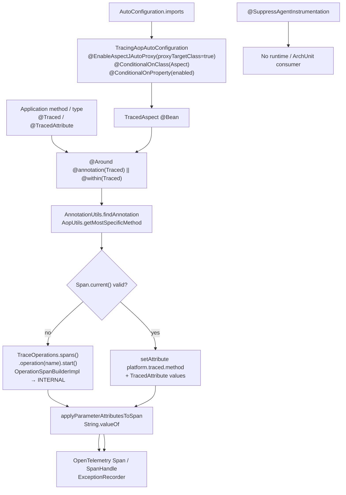
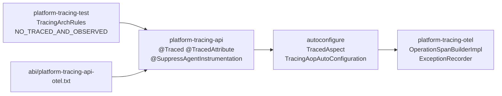
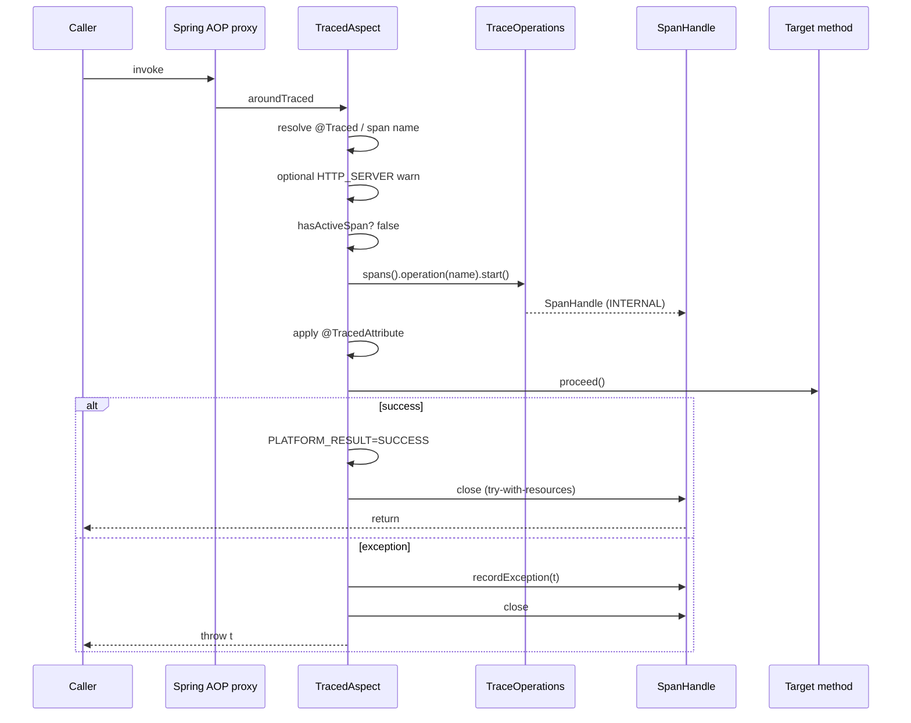
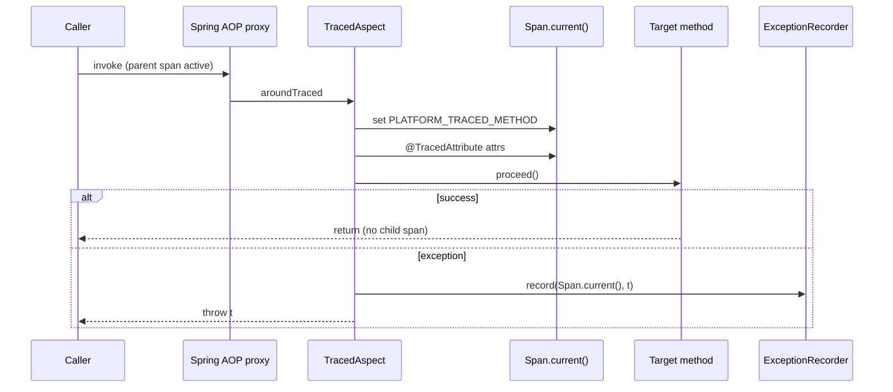

# Tracing API Annotations — Inventory and Extension Candidates

| Field | Value |
| --- | --- |
| Document type | Research inventory (architecture committee input) |
| Repository | https://github.com/andrew3008/EnglishDictionary |
| Local root | `E:/Platform_Traces` |
| Branch | `master` |
| Commit | `ab1fad9c4d64bf4c715d967acaa7bd0a96b073a1` |
| Commit subject | `PrivateControlLocator refactoring` |
| Target package | `space.br1440.platform.tracing.api.annotation` |
| Production code modified | **no** |
| Decision status | **No architecture decision made** — evidence base only |
| Audience | Perplexity Deep Research, Claude Opus, Faber, Gemini, Codex, Model Council, architecture committee |

---

## 1. Executive Summary

The package contains exactly **three** public annotations:

| Annotation | Runtime processor | Production usages in this repository |
| --- | --- | ---: |
| `@Traced` | `TracedAspect` (Spring AOP) | **0** |
| `@TracedAttribute` | `TracedAspect` (parameter attribute mapping) | **0** |
| `@SuppressAgentInstrumentation` | **none** (declarative marker; ArchUnit consumer removed) | **0** |

**CONFIRMED** material findings:

1. Declarative tracing is implemented solely by `TracedAspect` in `platform-tracing-spring-boot-autoconfigure` (`integrations.aop`), wired by `TracingAopAutoConfiguration`.
2. Several documented contracts do **not** match runtime behavior:
   - `@Traced.category()` is **not** applied to created spans (operation builder hardcodes `SpanCategory.INTERNAL`); only `HTTP_SERVER` triggers a one-time WARN.
   - `@Traced.attributes()` is **never read** by any processor.
   - `@Traced` Javadoc refers to attribute key `platform.type`; the platform constant is `platform.trace.type`.
3. `@SuppressAgentInstrumentation` has **no Java call sites** and **no active ArchUnit rule** after Slice 1B removal of `ESCAPE_HATCH_BUILDERS_REQUIRE_SUPPRESSION`.
4. Spring Boot starters do **not** pull `spring-boot-starter-aop`. AOP types are `compileOnly` in autoconfigure; `@ConditionalOnClass(Aspect.class)` means `@Traced` is inert unless the application supplies AspectJ/Spring AOP.
5. There is insufficient in-repository production demand to justify **new** public annotations. The highest-value follow-up research is **alignment / cleanup of the existing three**, not annotation proliferation.

This document does **not** approve any new annotation.

---

## 2. Scope and Methodology

### In scope

- Exact inventory of `space.br1440.platform.tracing.api.annotation`
- Runtime processing, tests, docs, ABI/compatibility surface
- Usage quality and unmet use cases grounded in repository evidence
- Candidate backlog and anti-candidates for later committee arbitration

### Out of scope

- Implementing new annotations
- Renaming/deleting existing annotations
- Aspects, processors, auto-configurations, or public API expansion
- Final architecture decision

### Evidence discipline

| Label | Meaning |
| --- | --- |
| **CONFIRMED** | Observed in source, tests, build, or docs at the recorded commit |
| **HIGH-CONFIDENCE INFERENCE** | Strongly implied by code structure but not directly asserted by a test |
| **HYPOTHESIS** | Plausible but unproven |
| **NEEDS_VERIFICATION** | Requires external research, runtime experiment, or committee confirmation |

### Working method

1. Phase 0 git pre-flight
2. MCP Sequential Thinking for analysis strategy and phase gates
3. Direct source reads of annotations, aspect, auto-configuration, builders, ArchUnit rules
4. Repository-wide searches for annotation names, processors, and manual tracing patterns
5. Cross-check against ABI snapshot, contract YAML, ADRs, and getting-started docs

---

## 3. Repository Baseline

| Check | Result | Confidence |
| --- | --- | --- |
| `git rev-parse --show-toplevel` | `E:/Platform_Traces` | CONFIRMED |
| `git branch --show-current` | `master` | CONFIRMED |
| `git rev-parse HEAD` | `ab1fad9c4d64bf4c715d967acaa7bd0a96b073a1` | CONFIRMED |
| `git remote -v` | `english-dict` → `https://github.com/andrew3008/EnglishDictionary.git` | CONFIRMED |
| Requested remote match | yes | CONFIRMED |
| Requested branch match | yes | CONFIRMED |
| Working tree at analysis start | clean (no `git status --short` output) | CONFIRMED |

Mismatch handling: **not applicable** — repository and branch match the request.

---

## 4. Module and Dependency Context

| Item | Value | Evidence | Contract implication |
| --- | --- | --- | --- |
| Physical module | `platform-tracing-api` | `platform-tracing-api/src/main/java/.../annotation/*.java` | Annotations are part of the published API module |
| Source root | `platform-tracing-api/src/main/java` | module layout | Standard Java library source set |
| Java version | 21 | root `build.gradle` toolchain; all `java-library` subprojects | Language features of Java 21 available |
| Platform version | `0.1.0-SNAPSHOT` | `gradle.properties` | Pre-production; breaking changes allowed under repo policy |
| Spring Boot | `3.5.16` | `gradle.properties` | Auto-config / AOP semantics follow Boot 3.5 |
| Spring Cloud | `2025.0.0` | `gradle.properties` | Not directly used by annotations |
| OpenTelemetry BOM | `1.62.0` | `gradle.properties` | Aspect uses OTel `Span.current()` at runtime via otel module |
| OTel Instrumentation BOM | `2.28.1` | `gradle.properties` | Agent-first model for HTTP/DB/Kafka |
| Micrometer Observation | resolved via Boot BOM (reported `1.15.x` in dependency insight) | Boot BOM | `@Observed` coexistence governed by ArchUnit |
| Micrometer Tracing | resolved via Boot BOM (reported `1.5.x`) | Boot BOM | Boundary ADR exists; not used as annotation processor |
| API module Spring dep | **none** | `platform-tracing-api/build.gradle` | Annotations are Spring-free by design |
| API module OTel dep | **none** | same | Annotations do not compile against OTel |
| Published | yes (`maven-publish`, sources+javadoc jars) | root publication conventions | Public binary/source contract |
| `module-info.java` | **absent** | repo search | No JPMS export surface |
| Compatibility tool | custom ABI snapshot (`AbiSnapshotTest`), not japicmp/Revapi | `platform-tracing-otel/src/test/resources/abi/platform-tracing-api-otel.txt` | Annotation members are ABI-locked |
| Autoconfigure allowlist | lists `TracedAspect`, `TracingAopAutoConfiguration` | `docs/architecture/platform-tracing-autoconfigure-public-type-allowlist.txt` | Processors are intentional public autoconfigure types |
| Starter AOP dependency | **not** included in servlet/reactive starters | starter `build.gradle` search | Consumers must add AOP for `@Traced` to activate |

---

## 5. Annotation Package Tree

```text
space.br1440.platform.tracing.api.annotation
├── Traced.java                         (~41 LOC)
├── TracedAttribute.java                (~27 LOC)
└── SuppressAgentInstrumentation.java   (~28 LOC)
```

Adjacent types **referenced by** annotations (not in the package):

| Type | Module | Role |
| --- | --- | --- |
| `SpanCategory` | `platform-tracing-api` | Element type of `@Traced.category()` |
| `PlatformAttributes` | `platform-tracing-api` | Runtime attribute keys used by aspect |
| `TraceOperations` / `SpanFactory` | `platform-tracing-api` | Facade used by aspect to start operation spans |
| `ExceptionRecorder` | `platform-tracing-otel` | Exception recording on enrich/create paths |
| `TracedAspect` | autoconfigure | Sole runtime processor |
| `TracingAopAutoConfiguration` | autoconfigure | Bean wiring + `@EnableAspectJAutoProxy` |
| `TracingArchRules` | `platform-tracing-test` | `@Traced` vs `@Observed` ArchUnit rule |

---

## 6. Existing Annotation Census

| Annotation | Visibility | `@Target` | `@Retention` | `@Documented` | `@Inherited` | `@Repeatable` | Elements | Defaults |
| --- | ---: | --- | --- | --- | --- | --- | --- | --- |
| `Traced` | public | METHOD, TYPE | RUNTIME | no | no | no | `value`, `category`, `attributes` | `""`, `INTERNAL`, `{}` |
| `TracedAttribute` | public | PARAMETER | RUNTIME | no | no | no | `value` | `""` |
| `SuppressAgentInstrumentation` | public | METHOD, TYPE | RUNTIME | **yes** | no | no | `value` | `""` |

| Annotation | Path | LOC | Javadoc quality | Public API | Runtime processing | Marker-only |
| --- | --- | ---: | --- | --- | --- | --- |
| `Traced` | `platform-tracing-api/.../Traced.java` | ~41 | Medium; claims Micrometer `@Observed` analogy and `platform.type` | ABI-locked | yes (`TracedAspect`) | no |
| `TracedAttribute` | `.../TracedAttribute.java` | ~27 | Medium; warns against sensitive data | ABI-locked | yes (via aspect) | no |
| `SuppressAgentInstrumentation` | `.../SuppressAgentInstrumentation.java` | ~28 | Clear “no runtime effect” statement | ABI-locked | **no** | **yes** (intended) |

Introduced version: **NEEDS_VERIFICATION** beyond pre-production `0.1.0-SNAPSHOT` (no per-annotation `@since` / changelog entry found).

Documentation references: **CONFIRMED** in getting-started, migration, anti-double-instrumentation, public-contract inventory, semantic-contract map, SUPPORTED.md, ABI snapshot.

---

## 7. Detailed Existing Annotation Dossiers

### 7.1 `Traced`

#### Identity

```text
Fully qualified name: space.br1440.platform.tracing.api.annotation.Traced
File path: platform-tracing-api/src/main/java/space/br1440/platform/tracing/api/annotation/Traced.java
Module: platform-tracing-api
Visibility: public
Targets: METHOD, TYPE
Retention: RUNTIME
Repeatable: no
Inherited: no
```

#### Declared purpose

Javadoc claims:

- Declarative wrapping of method calls in a platform span
- Processing by AOP aspect from autoconfigure
- Compatibility with Micrometer Observation concept (`@Observed` analogue)
- Platform-canonical alternative to `@Observed`
- `value` = span name (default: simple method name)
- `category` → attribute `platform.type`
- `attributes` names parameters that should become span attributes (together with `@TracedAttribute`)

#### Actual runtime semantics

**CONFIRMED processor:** `TracedAspect.aroundTraced`.

| Concern | Actual behavior | Confidence |
| --- | --- | --- |
| Discovery | Pointcut `@annotation(Traced) \|\| @within(Traced)`; resolve via `AnnotationUtils.findAnnotation` method then class | CONFIRMED |
| Active span absent | `traceOperations.spans().operation(spanName).start()`; apply `@TracedAttribute`; SUCCESS on return; `recordException` on throw | CONFIRMED |
| Active span present | **No child span**; enrich with `platform.traced.method` + `@TracedAttribute`; record exception on throw | CONFIRMED |
| `category` | Not passed to builder; only `HTTP_SERVER` emits one-time WARN | CONFIRMED |
| `attributes[]` | Never read | CONFIRMED |
| Span type attribute | Comes from `OperationSpanBuilderImpl` hardcoding `INTERNAL` → `platform.trace.type=internal` | CONFIRMED |

#### Annotation elements

| Element | Type | Default | Meaning (declared) | Validation | Runtime consumer |
| --- | --- | --- | --- | --- | --- |
| `value` | `String` | `""` | Span name | blank → method name | `TracedAspect.resolveSpanName` |
| `category` | `SpanCategory` | `INTERNAL` | Span category / `platform.type` | none beyond enum | Partially: HTTP_SERVER warn only |
| `attributes` | `String[]` | `{}` | Parameter names for attributes | none | **None** |

#### Supported targets

| Target | Declared | Evidenced support |
| --- | --- | --- |
| METHOD | yes | CONFIRMED by tests |
| TYPE | yes | Pointcut `@within` CONFIRMED; **no dedicated class-level unit test** → HIGH-CONFIDENCE INFERENCE that class-level works via Spring AOP |
| Other | no | n/a |

#### Method eligibility / Spring proxy

Tests use `AspectJProxyFactory` on a concrete class implementing an interface, with annotations on implementation methods. **Not evidenced:** private methods, self-invocation, final methods/classes, abstract methods, Kotlin methods, reactive return types under full Spring context.

**HIGH-CONFIDENCE INFERENCE:** standard Spring AOP proxy limits apply (`proxyTargetClass=true` prefers CGLIB).

#### Span semantics

| Topic | Actual | Confidence |
| --- | --- | --- |
| Span name | `value` or `method.getName()` | CONFIRMED |
| Category / kind | Always INTERNAL for newly created spans | CONFIRMED |
| Parent relation | Child of current context when creating; enrich-only when valid span exists | CONFIRMED |
| Attributes | `@TracedAttribute` → `String.valueOf`; plus SUCCESS/FAILURE / traced.method | CONFIRMED |
| Exception | `SpanHandle.recordException` or `ExceptionRecorder.record`; rethrow | CONFIRMED |
| Async/reactive lifecycle | No special handling | CONFIRMED absence |
| Sampled-out / Agent present | Uses current OTel context; enrich path intentionally avoids double child under Agent parent | CONFIRMED by test intent |

#### Failure semantics

| Situation | Behavior | Mode |
| --- | --- | --- |
| Missing annotation after pointcut | `IllegalStateException` | fail-closed (programming defect) |
| Attribute enrichment failure | WARN; continue | fail-open for tracing side effects |
| Exception recording failure | WARN; business exception still thrown | fail-open for tracing |
| Tracing disabled (`platform.tracing.enabled=false`) | Auto-config off → no aspect bean | CONFIRMED by auto-config test |
| No AOP on classpath | Auto-config skipped (`@ConditionalOnClass(Aspect.class)`) | CONFIRMED |
| Invalid category | No validation; HTTP_SERVER warns | best-effort |

#### Usage inventory

| Module | Class/method | Configuration | Runtime path | Importance |
| --- | --- | --- | --- | --- |
| *(none production)* | — | — | — | — |

Test fixtures only (`TracedAspectTest`, `TracingArchRulesTest`).

#### Effective contract

| Layer | Content |
| --- | --- |
| Intended documented | Always create categorized platform span; map category; honor `attributes[]` |
| Actual implementation | Create **or enrich**; category ignored (except warn); `attributes[]` dead |
| Accidental effective | Under Agent HTTP parent, `@Traced` becomes an enrichment marker, not a business child span |

#### Risks

- Public API elements with no runtime effect (`attributes`, most `category` values) → user false confidence (**CONFIRMED**)
- Dual create/enrich semantics undocumented in annotation Javadoc (**CONFIRMED**)
- Starter without AOP → silent no-op (**CONFIRMED** wiring)

---

### 7.2 `TracedAttribute`

#### Identity

```text
Fully qualified name: space.br1440.platform.tracing.api.annotation.TracedAttribute
File path: platform-tracing-api/src/main/java/space/br1440/platform/tracing/api/annotation/TracedAttribute.java
Module: platform-tracing-api
Visibility: public
Targets: PARAMETER
Retention: RUNTIME
Repeatable: no
Inherited: no
```

#### Declared purpose

Mark method parameters whose values become span attributes as `<key> = String.valueOf(parameter)`, jointly with `@Traced`. Warns against sensitive data.

#### Actual runtime semantics

Consumed only inside `TracedAspect.applyParameterAttributesToSpan` / `findTracedAttribute`:

- Looks for direct `instanceof TracedAttribute` on parameter annotations (**not** Spring `AnnotationUtils` / meta-annotations)
- Key = `value` if non-blank, else `parameter.getName()` (requires `-parameters`)
- Null values skipped
- No scrubbing at aspect boundary (relies on later processors / discipline)

#### Annotation elements

| Element | Type | Default | Meaning | Validation | Runtime consumer |
| --- | --- | --- | --- | --- | --- |
| `value` | `String` | `""` | Attribute key | none | `TracedAspect` |

#### Supported targets

PARAMETER only — CONFIRMED.

#### Attribute extraction

| Topic | Behavior | Confidence |
| --- | --- | --- |
| Types | Any → `String.valueOf` | CONFIRMED |
| Null | skipped | CONFIRMED |
| Collections/maps | `toString`/`String.valueOf` shape | HIGH-CONFIDENCE INFERENCE |
| SpEL | none | CONFIRMED absence |
| Cardinality | key from annotation/param name; value unbounded | CONFIRMED |
| PII | documented prohibition only; no enforcement in aspect | CONFIRMED |

#### Failure semantics

Attribute write failures in enrich path are WARN + continue. Create path applies attributes outside that try/catch (exception would surface as aspect failure) — **NEEDS_VERIFICATION** for create-path attribute failure isolation.

#### Usage inventory

Production: **0**. Tests: `TracedAspectTest` (`orderId`, `input`).

#### Effective contract

| Layer | Content |
| --- | --- |
| Intended | Safe parameter→attribute mapping with `@Traced` |
| Actual | String coercion; no meta-annotation support; no scrubbing |
| Accidental | Blank key depends on compiler `-parameters`; otherwise synthetic names |

#### Risks

- PII leakage via `String.valueOf` (**HIGH**)
- High-cardinality IDs as attribute values (**HIGH**)
- Meta-annotations not supported unlike ArchUnit’s meta handling for `@Observed` (**CONFIRMED** asymmetry)

---

### 7.3 `SuppressAgentInstrumentation`

#### Identity

```text
Fully qualified name: space.br1440.platform.tracing.api.annotation.SuppressAgentInstrumentation
File path: platform-tracing-api/src/main/java/space/br1440/platform/tracing/api/annotation/SuppressAgentInstrumentation.java
Module: platform-tracing-api
Visibility: public
Targets: METHOD, TYPE
Retention: RUNTIME
Documented: yes
Repeatable: no
Inherited: no
```

#### Declared purpose

Audit marker for intentional escape-hatch spans in Agent-instrumented areas. Javadoc states **no runtime effect**; ArchUnit/code review only.

#### Actual runtime semantics

**CONFIRMED: no processor.**  
ArchUnit rule `ESCAPE_HATCH_BUILDERS_REQUIRE_SUPPRESSION` removed in Slice 1B (`TracingArchRules` comment). Zero `@SuppressAgentInstrumentation` usages in Java sources. Agent extension has no references.

#### Annotation elements

| Element | Type | Default | Meaning | Validation | Runtime consumer |
| --- | --- | --- | --- | --- | --- |
| `value` | `String` | `""` | Human reason for audit | none | none |

#### Effective contract

| Layer | Content |
| --- | --- |
| Intended | Governance marker enforced by ArchUnit |
| Actual | Orphan public ABI type |
| Accidental | Docs may still describe historical enforcement |

#### Risks

- Public API commitment without enforcement (**HIGH**)
- Documentation drift in `SUPPORTED.md` / anti-double-instrumentation (**CONFIRMED** drift risk)

---

## 8. Annotation Processing Architecture



### Dependency / coupling graph



---

## 9. Runtime Invocation Lifecycle

### Create path (no active span)



### Enrich path (active span present)



Reactive/async: **no separate diagrams** — no dedicated lifecycle exists (CONFIRMED absence; see ADR-reactor-no-inspan).

---

## 10. Usage Inventory

### Production

| Annotation | Production Java usages | Notes |
| --- | ---: | --- |
| `@Traced` | 0 | Only processor + tests |
| `@TracedAttribute` | 0 | Only tests |
| `@SuppressAgentInstrumentation` | 0 | Definition + docs |

### Test / fixture

| Location | Annotations | Purpose |
| --- | --- | --- |
| `TracedAspectTest.SampleServiceImpl` | `@Traced`, `@TracedAttribute` | create / failure / enrich |
| `TracedAspectTest.HttpServerMisuseImpl` | `@Traced(category=HTTP_SERVER)` | warn-once |
| `TracingArchRulesTest` | `@Traced` (+ `@Observed` fixtures) | ArchUnit dual-annotation ban |

### Auto-config tests

| Test | Assertion |
| --- | --- |
| `TracingAutoConfigurationTest` | aspect bean present when enabled; absent when disabled |

---

## 11. Public and Effective Contract Inventory

### Binary / source contract (ABI-locked)

From `platform-tracing-api-otel.txt`:

```text
Traced: value():String="", attributes():String[]=[], category():SpanCategory=INTERNAL
TracedAttribute: value():String=""
SuppressAgentInstrumentation: value():String=""
```

### Behavioral contract (actual)

| Topic | Contract |
| --- | --- |
| Interception | Spring AOP around advice when Aspect present and tracing enabled |
| Span name | annotation value or method name |
| Exceptions | recorded; original rethrown |
| Disabled | no aspect bean |
| Duplicate instrumentation | enrich-if-parent; ArchUnit bans `@Traced`+`@Observed` on same method |

### Operational contract

| Signal | When |
| --- | --- |
| Span name | create path |
| `platform.trace.type=internal` | create path (builder default) |
| `platform.trace.result` | SUCCESS/FAILURE on create path |
| `platform.traced.method` | enrich path |
| Parameter attributes | both paths |
| WARN log | HTTP_SERVER category; tracing side-failures |

### Compatibility risks

| Change | Risk |
| --- | --- |
| Add element with default | ABI/source-compatible if defaulted; still behavioral risk |
| Add element without default | **breaking** |
| Change defaults | behavioral break |
| Narrow `@Target` | breaking for compilers |
| Change retention | breaks runtime discovery |
| Make repeatable | ABI + processor complexity |
| Rename/change element type | breaking |
| Start honoring `category` / `attributes[]` | behavioral break for current accidental contract |
| Delete unused `attributes[]` | ABI break even if unused |

---

## 12. Spring AOP and Proxy Constraints

| Topic | Evidence | Status |
| --- | --- | --- |
| Proxy style | `@EnableAspectJAutoProxy(proxyTargetClass=true)` | CONFIRMED CGLIB preference |
| Not LTW | autoconfigure comment + Spring AOP usage | CONFIRMED |
| Method resolution | `AopUtils.getMostSpecificMethod` | CONFIRMED |
| Annotation lookup | Spring `AnnotationUtils.findAnnotation` | CONFIRMED |
| Ordering vs `@Transactional`/`@Async` | not tested | NEEDS_VERIFICATION |
| Self-invocation | not tested | HIGH-CONFIDENCE INFERENCE: not advised |
| Private methods | not tested | HIGH-CONFIDENCE INFERENCE: not advised |
| Interface vs impl | annotations on impl in tests | CONFIRMED for that setup |
| AOP on classpath | `compileOnly` in autoconfigure; starters omit `starter-aop` | CONFIRMED |

---

## 13. Async, Reactive and Virtual-Thread Semantics

| Concern | Evidence | Confidence |
| --- | --- | --- |
| Reactor `inSpan` API | Explicitly deferred — `ADR-reactor-no-inspan-v0.1.0.md` | CONFIRMED |
| `@Traced` on `Mono`/`Flux` methods | No special aspect path; comment-only references | CONFIRMED absence |
| `@Async` span integration | TaskDecorator removed; MDC projection only (`AsyncRequestIdentityMdcAutoConfiguration`) | CONFIRMED |
| Virtual threads | No annotation-specific tests | NEEDS_VERIFICATION |
| Imperative span around reactive assembly | Documented antipattern | CONFIRMED (ADR) |

---

## 14. Agent and Manual Instrumentation Interaction

| Mechanism | Role | Confidence |
| --- | --- | --- |
| Enrich-if-parent in `TracedAspect` | Avoids child span under Agent HTTP parent | CONFIRMED |
| WARN on `@Traced(HTTP_SERVER)` | Discourages duplicating Agent HTTP spans | CONFIRMED |
| ArchUnit `@Traced`+`@Observed` | Prevents double observation spans | CONFIRMED |
| `@SuppressAgentInstrumentation` | Intended escape-hatch marker; **unenforced** | CONFIRMED |
| Agent Java code reading annotations | none found | CONFIRMED |

---

## 15. Security, Privacy and Cardinality Analysis

| Risk | Severity | Evidence |
| --- | ---: | --- |
| `@TracedAttribute` → `String.valueOf` can leak PII/secrets | HIGH | aspect code + javadoc warning only |
| High-cardinality IDs as attribute values / span names | HIGH | `value` and attribute keys unconstrained |
| Dynamic span names via annotation value | MEDIUM | free-form `String value()` |
| No scrubbing at aspect boundary | MEDIUM | scrubbing is processor-side / SPI elsewhere |
| Orphan suppress annotation false sense of compliance | MEDIUM | no enforcement |

---

## 16. Existing Test Coverage

| Contract | Unit | Context | Integration | E2E | Gap |
| --- | ---: | ---: | ---: | ---: | --- |
| Create span + name + INTERNAL type | yes | auto-config bean | no | no | category application untested (builder default masks gap) |
| FAILURE + exception event | yes | — | no | no | — |
| Enrich-when-parent | yes | — | no | no | — |
| HTTP_SERVER warn once | yes | — | no | no | — |
| `@Traced.attributes[]` | no | no | no | no | **dead element** |
| Class-level `@Traced` | no | no | no | no | pointcut exists |
| Blank `@TracedAttribute` → param name | no | no | no | no | `-parameters` dependency |
| Self-invocation / private | no | no | no | no | AOP limits |
| Reactive `@Traced` | no | no | no | no | deferred |
| `@SuppressAgentInstrumentation` | no | no | no | no | orphan |
| No AOP on classpath | no | partial (ConditionalOnClass) | no | no | starter matrix |
| Agent present E2E for `@Traced` | no | no | no | no | gap |

---

## 17. Documentation Consistency

| Document claim | Code reality | Verdict |
| --- | --- | --- |
| category → `platform.type` (annotation Javadoc) | key is `platform.trace.type`; category not applied | **Contradiction** |
| category maps to platform type (contract YAML) | ignored by aspect | **Contradiction** |
| `attributes[]` used with `@TracedAttribute` | array unread | **Contradiction** |
| Suppress enforced by ArchUnit | rule removed Slice 1B | **Contradiction / stale docs** |
| `@Traced` vs `@Observed` guidance-only (some maps) | ArchUnit enforced | **Contradiction** |
| Aspect package `autoconfigure.aspect` (some inventories) | `integrations.aop` | **Stale path** |
| Getting-started recommends `@Traced` | no in-repo production examples | **Adoption gap** |

---

## 18. Repeated Manual Tracing Patterns

Legacy facade patterns (`startRootSpan`, `inSpan`, `httpServerSpan`, …) are **removed** from public API (CONFIRMED zero matches).

Current v3 patterns (approximate `rg` counts at analysis time):

| Pattern | `src/main` (approx.) | Tests/JMH (approx.) | Annotation candidate suggested? |
| --- | ---: | ---: | ---: |
| `spans().operation(` | low (~8 all-main; **2** in runtime modules excl. javadoc) | high (~118) | Weak — fluent API already exists |
| `spans().transport()` / typed transport | very low in main | moderate | No — Agent owns most transport |
| `recordException(` | ~22 main (mostly runtime internals) | ~27 | No new annotation |
| `.setAttribute(` | high in agent processors | high | No — not app-facing pattern |
| `.linkedTo(` | low | moderate | INSUFFICIENT_EVIDENCE for annotation |
| `@Traced` production | 0 | fixtures only | Align existing first |

**Verdict:** Repeated *application-facing* manual tracing in production modules is thin. Most volume is tests/benchmarks/agent internals. This **does not** justify broad new annotation APIs from repository evidence alone.

---

## 19. Unmet Use Cases

| ID | Use case | Evidence | Notes |
| --- | --- | --- | --- |
| U1 | Declarative category selection via `@Traced.category` | Element exists; builder ignores it | Contract gap |
| U2 | Declarative attribute name list via `@Traced.attributes[]` | Element exists; unread | Dead API |
| U3 | Governance for intentional Agent-overlap spans | Suppress annotation orphaned | Governance gap |
| U4 | In-repo adoption samples for `@Traced` | 0 production usages | Adoption/docs gap |
| U5 | Reactive declarative business spans | ADR defers Reactor inSpan | Explicit non-goal for v0.1 |
| U6 | Guaranteed AOP availability from starters | starters omit AOP | Operational gap |
| U7 | Meta-annotation support for `@TracedAttribute` | direct instanceof only | Asymmetry vs ArchUnit `@Observed` meta |

---

## 20. Candidate Annotation Backlog

> Backlog only. Dispositions are **not** approvals.

| Candidate ID | Working concept | Repository evidence | Intended users | Possible target | Runtime processor needed |
| --- | --- | --- | --- | --- | --- |
| C1 | Honor existing `@Traced.category` (not a new annotation) | dead category element + hardcoded INTERNAL | app developers | METHOD/TYPE (existing) | extend `TracedAspect` / operation builder |
| C2 | Implement or remove `@Traced.attributes[]` | unread element in ABI | app developers | METHOD (existing) | extend aspect **or** ABI deletion research |
| C3 | Restore or retire `@SuppressAgentInstrumentation` | orphan ABI + stale docs | platform engineers | METHOD/TYPE | ArchUnit and/or transport governance |
| C4 | OTel-style `@WithSpan` platform clone | no OTel annotations dep; `@Traced` exists | — | METHOD | would duplicate `@Traced` |
| C5 | Parameter/return `@SpanAttribute` expansion | only parameter attrs today | app developers | PARAMETER/METHOD | aspect + serializers |
| C6 | Per-`SpanCategory` annotations | enum has 8 values | — | METHOD | multiple advisors |
| C7 | Root/scheduled operation annotation | few production root call sites | batch jobs | METHOD | new advisor |
| C8 | Span-link annotation | `.linkedTo` mostly tests/Kafka batch | messaging | METHOD | complex |
| C9 | Sensitive/redacted attribute marker | PII risk on `@TracedAttribute` | security | PARAMETER | scrubbing integration |
| C10 | Suppress-agent / anti-double marker (runtime) | Agent flags exist; annotation orphan | platform | METHOD/TYPE | Agent or ArchUnit |

---

## 21. Candidate Dossiers

### C1 — Align `@Traced.category` (RESEARCH_FURTHER)

#### Problem statement

Public element promises category semantics that runtime does not apply.

#### Evidence

`Traced.category()`; `TracedAspect` ignores it; `OperationSpanBuilderImpl` hardcodes `INTERNAL`.

#### Proposed semantic boundary

Make declarative category match fluent `SpanCategory` semantics for **operation** spans, or document that only INTERNAL is supported and remove/narrow the element.

#### Potential targets

Existing METHOD/TYPE.

#### Possible elements

Reuse `category`; optionally restrict allowed values to INTERNAL (and maybe RPC_*) .

#### Required runtime support

Extend operation builder API used by aspect; tests for each allowed category; Agent double-instrumentation rules for transport categories.

#### Interaction

Conflicts with enrich-if-parent and Agent HTTP spans if HTTP_* allowed silently.

#### Risk analysis

Behavioral break if category suddenly applies; cardinality low; API commitment already present.

#### Alternatives

Document-only fix; delete element (breaking); force INTERNAL in Javadoc.

#### Initial disposition

**RESEARCH_FURTHER**

---

### C2 — `@Traced.attributes[]` (RESEARCH_FURTHER)

#### Problem statement

Dead public element listed in ABI and test fixture (`attributes = {"orderId"}`) without effect.

#### Evidence

No reads of `annotation.attributes()` in repository.

#### Disposition rationale

Either implement name-based parameter capture **or** remove in a deliberate API cleanup. Prefer research of whether anyone depends on the element externally (NEEDS_VERIFICATION outside repo).

#### Initial disposition

**RESEARCH_FURTHER**

---

### C3 — `@SuppressAgentInstrumentation` governance (RESEARCH_FURTHER)

#### Problem statement

Public marker without enforcement after Slice 1B.

#### Evidence

Annotation Javadoc; `TracingArchRules` Slice 1B comment; zero usages; docs still mention historical rule.

#### Alternatives

1. Restore ArchUnit around `spans().transport()` misuse  
2. Delete annotation in pre-production cleanup  
3. Keep as documentation-only with explicit ADR

#### Initial disposition

**RESEARCH_FURTHER**

---

### C4 — New `@WithSpan`-like annotation (DUPLICATES_STANDARD / LOW_VALUE)

#### Problem statement

Industry familiarity with OTel `@WithSpan`.

#### Evidence

No `opentelemetry-instrumentation-annotations` dependency; platform already has `@Traced`.

#### Initial disposition

**DUPLICATES_STANDARD** (relative to platform `@Traced`) / **LOW_VALUE** for a second parallel annotation.

---

### C5 — Richer attribute annotations (INSUFFICIENT_EVIDENCE / TOO_RISKY if SpEL/returns)

#### Problem statement

Desire to capture returns, typed attributes, SpEL.

#### Evidence

Historical Jira notes mention SpEL; current API has none. No production attribute annotation usage.

#### Initial disposition

**INSUFFICIENT_EVIDENCE** for expansion; SpEL/return serialization **TOO_RISKY**.

---

### C6 — Per-category annotations (TOO_RISKY)

Attractive for discoverability; dangerous for API surface explosion and Agent overlap.

#### Initial disposition

**TOO_RISKY**

---

### C7 — Root/scheduled annotation (LOW_VALUE / INSUFFICIENT_EVIDENCE)

Fluent `.root()` exists; production counts low.

#### Initial disposition

**INSUFFICIENT_EVIDENCE** (lean **LOW_VALUE**)

---

### C8 — Span-link annotation (INSUFFICIENT_EVIDENCE)

Kafka batch linking exists as specialized aspect; not a general annotation demand.

#### Initial disposition

**INSUFFICIENT_EVIDENCE**

---

### C9 — Sensitive/redacted attribute marker (RESEARCH_FURTHER)

Could mitigate `@TracedAttribute` PII risk; overlaps scrubbing SPI.

#### Initial disposition

**RESEARCH_FURTHER** (prefer scrubbing rules over new annotation unless evidence grows)

---

### C10 — Runtime suppress-agent annotation (TOO_RISKY / DUPLICATES_STANDARD)

Agent instrumentation suppression is an Agent/config concern; annotation-driven remote side effects are hazardous.

#### Initial disposition

**TOO_RISKY** for runtime suppression; documentation/ArchUnit path preferred (**RESEARCH_FURTHER** under C3).

---

## 22. Anti-Candidates

| Concept | Why attractive | Why dangerous | Existing alternative |
| --- | --- | --- | --- |
| Annotation per `SpanCategory` | Discoverability | API explosion; Agent duplicates | `spans().transport()` / Agent |
| Duplicate HTTP/JDBC/Kafka/gRPC annotations | Familiarity | Double instrumentation | OTel Java Agent |
| Free-form dynamic span names without governance | Flexibility | Cardinality explosion | Bounded `value` + conventions |
| Serialize arbitrary return values | Convenience | PII, cardinality, cost | Explicit attributes / scrubbing |
| Ungoverned SpEL in attributes | Power | Injection, reflection, opacity | Explicit parameter annotation |
| Mega-annotation (trace+metrics+log+retry+auth) | One-stop | Impossible semantics | Separate concerns |
| ThreadLocal-only WebFlux annotation | Familiar sync model | Broken reactive lifecycle | Agent + ADR deferral |
| Annotation that only shortens one builder line | Less typing | Public API cost | Fluent API |
| Annotation with unclear self-invocation behavior | “Just works” myth | Silent missing spans | Document AOP limits |
| Annotation with hidden remote propagation | Magic context | Security/privacy | Explicit propagation APIs |

---

## 23. External Research Inputs

| External concept | Existing platform equivalent | Repository dependency present? | Potential overlap |
| --- | --- | ---: | --- |
| OpenTelemetry `@WithSpan` | `@Traced` | no instrumentation-annotations dep | High overlap if added |
| OpenTelemetry `@SpanAttribute` | `@TracedAttribute` | no | High |
| Micrometer `@Observed` | `@Traced` (conceptual) | yes (micrometer-observation) | ArchUnit mutual exclusion |
| Micrometer `@MeterTag` | none | no usage found | Metrics, not tracing |
| Spring `@Transactional` | n/a | via Boot | Ordering interaction NEEDS_VERIFICATION |
| Spring `@Async` | MDC projection only | yes | No span annotation bridge |
| Spring Retry / Resilience4j annotations | none in tracing API | not as tracing deps | Anti-candidate mega-annotation |
| MicroProfile Telemetry annotations | none | no | External research |
| Jakarta Interceptors | Spring AOP used instead | no | External research |
| Quarkus observability annotations | none | no | External research |

Items marked “External research” require Perplexity/Model Council comparison; this document only prepares repository facts.

---

## 24. Annotation Governance Scorecard

Proposed for later committee use (not scored here):

| Criterion | Weight | Required evidence |
| --- | ---: | --- |
| Clear single responsibility | 10 | one semantic job; no mega-annotation |
| Stable semantics | 10 | create vs enrich defined; tests |
| Low-cardinality defaults | 9 | name/attribute policy |
| No PII by default | 10 | no automatic `toString` of entities; scrubbing |
| Explicit lifecycle (sync/async/reactive) | 9 | stated applicability matrix |
| Agent double-instrumentation rules | 10 | tests with Agent present/absent |
| Failure behavior | 8 | fail-open/closed documented + tested |
| Public API compatibility plan | 9 | ABI/ADR |
| AOT/native support | 6 | hints if reflection used |
| Testability | 8 | proxy matrix + E2E |
| Documentation accuracy | 9 | Javadoc matches code |
| Migration / deprecation strategy | 7 | pre-prod may delete; still planned |
| Starter/classpath enablement | 8 | AOP dependency story |
| Alternatives exhausted | 8 | fluent API / Agent / config considered |

Minimum bar hypothesis for any **new** public annotation: weighted score threshold to be set by committee after external research — **not defined here**.

---

## 25. Architecture Observations

| Observation | Evidence | Severity | Confidence | Why it matters |
| --- | --- | ---: | ---: | --- |
| Annotation package is tiny and cohesive | 3 types only | INFORMATIONAL | CONFIRMED | Good API minimalism |
| Documented contracts diverge from aspect | category/attributes/Javadoc key | **HIGH** | CONFIRMED | User trust / support cost |
| Zero production adoption in-repo | searches | MEDIUM | CONFIRMED | Hard to validate UX |
| AOP optional at starter level | compileOnly + no starter-aop | **HIGH** | CONFIRMED | Silent feature absence |
| Orphan Suppress annotation | no readers | MEDIUM | CONFIRMED | Public API debt |
| Enrich-vs-create is powerful but under-documented | aspect + test | MEDIUM | CONFIRMED | Surprises under Agent |
| Spring coupling confined to autoconfigure | API Spring-free | INFORMATIONAL | CONFIRMED | Correct layering |
| OTel types leak into aspect impl | `Span.current()` in aspect | LOW | CONFIRMED | Acceptable in autoconfigure/otel boundary |
| Dual story with `@Observed` enforced | ArchUnit | INFORMATIONAL | CONFIRMED | Clear policy |
| Manual fluent API is the real app path | TraceOperations usage | INFORMATIONAL | CONFIRMED | Annotations are secondary |

---

## 26. Confirmed Invariants

1. Exactly three annotations exist in the target package.
2. Only `TracedAspect` processes `@Traced` / `@TracedAttribute` at runtime.
3. `@SuppressAgentInstrumentation` has no runtime processor.
4. Newly created `@Traced` spans are INTERNAL via `OperationSpanBuilderImpl`.
5. Valid active span ⇒ enrich-only (no child).
6. Business exceptions are never swallowed by the aspect.
7. `@Traced` and `@Observed` on the same method are ArchUnit-forbidden.
8. Annotations are ABI-locked in `platform-tracing-api-otel.txt`.
9. `platform-tracing-api` remains Spring- and OTel-SDK-free.
10. Starters do not automatically enable AOP.

---

## 27. Contradictions and Ambiguities

| ID | Contradiction | Confidence |
| --- | --- | --- |
| X1 | Javadoc/contracts claim category mapping; runtime ignores category | CONFIRMED |
| X2 | `@Traced.attributes[]` documented/fixture-used; unread | CONFIRMED |
| X3 | Attribute key name `platform.type` vs `platform.trace.type` | CONFIRMED |
| X4 | Suppress “ArchUnit enforced” vs rule removed | CONFIRMED |
| X5 | Some docs call dual `@Traced`/`@Observed` guidance-only vs enforced rule | CONFIRMED |
| X6 | Create vs enrich semantics absent from annotation Javadoc | CONFIRMED |
| X7 | Whether class-level `@Traced` element values apply as expected to all methods | NEEDS_VERIFICATION |

---

## 28. Open Questions

1. Do any external (out-of-repo) services already depend on `@Traced.attributes[]` or non-INTERNAL `@Traced.category` meaning?
2. Should starters gain an optional AOP dependency, a dedicated `starter-aop` note, or fail-fast diagnostics when `@Traced` is present without AspectJ?
3. Is enrich-if-parent the long-term desired Agent interaction model, or should child INTERNAL spans be created under Agent parents?
4. Should `@SuppressAgentInstrumentation` be deleted in pre-production or reattached to `spans().transport()` governance?
5. What is the official stance vs Micrometer `@Observed` for new services beyond ArchUnit exclusion?
6. Are native-image/AOT hints required for annotation discovery beyond Spring’s default AOP support?

---

## 29. Missing Evidence

| Gap | Impact |
| --- | --- |
| No production call sites | Cannot empirically score usability |
| No self-invocation / private-method tests | AOP limits inferred |
| No full Spring Boot + Agent E2E for `@Traced` | Agent interaction partially unit-simulated |
| No classpath matrix test (starter without AOP) | Operational gap severity inferred |
| No external consumer survey | ABI deletion risk for dead elements unknown |
| No japicmp historical timeline | Introduced-version unknown |
| Micrometer/OTel annotation comparison details | deferred to external research |

---

## 30. Recommended Next Research Passes

1. **Perplexity / Model Council:** compare `@Traced`/`@TracedAttribute` with OTel `@WithSpan`/`@SpanAttribute` and Micrometer `@Observed` semantics and industry pitfalls.
2. **Contract alignment pass:** decide fate of `category` and `attributes[]` (implement vs delete vs document-as-unsupported).
3. **Classpath enablement pass:** starter/AOP story and developer diagnostics.
4. **Suppress governance pass:** restore ArchUnit for transport builders or remove annotation.
5. **Adoption pass:** add a minimal sample (not requested here) only after contract alignment.
6. **Do not** start greenfield annotation designs until C1–C3 are resolved.

---

## 31. Appendix A — File Inventory

| Path | Role |
| --- | --- |
| `platform-tracing-api/src/main/java/.../annotation/Traced.java` | Annotation |
| `platform-tracing-api/src/main/java/.../annotation/TracedAttribute.java` | Annotation |
| `platform-tracing-api/src/main/java/.../annotation/SuppressAgentInstrumentation.java` | Annotation |
| `platform-tracing-api/src/main/java/.../span/SpanCategory.java` | Element type |
| `platform-tracing-api/src/main/java/.../attributes/PlatformAttributes.java` | Attribute keys |
| `platform-tracing-api/src/main/java/.../TraceOperations.java` | Facade |
| `platform-tracing-spring-boot-autoconfigure/.../integrations/aop/TracedAspect.java` | Processor |
| `platform-tracing-spring-boot-autoconfigure/.../integrations/aop/TracingAopAutoConfiguration.java` | Wiring |
| `platform-tracing-spring-boot-autoconfigure/src/test/.../TracedAspectTest.java` | Unit tests |
| `platform-tracing-otel/.../OperationSpanBuilderImpl.java` | INTERNAL hardcode |
| `platform-tracing-test/.../arch/TracingArchRules.java` | ArchUnit |
| `platform-tracing-otel/src/test/resources/abi/platform-tracing-api-otel.txt` | ABI lock |
| `docs/tracing/anti-double-instrumentation.md` | Suppress history |
| `docs/decisions/ADR-reactor-no-inspan-v0.1.0.md` | Reactive deferral |
| `docs/decisions/ADR-platform-tracing-micrometer-observation-boundary.md` | Observed boundary |
| `docs/contracts/public-contract-inventory.yaml` | Contract inventory |
| `docs/contracts/semantic-contract-map.yaml` | Semantic map |

---

## 32. Appendix B — Search Commands

Executed conceptually via repository search tooling (ripgrep / IDE search / explore agents) at commit `ab1fad9c`:

```text
package space.br1440.platform.tracing.api.annotation
import space.br1440.platform.tracing.api.annotation
@Traced
@TracedAttribute
@SuppressAgentInstrumentation
@WithSpan
@SpanAttribute
@Observed
@MeterTag
@Aspect
@Around
@Pointcut
Advisor
MethodInterceptor
BeanPostProcessor
AnnotatedElementUtils
MergedAnnotations
AnnotationUtils
PlatformTracing
TraceOperations
SpanFactory
SpanScope
SpanCategory
SpanRelation
recordException
startSpan
inSpan
SuppressAgentInstrumentation
spans().operation(
spans().transport()
ESCAPE_HATCH_BUILDERS_REQUIRE_SUPPRESSION
NO_TRACED_AND_OBSERVED
```

Phase 0:

```bash
git rev-parse --show-toplevel
git branch --show-current
git rev-parse HEAD
git status --short
git remote -v
```

---

## 33. Appendix C — Public API Signatures

```java
@Target({ElementType.METHOD, ElementType.TYPE})
@Retention(RetentionPolicy.RUNTIME)
public @interface Traced {
    String value() default "";
    SpanCategory category() default SpanCategory.INTERNAL;
    String[] attributes() default {};
}

@Target(ElementType.PARAMETER)
@Retention(RetentionPolicy.RUNTIME)
public @interface TracedAttribute {
    String value() default "";
}

@Documented
@Retention(RetentionPolicy.RUNTIME)
@Target({ElementType.METHOD, ElementType.TYPE})
public @interface SuppressAgentInstrumentation {
    String value() default "";
}
```

Processor entry (not API module, but runtime contract):

```java
@Around("@annotation(space.br1440.platform.tracing.api.annotation.Traced) "
      + "|| @within(space.br1440.platform.tracing.api.annotation.Traced)")
public Object aroundTraced(ProceedingJoinPoint joinPoint) throws Throwable { ... }
```

---

*End of inventory. No annotation additions approved. No production code modified.*
