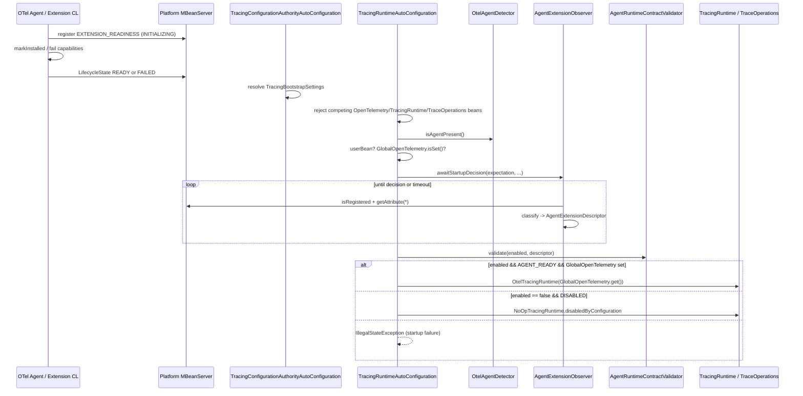
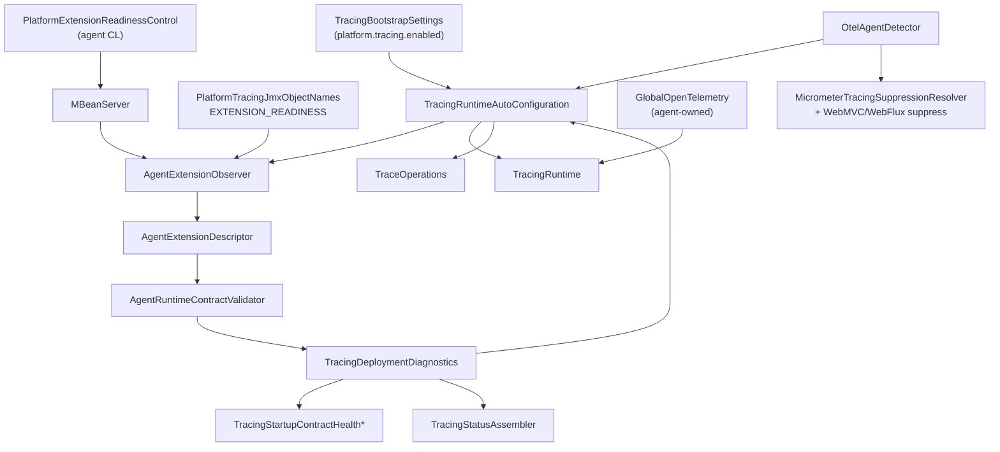
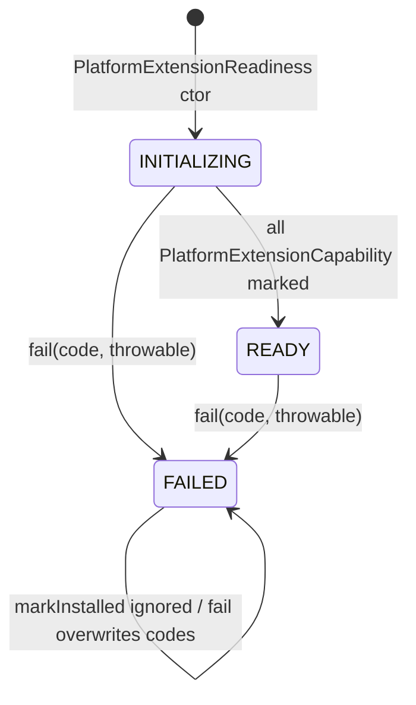
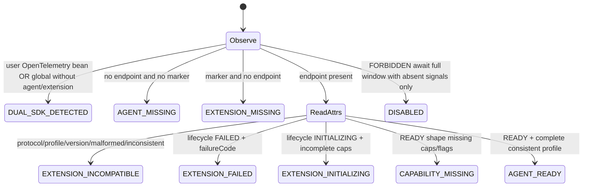

# Agent Auto-Configuration Package Inventory

| Field | Value |
| ----- | ----- |
| Inventory date | 2026-08-06 |
| Target package | `space.br1440.platform.tracing.autoconfigure.agent` |
| Owning module | `platform-tracing-spring-boot-autoconfigure` |
| Source root | `src/main/java` |
| Working-tree note | All 7 production types are modified vs HEAD; diff is Javadoc removal / Lombok `@UtilityClass` / formatting only (no behavioral logic change observed in `git diff`) |
| Investigation mode | Inventory and analysis preparation only — no refactoring |

---

## 1. Executive Summary

The package `space.br1440.platform.tracing.autoconfigure.agent` is a flat, seven-type application-plane package that detects the OpenTelemetry Java Agent marker, observes a classloader-neutral JMX readiness descriptor published by `platform-tracing-otel-javaagent-extension`, classifies deployment state into `AgentRuntimeState`, and validates that observed state against `platform.tracing.enabled`.

It does **not** create an `OpenTelemetrySdk`. Production ownership of the SDK belongs to the Controlled Platform Agent distribution. Spring wiring in `TracingRuntimeAutoConfiguration` consumes the package’s diagnostics, rejects competing application beans, and binds the application facade to `GlobalOpenTelemetry` only when the observed state is `AGENT_READY`.

Evidence confidence for the package’s own types is high (complete source read + unit/context/E2E/architecture tests). Cross-module producer behavior on the agent plane is also directly evidenced. Several operator documents remain partially outdated relative to current enums and property names.

---

## 2. Scope and Methodology

### Scope

Primary:

- `platform-tracing-spring-boot-autoconfigure/.../autoconfigure/agent/*`

Expanded when directly related:

- Spring wiring (`TracingRuntimeAutoConfiguration`, bootstrap authority, status, startup health)
- JMX ObjectName duplicates (`PlatformTracingJmxObjectNames`)
- Agent-plane readiness producer (`platform-tracing-otel-javaagent-extension`)
- Observation suppression consumers of `OtelAgentDetector`
- Starters, E2E attestation, architecture allowlists, ADR-sdk-mode-detection
- Test fixtures (`ControlledAgentTestRuntime`, readiness fixture extension)

Out of scope for implementation changes: production code, tests, refactoring plans, target architecture proposals.

### Methodology

1. MCP Sequential Thinking used for investigation strategy and before package-boundary, lifecycle, responsibility, test-coverage, and conclusion checkpoints.
2. Repository source code treated as primary truth; docs/ADRs used for consistency comparison only.
3. Complete production classes in the target package were read in full.
4. Callers, tests, build files, AutoConfiguration.imports, and extension readiness producers were inspected.
5. Claims are labeled:

| Label | Meaning |
| ----- | ------- |
| **CONFIRMED** | Directly supported by current source and/or executable tests |
| **INFERENCE** | Strongly supported by code structure; not an explicit comment/test assertion |
| **HYPOTHESIS** | Requires further verification |

### Evidence labels used below

- File paths are repository-relative from `E:/Platform_Traces` unless absolute.
- Line numbers refer to the working-tree files as read on 2026-08-06.

---

## 3. Repository and Module Context

### Repository

| Item | Value | Evidence |
| ---- | ----- | -------- |
| Root project name | `spring-boot-platform-tracing` | `settings.gradle` |
| Repository root | `E:/Platform_Traces` | workspace |
| Java toolchain | 21 | root `build.gradle` `JavaLanguageVersion.of(21)` |
| Spring Boot | `3.5.16` | `gradle.properties` `springBootVersion` |
| OpenTelemetry BOM | `1.62.0` | `gradle.properties` `openTelemetryBomVersion` |
| OTel Instrumentation / Agent BOM | `2.28.1` | `gradle.properties` `openTelemetryInstrumentationBomVersion` |
| Instrumentation alpha | `2.28.1-alpha` | `gradle.properties` |
| Spring Cloud | `2025.0.0` | `gradle.properties` |
| Platform version | `0.1.0-SNAPSHOT` | `gradle.properties` |
| Dependency management | `platform-tracing-bom` imports Boot / Cloud / OTel BOMs | `platform-tracing-bom/build.gradle` |
| Version catalog (`libs.versions.toml`) | **Not present** | glob search returned 0 |

### Target module

`platform-tracing-spring-boot-autoconfigure`

Relevant dependency scopes from `platform-tracing-spring-boot-autoconfigure/build.gradle`:

| Scope | Dependency | Relevance to agent package |
| ----- | ---------- | -------------------------- |
| `api` | `platform-tracing-bom` | Version alignment |
| `api` | `platform-tracing-api` | Facade contracts used by composition root |
| `implementation` | `platform-tracing-otel` | `TracingRuntime` / facade implementations used after validation |
| `implementation` | `spring-boot`, `spring-boot-autoconfigure` | Auto-config composition root |
| `api` | `opentelemetry-api` | `GlobalOpenTelemetry` / `OpenTelemetry` checks |
| `api` | `micrometer-observation` | Suppression path uses detector |
| `compileOnly` | actuator, aop, kafka, spring-cloud-context, micrometer-tracing-bridge-otel, lombok | Optional runtime / AP; not required to compile agent package itself |
| `testImplementation` | `platform-tracing-otel-javaagent-extension` | ObjectName consistency / fixtures — **not** a production dependency |
| test systemProperty | `platform.tracing.test.startup-readiness-timeout-ms=40` | Shortens FORBIDDEN poll window in unit/context tests |

**CONFIRMED:** production autoconfigure module does **not** depend on `platform-tracing-otel-javaagent-extension` on main classpath. Arch/consumer smoke tests assert starters do not pull the extension.

### Module dependency view (focused)

| Module | Relationship | Relevant dependencies | Why it matters |
| ------ | ------------ | --------------------- | -------------- |
| `platform-tracing-spring-boot-autoconfigure` | Owns target package | api/impl above | Physical home of agent observation |
| `platform-tracing-api` | Compile dependency of autoconfigure | TraceOperations contracts | Facade types created after agent validation |
| `platform-tracing-otel` | Implementation dependency | OtelTracingRuntime, NoOpTracingRuntime | Runtime selected after AGENT_READY / DISABLED |
| `platform-tracing-otel-javaagent-extension` | **Producer** of readiness MBean; test-only dep of autoconfigure | JMX readiness, capabilities, lifecycle | Wire producer for observer |
| `platform-tracing-spring-boot-starter-servlet` | Aggregates autoconfigure + webmvc | `api` autoconfigure | Adoption path that activates agent package via AutoConfiguration.imports |
| `platform-tracing-spring-boot-starter-reactive` | Aggregates autoconfigure + webflux | `api` autoconfigure | Same activation path for reactive apps |
| `platform-tracing-autoconfigure-webmvc` | Sibling adapter | Uses `OtelAgentDetector` for log diagnostics | Detector coupling only |
| `platform-tracing-autoconfigure-webflux` | Sibling adapter | Uses `OtelAgentDetector` for log diagnostics | Detector coupling only |
| `platform-tracing-e2e-tests` | Consumer/verifier | Starters + agent + fixture extensions | Attestation / composition E2E |
| `platform-tracing-test` | Test utility module | Arch helpers | Indirect architecture gates |
| `platform-tracing-bom` | Version platform | Boot/OTel BOMs | Version source |

No `module-info.java` found for the autoconfigure module.

---

## 4. Package Tree

```text
space.br1440.platform.tracing.autoconfigure.agent
├── AgentDeploymentExpectation.java          (public enum)
├── AgentExtensionDescriptor.java            (public record)
├── AgentExtensionObserver.java              (public final class; nested package-private Sleeper)
├── AgentRuntimeContractValidator.java       (public final utility)
├── AgentRuntimeState.java                   (public enum)
├── OtelAgentDetector.java                   (public final utility)
└── TracingDeploymentDiagnostics.java        (public record)
```

**CONFIRMED:** no subpackages; no `package-info.java`.

---

## 5. Class Census

### Production types in target package

| Type | Kind | Visibility | Approx. LOC | Primary responsibility | Main collaborators | Instantiated by |
| ---- | ---- | ---------: | ----------: | ---------------------- | ------------------ | --------------- |
| `OtelAgentDetector` | utility class (`@UtilityClass`) | public | 10 | Classpath marker detect for OTel Java Agent | Spring `ClassUtils` | static methods only |
| `AgentDeploymentExpectation` | enum | public | 14 | REQUIRED vs FORBIDDEN startup expectation | Observer, `TracingRuntimeAutoConfiguration` | enum constants |
| `AgentRuntimeState` | enum | public | 12 | Classified runtime outcomes | Descriptor, validator, health/status | enum constants |
| `AgentRuntimeContractValidator` | utility class (`@UtilityClass`) | public | 31 | Fail-closed enabled↔state check | Descriptor | static `validate` |
| `AgentExtensionDescriptor` | record | public | 22 | Immutable observed readiness snapshot | Observer, diagnostics, status | `new` by observer / tests |
| `AgentExtensionObserver` | final class | public | 272 | JMX poll + classify readiness | `MBeanServer`, `PlatformTracingJmxObjectNames` | `new` in auto-config + tests |
| `AgentExtensionObserver.Sleeper` | nested functional interface | package-private | ~3 | Injectable sleep for tests | Observer | lambda / method ref |
| `TracingDeploymentDiagnostics` | record | public | 7 | Startup diagnostics aggregate bean | Auto-config, health, status | Spring `@Bean` factory |

### Counts

| Metric | Count |
| ------ | ----: |
| Production top-level types | 7 |
| Nested production types | 1 (`Sleeper`) |
| Public top-level types | 7 (100%) |
| Package-private top-level types | 0 |
| Enums | 2 |
| Records | 2 |
| Utility classes | 2 |
| Stateful services | 1 (`AgentExtensionObserver` — immutable fields, no mutable instance state beyond collaborators) |
| Exceptions defined in package | 0 |
| Spring `@Configuration` in package | 0 |
| Spring `@Bean` methods in package | 0 |
| JMX client classes in package | 1 observer (uses platform `MBeanServer`) |
| package-info | 0 |

### Test types in package source tree

| Test file | Class name | Role |
| --------- | ---------- | ---- |
| `.../agent/OtelAgentDetectorTest.java` | `OtelAgentDetectorTest` | Negative marker detect |
| `.../agent/AgentExtensionObserverTest.java` | `AgentExtensionObserverTest` | Classification + FORBIDDEN wait |
| `.../agent/SdkModeResolverTest.java` | `AgentRuntimeContractValidatorTest` | Validator contract (**stale filename**) |

---

## 6. Detailed Class Dossiers

### 6.1 `OtelAgentDetector`

#### Identity

```text
Fully qualified name: space.br1440.platform.tracing.autoconfigure.agent.OtelAgentDetector
File path: platform-tracing-spring-boot-autoconfigure/src/main/java/space/br1440/platform/tracing/autoconfigure/agent/OtelAgentDetector.java
Module: platform-tracing-spring-boot-autoconfigure
Kind: final utility class
Visibility: public
Annotations: lombok.experimental.UtilityClass
Implemented interfaces: none
Extended class: none (final)
```

#### Purpose

Deterministic classpath presence check for `io.opentelemetry.javaagent.OpenTelemetryAgent` via `ClassUtils.isPresent(..., null)`.

#### Construction and ownership

- No runtime instances (Lombok utility).
- Constant `AGENT_MARKER_CLASS`.
- Immutable / thread-safe / no state.

#### Methods

| Method | Inputs | Output | Side effects | Failure behavior | Callers |
| ------ | ------ | ------ | ------------ | ---------------- | ------- |
| `isAgentPresent()` | none | `boolean` | classloader lookup | returns false if absent; no throw | `TracingRuntimeAutoConfiguration`, `MicrometerTracingSuppressionResolver`, `TracingObservationSuppressStartupRunner`, WebMVC/WebFlux suppress configs, E2E launchers |

#### Dependencies

- Spring: `ClassUtils`
- JDK: none beyond generated utility machinery
- No OTel compile dependency for the marker string itself

#### State and invariants

- Marker proves only agent mechanism visibility, not extension readiness (**CONFIRMED** by ADR + observer distinguishing `AGENT_MISSING` vs `EXTENSION_MISSING`).

#### Failure semantics

- Fail-open for detection (absence → false), not an exception path.

#### Tests

- Direct: `OtelAgentDetectorTest.returnsFalseWhenAgentNotPresentInTestJvm`
- Indirect: E2E `ClassLoaderVisibilityE2ELauncher`, attestation/composition suites

#### Load-bearing behavior

- Exact marker FQCN string `io.opentelemetry.javaagent.OpenTelemetryAgent`
- Default classloader argument `null` to `ClassUtils.isPresent`

---

### 6.2 `AgentDeploymentExpectation`

#### Identity

```text
Fully qualified name: space.br1440.platform.tracing.autoconfigure.agent.AgentDeploymentExpectation
File: .../agent/AgentDeploymentExpectation.java
Kind: enum
Visibility: public
Values: REQUIRED, FORBIDDEN
```

#### Purpose

Expresses observer startup expectation derived from `platform.tracing.enabled`:

- `REQUIRED` — agent/extension must become ready
- `FORBIDDEN` — agent must be absent for the full startup validation window

#### Construction

Enum constants only. Mapped in `TracingRuntimeAutoConfiguration.platformTracingDeploymentDiagnostics` lines 75–77.

#### Methods

Enum methods only. Consumed by `AgentExtensionObserver.awaitStartupDecision` / `observe`.

#### Load-bearing behavior

- `FORBIDDEN` full-window wait semantics documented in observer Javadoc (Russian) and enforced in `awaitStartupDecision`.
- Allowlisted as public type; type ledger notes “internal cross-package; not application API/SPI” while remaining public for compilation.

#### Tests

Covered indirectly via observer unit tests and context tests; no dedicated enum-only test class.

---

### 6.3 `AgentRuntimeState`

#### Identity

```text
Fully qualified name: space.br1440.platform.tracing.autoconfigure.agent.AgentRuntimeState
Kind: enum
Visibility: public
```

#### Values (exact)

| Constant | Meaning in classifier / validator (CONFIRMED) |
| -------- | --------------------------------------------- |
| `DISABLED` | Successful intentional absence after FORBIDDEN wait |
| `AGENT_READY` | Compatible READY profile with all required capabilities/flags |
| `AGENT_MISSING` | No readiness endpoint and agent marker not visible |
| `EXTENSION_INITIALIZING` | Lifecycle `INITIALIZING` with blank failureCode and incomplete capabilities |
| `EXTENSION_MISSING` | Marker visible, readiness endpoint absent |
| `EXTENSION_INCOMPATIBLE` | Protocol/profile/version/lifecycle inconsistency or malformed descriptor |
| `EXTENSION_FAILED` | Lifecycle `FAILED` with non-blank failureCode |
| `CAPABILITY_MISSING` | READY-shaped but missing required capabilities or boolean component flags |
| `DUAL_SDK_DETECTED` | Application OpenTelemetry bean present, or global set without agent/extension signals |

#### Load-bearing behavior

- Enum **names** are wire values for health (`agentState`) and status (`agent.state`).
- Protected by `TracingStartupContractSnapshotWireDriftTest` for `AGENT_READY` / `DISABLED`.

#### Tests

Used extensively in observer/validator/context/E2E/health/status tests.

---

### 6.4 `AgentRuntimeContractValidator`

#### Identity

```text
Fully qualified name: space.br1440.platform.tracing.autoconfigure.agent.AgentRuntimeContractValidator
Kind: final utility (@UtilityClass)
Visibility: public
```

#### Purpose

Fail-closed startup contract:

- `tracingEnabled=true` → descriptor state must be `AGENT_READY`
- `tracingEnabled=false` → descriptor state must be `DISABLED`

Otherwise throws `IllegalStateException` with message:

```text
platform.tracing.enabled=<bool> rejected observed runtime state=<state>, failureCode=<code|NONE>
```

#### Methods

| Method | Inputs | Output | Side effects | Failure | Callers |
| ------ | ------ | ------ | ------------ | ------- | ------- |
| `validate(boolean, AgentExtensionDescriptor)` | enabled + descriptor | `AgentRuntimeState` | none | NPE if null descriptor; ISE if contract violated | `TracingRuntimeAutoConfiguration` |
| `requireReady` / `requireAbsent` / `runtimeFailure` | private helpers | state / message | none | ISE | internal |

#### Historical rename (**CONFIRMED** by type ledger)

`SdkModeResolver` → `TracingRuntimeStateResolver` → `AgentRuntimeContractValidator`. Production `SdkModeResolver` is absent. Test file still named `SdkModeResolverTest.java`.

#### Tests

`AgentRuntimeContractValidatorTest` in `SdkModeResolverTest.java`.

---

### 6.5 `AgentExtensionDescriptor`

#### Identity

```text
Fully qualified name: space.br1440.platform.tracing.autoconfigure.agent.AgentExtensionDescriptor
Kind: public record
Components: state, agentMarkerVisible, readinessEndpointPresent, extensionVersion, protocolVersion, profile, lifecycle, failureCode, capabilities
```

#### Purpose

Immutable application-side snapshot of readiness observation. Compact constructor normalizes null strings to `""` and copies capabilities to an immutable set.

#### Architecture constraint (**CONFIRMED**)

`StrictSdkOwnershipArchitectureTest` asserts the record has **no** `failureMessage` component/method — agent failure message must not cross into application diagnostics.

#### Instantiation

- `AgentExtensionObserver` (`empty`, successful classify, malformed catch, `withFailureCode`)
- Tests / E2E probes
- Stored inside `TracingDeploymentDiagnostics`

#### Load-bearing behavior

- Empty-string vs null distinction collapsed for strings
- `protocolVersion=-1` used in empty/malformed descriptors
- Capabilities default to empty set

---

### 6.6 `AgentExtensionObserver`

#### Identity

```text
Fully qualified name: space.br1440.platform.tracing.autoconfigure.agent.AgentExtensionObserver
Kind: public final class
Nested: package-private @FunctionalInterface Sleeper
```

#### Purpose

Application-plane consumer of the extension readiness MBean. Performs:

1. Dual-SDK / absence classification before or without attribute reads
2. Attribute decoding (String/Integer/Boolean/String[])
3. Protocol/profile/version/lifecycle/capability classification
4. Bounded startup polling via `awaitStartupDecision`

#### Construction

| Constructor | Visibility | Notes |
| ----------- | ---------- | ----- |
| `AgentExtensionObserver()` | public | Uses `ManagementFactory.getPlatformMBeanServer()` |
| `AgentExtensionObserver(MBeanServer)` | package-private | Test/prod override of server |
| `AgentExtensionObserver(MBeanServer, Duration, LongSupplier, Sleeper)` | package-private | Full test injection |

Fields are `final`; no mutable instance state. Thread-safety depends on `MBeanServer` and supplied clock/sleeper.

Timeout:

- Production constant `STARTUP_READINESS_TIMEOUT = 2s`
- Poll interval `25ms`
- Override system property `platform.tracing.test.startup-readiness-timeout-ms` (must be positive)

#### Public / package-visible methods

| Method | Inputs | Output | Side effects | Failure behavior | Callers |
| ------ | ------ | ------ | ------------ | ---------------- | ------- |
| `observe(...)` | expectation, marker, userBean, globalSet | descriptor | JMX attribute reads | Malformed → `EXTENSION_INCOMPATIBLE` + `MALFORMED_READINESS_DESCRIPTOR`; type mismatches throw into catch | `awaitStartupDecision`, unit tests |
| `awaitStartupDecision(...)` | same | descriptor | polls/sleeps until decision | timeout on INITIALIZING → same state with `EXTENSION_READINESS_TIMEOUT`; FORBIDDEN absence waits full window then `DISABLED` | `TracingRuntimeAutoConfiguration` |
| `resolveStartupTimeout()` | system property | `Duration` | reads system property | ISE if non-positive override | constructors |
| `classify(...)` | attributes | `AgentRuntimeState` | additional boolean attribute reads | throws → caught by observe | internal |
| attribute helpers | ObjectName + name | typed values | JMX getAttribute | ISE on wrong type | internal |

**CONFIRMED nuance:** `observe` requires non-null `expectation` but does **not** use the value in its body. Expectation affects only `awaitStartupDecision` control flow.

**CONFIRMED nuance:** `FailureMessage` attribute is read (`stringAttribute(..., "FailureMessage")`) and discarded.

#### Classification algorithm (CONFIRMED)

Order in `observe`:

1. If `userOpenTelemetryBeanPresent` **OR** (`globalOpenTelemetrySet && !agentMarkerVisible && !endpointPresent`) → `DUAL_SDK_DETECTED` / `APPLICATION_RUNTIME_DETECTED`
2. If endpoint absent → `EXTENSION_MISSING` (marker true) or `AGENT_MISSING` (marker false)
3. Else read attributes and `classify`:
   - protocol ≠ 1 OR profile ≠ `platform-agent-secure-v1` OR versions incompatible → `EXTENSION_INCOMPATIBLE`
   - lifecycle `FAILED` → `EXTENSION_FAILED` if failureCode non-blank else `EXTENSION_INCOMPATIBLE`
   - lifecycle `INITIALIZING` → `EXTENSION_INITIALIZING` only if failureCode blank **and** capabilities incomplete; else `EXTENSION_INCOMPATIBLE`
   - lifecycle not `READY` or failureCode non-blank → `EXTENSION_INCOMPATIBLE`
   - missing required capabilities or any of five boolean flags false → `CAPABILITY_MISSING`
   - else `AGENT_READY`

Version compatibility:

```text
extensionVersion == "development"
  OR applicationVersion == "development"
  OR extensionVersion.equals(applicationVersion)
```

`applicationVersion()` reads `AgentExtensionObserver.class.getPackage().getImplementationVersion()`, defaulting to `"development"`.

#### Required capabilities (exact strings)

```text
CONFIGURATION_LOADED
PLATFORM_SAMPLER_INSTALLED
REQUIRED_SPAN_PROCESSORS_INSTALLED
SANITIZER_INSTALLED
PROPAGATION_HOOKS_INSTALLED
SAFE_EXPORTER_INSTALLED
EXPORT_PATH_PROTECTED
```

Boolean attributes additionally required for READY:

```text
SanitizerInstalled
SamplerInstalled
RequiredSpanProcessorsInstalled
PropagationHooksInstalled
ExportPathProtected
```

#### Failure semantics

- Malformed MBean → degraded classification (`EXTENSION_INCOMPATIBLE`), not startup throw from observer itself
- Contract throw happens later in `AgentRuntimeContractValidator` / runtime bean creation
- Logging is **not** performed inside the observer

#### Tests

`AgentExtensionObserverTest` (+ E2E attestation matrix + ControlledAgentTestRuntime context suite).

#### Load-bearing behavior

- Exact ObjectName via `PlatformTracingJmxObjectNames.EXTENSION_READINESS`
- Exact attribute names / types
- Exact capability identifiers
- Sticky timeout failure code `EXTENSION_READINESS_TIMEOUT`
- FORBIDDEN must not return `DISABLED` on first empty poll (must use await)
- Dual-SDK detection priority before absence classification

---

### 6.7 `TracingDeploymentDiagnostics`

#### Identity

```text
Fully qualified name: space.br1440.platform.tracing.autoconfigure.agent.TracingDeploymentDiagnostics
Kind: public record
Components: tracingEnabled, agentDetected, runtimeState, extensionDescriptor
```

#### Purpose

Immutable startup diagnostics bean published by `TracingRuntimeAutoConfiguration.platformTracingDeploymentDiagnostics`.

Consumed by:

- `tracingImplementation` decision path
- `TracingStartupContractHealthAutoConfiguration` (snapshot at health bean creation)
- `TracingStatusAssembler` via `startupDiagnostics::extensionDescriptor` (**sticky** supplier in production wiring)

#### Instantiation

Spring `@Bean` method only in production; tests may construct directly.

#### Load-bearing behavior

- Bean type used in `@ConditionalOnBean`
- No bean name override in `@Bean` annotation → default name `platformTracingDeploymentDiagnostics`
- Contains both `runtimeState` and nested `extensionDescriptor.state()` (expected equal at construction time)

---

## 7. Spring Boot Auto-Configuration Model

### Auto-configurations related to the package

| Auto-configuration | Relation | Key annotations |
| ------------------ | -------- | --------------- |
| `TracingConfigurationAuthorityAutoConfiguration` | Registers `TracingBootstrapSettings` before runtime AC | `@AutoConfigureBefore(TracingRuntimeAutoConfiguration, ...)` |
| `TracingRuntimeAutoConfiguration` | **Composition root** for agent observation + facade | `@AutoConfiguration`, `@ConditionalOnClass(OpenTelemetry.class)`, `@EnableConfigurationProperties(TracingProperties.class)` |
| `TracingStartupContractHealthAutoConfiguration` | Health from diagnostics | `@AutoConfigureAfter(TracingRuntimeAutoConfiguration)`, `@ConditionalOnClass(HealthIndicator)`, `@ConditionalOnBean({TracingRuntime, TracingDeploymentDiagnostics})` |
| `TracingStatusAutoConfiguration` | Actuator status | `@AutoConfigureAfter(... TracingRuntimeAutoConfiguration ...)`, `@ConditionalOnClass(Endpoint)` |
| WebMVC/WebFlux suppress ACs | Use detector only | separate modules |

Registration file:

`platform-tracing-spring-boot-autoconfigure/src/main/resources/META-INF/spring/org.springframework.boot.autoconfigure.AutoConfiguration.imports`

Relevant order entries (file order; Spring also honors `@AutoConfigureBefore/After`):

1. `TracingConfigurationAuthorityAutoConfiguration`
2. … control configs …
3. `TracingRuntimeAutoConfiguration`
4. …
5. `TracingStartupContractHealthAutoConfiguration`
6. `TracingStatusAutoConfiguration`

### `TracingRuntimeAutoConfiguration` details

| Aspect | Evidence |
| ------ | -------- |
| `@AutoConfiguration` | yes, no explicit `before`/`after` on the class itself |
| `proxyBeanMethods` | default |
| Class condition | `@ConditionalOnClass(OpenTelemetry.class)` |
| Property conditions on class | none |
| BFPP bean | `rejectCompetingTracingRuntimeBeans` — rejects any competing `TracingRuntime`, `TraceOperations`, and **all** `OpenTelemetry` bean definitions |
| Diagnostics bean | `platformTracingDeploymentDiagnostics` — always created when AC active; may throw during factory method |
| Runtime bean | `tracingImplementation` |
| Facade bean | `traceOperations` |

**CONFIRMED:** there is no starter-owned SDK `@Bean` for `OpenTelemetry` / `OpenTelemetrySdk` in this auto-configuration.

---

## 8. Bean Contract

| Bean name/type | Factory method | Conditions | Dependencies | Back-off | Consumer |
| -------------- | -------------- | ---------- | ------------ | -------- | -------- |
| `tracingBootstrapSettings` (`TracingBootstrapSettings`) | `TracingBootstrapSettingsRegistrar.register` via authority BFPP | authority AC active | Environment | none (singleton register once) | runtime AC, status, authority guard |
| BFPP `rejectCompetingTracingRuntimeBeans` | static `@Bean` | runtime AC | bean factory | N/A (rejects competitors) | startup |
| `platformTracingDeploymentDiagnostics` (`TracingDeploymentDiagnostics`) | `platformTracingDeploymentDiagnostics(...)` | runtime AC | bootstrap settings, bean factory, JMX/platform MBeanServer | none | runtime, health, status |
| `tracingImplementation` (`TracingRuntime`) | `tracingImplementation(...)` | runtime AC | diagnostics, bootstrap, optional AttributePolicy/ExceptionRecorder/metrics | no missing-bean back-off | facade, health |
| `traceOperations` (`TraceOperations`) | `traceOperations(...)` | runtime AC | TracingRuntime | no missing-bean back-off | status, app code |
| `tracingStartupContractHealthIndicator` (`HealthIndicator`) | health AC | `@ConditionalOnMissingBean(name=...)`, `@ConditionalOnEnabledHealthIndicator("tracing-startup-contract")`, beans present | TracingRuntime + diagnostics | user bean same name backs off | Actuator health |
| `tracingStatusAssembler` | status AC | `@ConditionalOnBean(TraceOperations)`, `@ConditionalOnMissingBean` | diagnostics + runtime + jmx + … | missing-bean | endpoint |
| `tracingStatusEndpoint` | status AC | same | assembler | missing-bean | Actuator |

### Condition matrix (supported profiles from code/tests)

| Profile | Agent present | Extension present | Starter enabled (`platform.tracing.enabled`) | SDK present | Expected beans / outcome | Expected state |
| ------- | ------------: | ----------------: | -------------------------------------------: | ----------: | ------------------------ | -------------- |
| Spring without Agent, enabled (default) | no | no | true | no | startup **fails** | `AGENT_MISSING` / `CONTROLLED_AGENT_MISSING` |
| Spring without Agent, disabled | no | no | false | no | NoOp facade + diagnostics | `DISABLED` |
| Stock Agent without platform extension, enabled | yes | no | true | agent-owned possible | startup **fails** | `EXTENSION_MISSING` |
| Agent + platform extension READY, enabled | yes | yes READY | true | GlobalOpenTelemetry set by agent | `OtelTracingRuntime` + `DefaultTraceOperations` | `AGENT_READY` |
| Agent + extension READY, disabled | yes | yes READY | false | agent runtime present | startup **fails** (not successful NoOp) | observed `AGENT_READY` rejected |
| Agent + extension INITIALIZING beyond timeout, enabled | yes | INITIALIZING | true | varies | fails | `EXTENSION_INITIALIZING` + `EXTENSION_READINESS_TIMEOUT` |
| Extension FAILED, enabled | yes | FAILED | true | varies | fails | `EXTENSION_FAILED` |
| Extension incompatible / capability missing | yes | partial | true | varies | fails | `EXTENSION_INCOMPATIBLE` / `CAPABILITY_MISSING` |
| Application OpenTelemetry bean present | any | any | true/false | user bean | BFPP **fails** before/around wiring | message mentions Controlled Agent ownership |
| Dual SDK via global without agent/extension | no | no | any | GlobalOpenTelemetry set | observer → `DUAL_SDK_DETECTED` then validator fails (unless somehow DISABLED path — not for dual) | `DUAL_SDK_DETECTED` |
| Starter-owned SDK without Agent | — | — | — | — | **Unsupported** in production AC | N/A |
| Tracing facade disabled while Agent remains active | yes | READY | false | agent active | **fails** (intentional) | not NoOp |
| JMX unavailable / MBean absent | marker? | no | true | — | fails as missing agent/extension | `AGENT_MISSING` / `EXTENSION_MISSING` |
| Readiness MBean malformed | yes | present | true | — | fails as incompatible | `EXTENSION_INCOMPATIBLE` / `MALFORMED_READINESS_DESCRIPTOR` |

Unsupported / explicitly non-goals (**CONFIRMED** by comments/ADR):

- Dynamic Java Agent attach after Spring startup completion
- Successful NoOp fallback for incomplete agent
- Application-owned SDK as certified EXTERNAL mode

---

## 9. Runtime Startup Lifecycle

### Sequence (CONFIRMED)

1. JVM starts; if Controlled Agent distribution is used, OTel agent loads extension SPI `PlatformAutoConfigurationCustomizer`.
2. Extension constructs `PlatformTracingJmxRegistrar` → registers readiness MBean early at `INITIALIZING`.
3. Extension customizers mark capabilities or `fail(...)` (sticky FAILED on agent plane).
4. Spring Boot loads `AutoConfiguration.imports`.
5. `TracingConfigurationAuthorityAutoConfiguration` BFPP resolves bootstrap settings (`platform.tracing.enabled` default **true**, required authority + environment) and registers singleton.
6. `TracingRuntimeAutoConfiguration` BFPP rejects competing `OpenTelemetry` / `TracingRuntime` / `TraceOperations` bean definitions.
7. `platformTracingDeploymentDiagnostics` factory:
   - detects marker
   - inspects bean names for `OpenTelemetry`
   - checks `GlobalOpenTelemetry.isSet()`
   - maps enabled → expectation
   - `new AgentExtensionObserver().awaitStartupDecision(...)`
   - `AgentRuntimeContractValidator.validate(...)`
   - logs error for non-READY/non-DISABLED
   - returns diagnostics snapshot
8. `tracingImplementation` binds to NoOp or `OtelTracingRuntime(GlobalOpenTelemetry.get(), ...)` requiring READY + global set.
9. `traceOperations` binds Noop or Default.
10. Health/status auto-configurations project diagnostics.

### Startup sequence diagram



### Component dependency diagram



---

## 10. Runtime State Machine

There is **no mutable application-plane state machine object**. Classification is a pure function of JMX + markers + dual-SDK flags at observation time.

Agent-plane readiness **does** implement a small sticky lifecycle:



Application-plane observed states:



---

## 11. Agent/Application Plane Boundary

### Planes

| Plane | Classloader | Owners |
| ----- | ----------- | ------ |
| Application | app CL | autoconfigure.agent, Spring starter, facade |
| Agent / extension | agent/extension CL | `platform-tracing-otel-javaagent-extension` readiness + domain MBeans |

### Boundary crossings

| Boundary mechanism | Producer | Consumer | Data shape | Classloader-safe? | Failure behavior |
| ------------------ | -------- | -------- | ---------- | ----------------- | ---------------- |
| JMX Open MBean attributes | `PlatformExtensionReadinessControl` | `AgentExtensionObserver` | String, Integer, Boolean, String[] | **Yes** (JDK/OpenMBean) | malformed → `EXTENSION_INCOMPATIBLE` |
| Duplicated ObjectName strings | both modules | both | exact string constants | Yes (strings) | mismatch would miss MBean; guarded by consistency test |
| Classpath marker class name | OTel agent bootstrap | `OtelAgentDetector` | FQCN string | Yes | false if absent |
| `GlobalOpenTelemetry` | agent SDK wiring | `TracingRuntimeAutoConfiguration` | OTel API types on app CL | API types shared by design | ISE if READY but global unset |
| System property timeout override | tests/JVM flags | `resolveStartupTimeout` | ms string | Yes | ISE if ≤0 |
| Package Implementation-Version | JAR manifests | observer + extension readiness | String | Yes | default `"development"` |
| ServiceLoader (agent SPI) | extension JAR | OTel agent autoconfigure | provider FQCN in agent CL | Agent-local | not used by app package |
| Java object transfer of readiness types | — | — | — | **Not used** | N/A |
| Reflection `Class.forName` in package | — | — | — | **Not used** | N/A |

**CONFIRMED:** no production `src/main` imports of extension readiness Java types from application modules.

### Risks evidenced / constrained

| Risk | Status |
| ---- | ------ |
| Class identity mismatch of readiness DTO | Avoided — no shared DTO types |
| Accidental object transfer | Avoided — Open Types / primitives only |
| Dependency leakage of extension into starters | Guarded by published-consumer smoke / arch tests |
| Version skew | Checked by protocol/profile/version equality (+ development wildcard) |
| Stale readiness data in status endpoint | Production status uses **startup sticky** descriptor supplier |

---

## 12. Readiness and Attestation Protocol

### Protocol identifiers (exact)

| Constant | Value | Locations |
| -------- | ----- | --------- |
| Protocol version | `1` | `AgentExtensionObserver.SUPPORTED_PROTOCOL_VERSION`; `PlatformExtensionReadiness.PROTOCOL_VERSION` |
| Profile | `platform-agent-secure-v1` | both sides |
| ObjectName | `space.br1440.platform.tracing:type=Readiness,name=PlatformExtension` | `PlatformTracingJmxObjectNames` / `PlatformTracingObjectNames` |
| Lifecycle wire values | `INITIALIZING`, `READY`, `FAILED` | `PlatformExtensionLifecycle` names |

### What “ready” means here (**CONFIRMED**, do not conflate)

| Meaning | Sufficient alone? |
| ------- | ----------------: |
| Agent process / marker detected | No |
| Extension class loaded / MBean registered | No |
| Extension initialized (`READY`) | Necessary but not sufficient |
| All required capabilities installed | Necessary |
| Boolean component flags true | Necessary |
| Protocol/profile/version compatible | Necessary |
| Export pipeline operational to Collector | **Not** proven by readiness alone (ADR: collector unavailability after READY is degradation, not dual-SDK trigger) |
| Platform distribution signed/pre-JVM verified | Separate `PlatformAgentDistributionVerifier` / RG-CONTROLLED-AGENT — not this package |

### Protocol table

| Field/attribute | Type | Required | Producer | Consumer | Meaning | Compatibility risk |
| --------------- | ---- | -------: | -------- | -------- | ------- | ------------------ |
| ObjectName | ObjectName | yes | extension registrar | observer | locate MBean | HIGH if renamed |
| ExtensionVersion | String | yes | extension package Implementation-Version or `development` | observer version check | distribution alignment | MEDIUM (`development` wildcard) |
| ProtocolVersion | Integer | yes | constant 1 | must equal 1 | wire version | HIGH |
| Profile | String | yes | constant secure-v1 | must equal | capability profile | HIGH |
| LifecycleState | String | yes | lifecycle enum name | classify | INITIALIZING/READY/FAILED | HIGH |
| FailureCode | String | yes | fail(code) or `""` | classify + diagnostics | machine reason | MEDIUM |
| FailureMessage | String | yes on MBean | bounded message | **read and discarded** by observer | human detail | LOW for app plane (intentionally not exposed) |
| Capabilities | String[] | yes | capability enum names | must contain required set | installed features | HIGH |
| RequiredCapabilities | String[] | published | extension | not required by observer classify | documentation/ops | LOW |
| SanitizerInstalled | boolean | yes for READY | capability projection | observer | component flag | HIGH |
| SamplerInstalled | boolean | yes for READY | capability projection | observer | component flag | HIGH |
| RequiredSpanProcessorsInstalled | boolean | yes for READY | capability projection | observer | component flag | HIGH |
| PropagationHooksInstalled | boolean | yes for READY | capability projection | observer | component flag | HIGH |
| ExportPathProtected | boolean | yes for READY | capability projection | observer | component flag | HIGH |

### Polling / timeout / sticky semantics

| Concern | Behavior |
| ------- | -------- |
| Poll interval | 25 ms |
| Startup timeout | 2 s production; test override property |
| REQUIRED wait | exit when state ≠ `EXTENSION_INITIALIZING`; on timeout keep INITIALIZING + `EXTENSION_READINESS_TIMEOUT` |
| FORBIDDEN wait | if absent signals, sleep until deadline then `DISABLED`; any presence/non-absent classification returns immediately |
| Agent-plane FAILED | sticky; `markInstalled` ignored after FAILED |
| App-plane descriptor | immutable snapshot; no recovery API |

---

## 13. SDK Ownership and Dual-SDK Protection

### Decision table

| Agent marker | Extension readiness | Existing app OpenTelemetry bean | GlobalOpenTelemetry set | `platform.tracing.enabled` | Expected ownership | Expected outcome | Implementing branch |
| -----------: | ------------------- | ------------------------------: | ----------------------: | -------------------------: | ------------------ | ---------------- | ------------------- |
| any | any | yes | any | any | rejected | BFPP ISE “Application-owned OpenTelemetry bean…” | `rejectCompetingBeans(..., OpenTelemetry.class, null)` |
| no | absent | no | yes | any | dual detected | `DUAL_SDK_DETECTED` | observer dual condition |
| yes/no | READY complete | no | yes (agent) | true | agent-owned | `AGENT_READY` → `OtelTracingRuntime(GlobalOpenTelemetry.get())` | validator + `resolveTracingRuntime` |
| no | absent | no | no | false | none | `DISABLED` → NoOp facade | await FORBIDDEN + validator |
| yes | READY | no | yes | false | agent still live | startup **fails** (not NoOp) | validator `requireAbsent` |
| yes | missing/failed/incompatible | no | any | true | invalid | startup fails with classified state | validator `requireReady` |
| no | absent | no | no | true | invalid | `AGENT_MISSING` fail | validator |

**CONFIRMED:** production starter path does not construct `OpenTelemetrySdk`.

**CONFIRMED:** dual/unsafe states are never converted into successful NoOp (ADR + tests `disabledDoesNotHideDualRuntime`, composition E2E).

**INFERENCE:** if agent marker is visible or readiness endpoint present, a set `GlobalOpenTelemetry` is treated as agent-owned rather than dual — dual branch requires global set **without** marker and **without** endpoint (or an application bean).

---

## 14. Configuration Surface

| Property | Type | Default | Owner | Consumer | Effect | Validation | Runtime mutable? |
| -------- | ---- | ------- | ----- | -------- | ------ | ---------- | ---------------: |
| `platform.tracing.enabled` | boolean | `true` | bootstrap resolver | expectation + validator + runtime | REQUIRED vs FORBIDDEN; facade on/off | only `true`/`false` (case-insensitive); invalid → ISE | no (startup) |
| `platform.tracing.configuration.authority` | enum | **required** | bootstrap | authority guard / status | HELM / CONFIG_SERVER / ACTUATOR | missing/invalid → guard exception | no |
| `platform.environment` | enum | **required** | bootstrap | posture | LOCAL / SHARED / PRODUCTION | missing/invalid → ISE | no |
| `platform.tracing.mode` | obsolete | — | — | bootstrap fail-fast | startup fail if present | obsolete | n/a |
| `platform.tracing.configuration.enabled` | obsolete | — | — | bootstrap fail-fast | startup fail if present | obsolete | n/a |
| `platform.tracing.log-level` | obsolete | — | — | bootstrap fail-fast | startup fail if present | obsolete | n/a |
| `platform.tracing.suppression.suppress-micrometer-tracing` | Boolean | null → derive from `OtelAgentDetector` | observation | suppress runner / web suppress | suppress micrometer tracing | Boolean property | no |
| `management.health.tracing-startup-contract.enabled` | boolean | true (Boot default for indicator) | Boot health | health AC | enable/disable indicator | kebab-case id required | no |
| `platform.tracing.test.startup-readiness-timeout-ms` | long ms | unset → 2s | observer | tests (also set to 40 in autoconfigure `test {}`) | shorten poll window | must be > 0 | JVM sysprop |

Agent-bootstrap-only keys listed in `TracingBootstrapSettingsResolver.AGENT_BOOTSTRAP_KEEP_KEYS` are **warned** if present in Spring Environment (not bound by Spring).

Helm examples / env translations: see `docs/examples/helm-bootstrap.env` (mentions enabled/authority/environment; not re-invented here). Pre-JVM verifier is separate distribution tooling.

---

## 15. Dependency and Usage Map

### Production callers of target-package types

| Caller | Called type/method | Reason | Coupling strength | Refactoring impact |
| ------ | ------------------ | ------ | ----------------- | ------------------ |
| `TracingRuntimeAutoConfiguration` | Detector, Expectation, Observer, Validator, Descriptor, Diagnostics, RuntimeState | composition root | Spring bean contract + compile-time direct | **CRITICAL** |
| `TracingStartupContractHealthAutoConfiguration` | Diagnostics, RuntimeState | health snapshot | Spring bean contract | HIGH |
| `TracingStatusAutoConfiguration` / `TracingStatusAssembler` | Diagnostics, Descriptor, RuntimeState | actuator status / policy absence | Spring bean contract | HIGH |
| `MicrometerTracingSuppressionResolver` | `OtelAgentDetector.isAgentPresent` | default suppress | compile-time direct | MEDIUM |
| `TracingObservationSuppressStartupRunner` | Detector | diagnostics logging | compile-time direct | MEDIUM |
| `WebMvcSuppressMicrometerTracingAutoConfiguration` | Detector | log agentDetected | compile-time direct | LOW |
| `WebFluxSuppressMicrometerTracingAutoConfiguration` | Detector | log agentDetected | compile-time direct | LOW |

### Other coupling

| Kind | Evidence |
| ---- | -------- |
| JMX wire contract | ObjectName + attribute names shared with extension |
| Reflection/string contract | marker FQCN; capability strings; lifecycle strings; failure codes |
| Architecture allowlist | `platform-tracing-autoconfigure-public-type-allowlist.txt` lists all 7 types |
| Documentation-only | multiple docs still mention `SdkModeResolver` / old packages |
| Test-only | ControlledAgentTestRuntime, E2E probes, ArchUnit rules |

### Orphan candidates

No unused production types found in the package. All seven are allowlisted and referenced.

---

## 16. Public and Effective Contract Inventory

### Java API (intended vs effective)

All seven top-level types are **public** and allowlisted. Type ledger / allowlist comments describe several as internal cross-package bridges rather than application SPI, but they remain public compilation surface for the published autoconfigure JAR.

| Type | Public surface highlights |
| ---- | ------------------------- |
| `OtelAgentDetector` | `isAgentPresent()` |
| `AgentDeploymentExpectation` | `REQUIRED`, `FORBIDDEN` |
| `AgentRuntimeState` | 9 constants |
| `AgentRuntimeContractValidator` | `validate(...)` |
| `AgentExtensionDescriptor` | record components / accessors |
| `AgentExtensionObserver` | public ctor, `observe`, `awaitStartupDecision` |
| `TracingDeploymentDiagnostics` | record components / accessors |

Accidental effective contracts:

- Exact exception message substrings asserted by tests/E2E (`CONTROLLED_AGENT_MISSING`, `rejected observed runtime state=...`)
- Default Spring bean name `platformTracingDeploymentDiagnostics`
- Health indicator bean name `tracingStartupContractHealthIndicator`

### Spring contract

See §7–§8.

### Configuration contract

See §14.

### Operational contract

- JMX readiness ObjectName and attributes (§12)
- Health details: `agentState`, `failureCode`, reason codes `ENABLED_CONTRACT_SATISFIED` / `DISABLED_CONTRACT_SATISFIED` / `STARTUP_CONTRACT_VIOLATED`
- Status section `agent.*` keys in `TracingStatusAssembler.agentSection`
- Log: `Platform tracing runtime rejected: state={}, failureCode={}` at ERROR

### Dependency / compatibility contract

- OTel API on classpath (`@ConditionalOnClass(OpenTelemetry)`)
- Controlled Agent distribution with matching protocol/profile/version
- No extension JAR on application compile/runtime classpath for starters
- `development` version wildcard

---

## 17. Test Inventory and Coverage Matrix

### Direct unit tests

| Class | File |
| ----- | ---- |
| `OtelAgentDetectorTest` | `.../agent/OtelAgentDetectorTest.java` |
| `AgentExtensionObserverTest` | `.../agent/AgentExtensionObserverTest.java` |
| `AgentRuntimeContractValidatorTest` | `.../agent/SdkModeResolverTest.java` |

### Context / integration (selected)

| Class / file | Focus |
| ------------ | ----- |
| `TracingEnabledAutoConfigurationTest` (`SdkModeDetectionAutoConfigurationTest.java`) | enabled fail / disabled NoOp / user bean reject / obsolete mode |
| `ConfigurationEnabledRuntimeContractTest` | ready agent ops; disabled+ready fail; disabled no agent; incompatible |
| `TracingAutoConfigurationTest`, `BeanTopologyTest`, `SpringBootContextMatrixTest` | topology / health registration / missing agent |
| `TracingStartupContractHealth*` tests | health key, kebab-case enable property, HTTP contract |
| `TracingStatusAssemblerTest` | agent section / policy absence / supplier change |
| `StrictSdkOwnershipArchitectureTest` | no failureMessage; ownership constraints |
| `ObjectNameConstantsConsistencyTest` | Spring vs agent ObjectName strings |
| `TracingStartupContractSnapshotWireDriftTest` | enum name drift |

### E2E

| Suite | Focus |
| ----- | ----- |
| `AgentExtensionAttestationE2ETest` + probes | AGENT_MISSING, EXTENSION_MISSING, INITIALIZING, FAILED, INCOMPATIBLE, CAPABILITY_MISSING, DUAL_SDK |
| `SpringAgentCompositionE2ETest` | real controlled agent READY; disabled+live agent rejected |
| `AsyncAgentPropagationSmokeMain` | prints diagnostics |
| `ClassLoaderVisibilityE2ELauncher` | detector visibility |

### Fixtures

| Fixture | Role |
| ------- | ---- |
| `ControlledAgentTestRuntime` | process-locked READY/incompatible MBean + GlobalOpenTelemetry for context tests |
| `readinessFixtureExtension` | E2E controllable lifecycle/protocol/completeness |
| `FakeAgentPrivateControlPlane` | **not** readiness — private control plane only |

### Coverage matrix

| Behavior/invariant | Unit | Context | Integration | E2E | Missing |
| ------------------ | ---: | ------: | ----------: | --: | ------: |
| Agent absent | Y | Y | — | Y | |
| Agent present (marker) | N (neg only) | via fixture | — | Y | unit positive path |
| Extension absent | Y | Y | — | Y | |
| Extension initializing | Y | — | — | Y | context timeout path beyond unit |
| Extension ready | Y | Y | — | Y | |
| Extension failed | Y | — | — | Y | |
| Required capability absent | Y | — | — | Y | |
| Version/protocol mismatch | Y (protocol) | incompatible fixture | — | Y | non-development version equality unit |
| JMX unavailable / MBean absent | Y | Y | — | Y | |
| MBean malformed | Y | — | — | — | dedicated E2E malformed attrs |
| MBean disappears mid-poll | — | — | — | — | **gap** |
| SDK already exists (user bean) | — | Y | — | Y | |
| Dual-SDK attempt | Y | Y (bean) | — | Y | |
| Disabled facade with active Agent | Y | Y | — | Y | |
| Starter fallback SDK | — | — | — | — | unsupported by design (negative coverage via absence of bean) |
| Application shutdown | — | fixture close | — | — | observer ephemeral — low relevance |
| Concurrent readiness checks | — | — | — | — | **gap** (observer itself mostly stateless) |
| Repeated context startup | — | lock in fixture | — | — | process-wide fixture contention known |
| Multiple app contexts one JVM | — | — | — | — | **gap** / constrained by fixture lock |

---

## 18. Documentation Consistency

| Topic | Code says | Documentation says | Status |
| ----- | --------- | ------------------ | ------ |
| SDK ownership model | Controlled Agent only; no starter SDK | ADR-sdk-mode-detection aligned | CONSISTENT |
| `platform.tracing.enabled` default true | bootstrap resolver default true | ADR aligned | CONSISTENT |
| Obsolete `platform.tracing.mode` | fail-fast if present | ADR aligned | CONSISTENT |
| Spring Boot version | `3.5.16` in `gradle.properties` | ADR header `3.5.6` | CONTRADICTION |
| Package location | `autoconfigure.agent` | some inventory docs still `autoconfigure.support` / `SdkModeResolver` | OUTDATED_DOC |
| Status example authority | enums `HELM`/`CONFIG_SERVER`/`ACTUATOR` | runbook example `"SPRING"` | CONTRADICTION |
| Status example runtime.mode | `TracingRuntimeMode.ENABLED` / `DISABLED_BY_CONFIGURATION` | runbook example `"AGENT"` | CONTRADICTION |
| ObjectName consistency test name | `ObjectNameConstantsConsistencyTest` | Javadoc still says `ObjectNameConsistencyTest` | OUTDATED_DOC |
| FailureMessage exposure | intentionally absent on descriptor | ADR says not transferred | CONSISTENT |
| Traceability matrix SdkMode* | renamed away | `docs/tracing/traceability.md` still lists SdkMode* | OUTDATED_DOC |
| Uncommitted Javadoc removal in agent package | working tree has thinner Javadoc than HEAD | HEAD had richer Russian/English docs | NEEDS_VERIFICATION (WIP vs intentional) |

---

## 19. Architecture and Code-Quality Observations

| Observation | Evidence | Severity | Why it matters | Confidence |
| ----------- | -------- | -------: | -------------- | ---------: |
| Package is cohesive around agent observation + contract validation | 7 types, no subpackages, clear collaborators | INFORMATIONAL | Good inventory boundary | CONFIRMED |
| Composition decisions live outside package in `TracingRuntimeAutoConfiguration` | SDK bind, BFPP, NoOp | MEDIUM | Package alone is incomplete ownership of startup outcome | CONFIRMED |
| All types public + allowlisted | allowlist file | MEDIUM | Accidental public surface / binary API | CONFIRMED |
| `observe(expectation)` unused parameter | requireNonNull only | LOW | API smell / hidden contract | CONFIRMED |
| FailureMessage read+discard | observer lines ~111 | INFORMATIONAL | Intentional privacy boundary | CONFIRMED |
| Status uses sticky startup descriptor | `startupDiagnostics::extensionDescriptor` | MEDIUM | Live agent loss not reflected in agent section unless supplier replaced | CONFIRMED |
| Stale filenames `SdkMode*` | test file/class mismatch | LOW | Cognitive load for future agents | CONFIRMED |
| ObjectName string duplication across CLs | intentional + consistency test | INFORMATIONAL | Correct classloader pattern | CONFIRMED |
| FORBIDDEN waits full 2s in production | await loop | MEDIUM | Startup latency when tracing disabled without agent | CONFIRMED |
| Process-wide lock in test fixture | `ControlledAgentTestRuntime` | MEDIUM | Limits parallel/multi-context test fidelity | CONFIRMED |
| Docs/ADR version and status examples drift | §18 | MEDIUM | External research may trust stale docs | CONFIRMED |
| Working-tree Javadoc stripped vs HEAD | git diff -109/+39 | LOW | Intent of WIP unclear | CONFIRMED |

No defect claims beyond evidenced inconsistencies.

---

## 20. Change-Risk Matrix

### Responsibility owners

| Responsibility | Current owner | Collaborators | Tests | Change risk |
| -------------- | ------------- | ------------- | ----- | ----------: |
| Agent presence detection | `OtelAgentDetector` | suppress paths, runtime AC | unit + E2E | MEDIUM |
| Extension readiness observation | `AgentExtensionObserver` | JMX names, extension MBean | unit + E2E | **HIGH** |
| Attestation decoding | `AgentExtensionObserver` attribute helpers | MBean attribute types | unit | HIGH |
| Capability verification | observer `classify` + agent `markInstalled` | capability string set | unit + E2E | HIGH |
| Version compatibility | observer `versionsCompatible` | JAR manifests | partial | HIGH |
| JMX access | observer + `PlatformTracingJmxObjectNames` | extension registrar | consistency + E2E | HIGH |
| State classification vocabulary | `AgentRuntimeState` | health/status wire | wire-drift tests | HIGH |
| Enabled↔state validation | `AgentRuntimeContractValidator` | runtime AC | unit + context | HIGH |
| SDK ownership decision | `TracingRuntimeAutoConfiguration` | GlobalOpenTelemetry, BFPP | context + arch | **CRITICAL** |
| Fallback SDK decision | **none** (unsupported) | — | negative tests | CRITICAL if reintroduced |
| Diagnostic publication | `TracingDeploymentDiagnostics` + status/health | assembler/indicator | context | MEDIUM |
| Health reporting | startup health AC | diagnostics snapshot | health tests | MEDIUM |
| Auto-configuration | runtime/authority/status/health ACs | imports file | context | HIGH |
| Property binding | bootstrap resolver | Environment | context | HIGH |
| Startup validation window | observer await + validator | sysprop override | unit | HIGH |

### High-risk change zones

- Exact ObjectName / attribute / capability strings
- Dual-SDK predicate ordering
- FORBIDDEN full-window semantics
- BFPP rejection of all `OpenTelemetry` beans
- Public allowlisted types / exception message contracts
- Classloader boundary (must remain JDK-safe)
- Sticky FAILED on agent plane vs app snapshot stickiness

---

## 21. Confirmed Invariants

| ID | Invariant | Evidence | Protected by tests? |
| -- | --------- | -------- | ------------------: |
| INV-01 | `platform.tracing.enabled=true` startup succeeds only when observed state is `AGENT_READY` | `AgentRuntimeContractValidator.requireReady`; runtime AC | yes |
| INV-02 | `platform.tracing.enabled=false` successful NoOp requires observed state `DISABLED` | validator `requireAbsent`; context tests | yes |
| INV-03 | Incomplete/unsafe agent states never become successful NoOp | ADR + observer/context/E2E | yes |
| INV-04 | Application-owned `OpenTelemetry` bean definitions are rejected | BFPP in runtime AC | yes |
| INV-05 | Production runtime AC does not create `OpenTelemetrySdk` | source of `TracingRuntimeAutoConfiguration` | yes (arch/topology) |
| INV-06 | READY requires protocol=1, profile=`platform-agent-secure-v1`, complete capabilities + boolean flags | observer `classify` | yes |
| INV-07 | Marker alone is not readiness | `AGENT_MISSING` vs `EXTENSION_MISSING` | yes |
| INV-08 | App plane does not import extension readiness implementation types | grep across main sources | yes (arch/consumer) |
| INV-09 | Readiness ObjectName strings are duplicated identically across modules | `ObjectNameConstantsConsistencyTest` | yes |
| INV-10 | `AgentExtensionDescriptor` exposes no `failureMessage` | StrictSdkOwnershipArchitectureTest | yes |
| INV-11 | Agent-plane `FAILED` ignores subsequent `markInstalled` | `PlatformExtensionReadiness` + test | yes |
| INV-12 | Health wire strings `AGENT_READY`/`DISABLED` match enum names | wire-drift test | yes |
| INV-13 | Default `platform.tracing.enabled` is `true` | bootstrap resolver | yes |
| INV-14 | Obsolete `platform.tracing.mode` fails startup | bootstrap fail-fast + context test | yes |

---

## 22. Contradictions and Ambiguities

1. **ADR Spring Boot 3.5.6 vs gradle.properties 3.5.16** — stack pin contradiction.
2. **Runbook status JSON examples** use `authority: "SPRING"` and `runtime.mode: "AGENT"` — not current enums.
3. **Historical names** (`SdkModeResolver`, `autoconfigure.support`) remain in docs/traceability while code uses `agent` package + `AgentRuntimeContractValidator`.
4. **Javadoc vs allowlist**: older Javadoc (HEAD) called `AgentDeploymentExpectation` internal; type is public allowlisted; working tree removed that Javadoc.
5. **Status “live” agent section**: assembler supports a live supplier in tests, but production wires sticky startup diagnostics — effective contract is sticky.
6. **`observe(expectation)`** signature suggests expectation-sensitive observation; implementation ignores expectation.

---

## 23. Open Questions

1. Is `observe(AgentDeploymentExpectation, ...)` intentionally expectation-agnostic (API reserved for await-only semantics), or an incomplete parameter use?
2. Should `/actuator/tracingStatus` `agent` section remain a startup sticky snapshot, or was live re-observation intended for production wiring?
3. Which Spring Boot version pin should external researchers treat as authoritative: ADR header or `gradle.properties`?
4. Are the current uncommitted agent-package Javadoc removals intentional WIP for a follow-up commit?
5. When agent marker is visible and an application somehow sets `GlobalOpenTelemetry` without an `OpenTelemetry` Spring bean, is dual-SDK detection intentionally limited to the BFPP bean-definition check plus the narrow global-without-marker branch?
6. Is the `development` version wildcard acceptable for any non-test packaged artifact, or only IDE/unversioned jars?
7. For FORBIDDEN mode, is the full 2-second absence wait an intentional production invariant under load, or primarily a safety margin that tests shorten?

---

## 24. Missing Evidence

| Gap | Why it matters |
| --- | -------------- |
| Unit proof of `OtelAgentDetector.isAgentPresent()==true` | Positive marker path relies on E2E/agent JVM |
| Mid-poll MBean unregister/disappear behavior | Timeout/classification under races unverified |
| Multi-`ApplicationContext` in one JVM with real observer | Fixture uses process-wide lock |
| Non-`development` Implementation-Version equality unit matrix | Relies on packaging/E2E/distribution verifier |
| Runtime verification of this inventory’s commands | Inventory did not re-execute the full E2E suite in this pass |
| Authoritative resolution of ADR vs gradle Boot version | External docs disagree |

---

## 25. Seed Directions for Further Research

Neutral candidate directions for subsequent LLM passes (not recommendations):

1. Verify lifecycle correctness of REQUIRED early-exit vs FORBIDDEN full-window wait under concurrent MBean registration.
2. Compare this readiness/attestation protocol with commercial and OSS agent-extension attestation models.
3. Analyze whether startup ownership decisions are overly centralized in `TracingRuntimeAutoConfiguration` relative to the `agent` package.
4. Examine classloader-safe wire completeness (`FailureMessage` discard, sticky vs live diagnostics).
5. Evaluate concurrency and stale-state risks between agent-plane sticky FAILED and app-plane sticky diagnostics.
6. Evaluate package decomposition options (detection / observation / validation / diagnostics) without proposing a preferred target.
7. Evaluate Spring Boot auto-configuration ordering, BFPP timing, and bean-name contracts as effective public API.
8. Reconcile documentation/ADR pins with `gradle.properties` and actuator payload examples.
9. Map RG-CONTROLLED-AGENT / pre-JVM verifier guarantees versus Spring fail-closed startup guarantees (different security boundaries).
10. Assess test filename/legacy SdkMode terminology debt impact on future automated refactors.

---

## 26. Appendix A — File Inventory

### Target package production

| Path |
| ---- |
| `platform-tracing-spring-boot-autoconfigure/src/main/java/space/br1440/platform/tracing/autoconfigure/agent/OtelAgentDetector.java` |
| `platform-tracing-spring-boot-autoconfigure/src/main/java/space/br1440/platform/tracing/autoconfigure/agent/AgentDeploymentExpectation.java` |
| `platform-tracing-spring-boot-autoconfigure/src/main/java/space/br1440/platform/tracing/autoconfigure/agent/AgentRuntimeState.java` |
| `platform-tracing-spring-boot-autoconfigure/src/main/java/space/br1440/platform/tracing/autoconfigure/agent/AgentRuntimeContractValidator.java` |
| `platform-tracing-spring-boot-autoconfigure/src/main/java/space/br1440/platform/tracing/autoconfigure/agent/AgentExtensionDescriptor.java` |
| `platform-tracing-spring-boot-autoconfigure/src/main/java/space/br1440/platform/tracing/autoconfigure/agent/AgentExtensionObserver.java` |
| `platform-tracing-spring-boot-autoconfigure/src/main/java/space/br1440/platform/tracing/autoconfigure/agent/TracingDeploymentDiagnostics.java` |

### Target package tests

| Path |
| ---- |
| `platform-tracing-spring-boot-autoconfigure/src/test/java/space/br1440/platform/tracing/autoconfigure/agent/OtelAgentDetectorTest.java` |
| `platform-tracing-spring-boot-autoconfigure/src/test/java/space/br1440/platform/tracing/autoconfigure/agent/AgentExtensionObserverTest.java` |
| `platform-tracing-spring-boot-autoconfigure/src/test/java/space/br1440/platform/tracing/autoconfigure/agent/SdkModeResolverTest.java` |

### Directly related production (selected)

| Path |
| ---- |
| `platform-tracing-spring-boot-autoconfigure/src/main/java/space/br1440/platform/tracing/autoconfigure/TracingRuntimeAutoConfiguration.java` |
| `platform-tracing-spring-boot-autoconfigure/src/main/java/space/br1440/platform/tracing/autoconfigure/bootstrap/TracingBootstrap*.java` |
| `platform-tracing-spring-boot-autoconfigure/src/main/java/space/br1440/platform/tracing/autoconfigure/control/authority/TracingConfigurationAuthorityAutoConfiguration.java` |
| `platform-tracing-spring-boot-autoconfigure/src/main/java/space/br1440/platform/tracing/autoconfigure/diagnostics/jmx/PlatformTracingJmxObjectNames.java` |
| `platform-tracing-spring-boot-autoconfigure/src/main/java/space/br1440/platform/tracing/autoconfigure/diagnostics/health/startup/TracingStartupContractHealthAutoConfiguration.java` |
| `platform-tracing-spring-boot-autoconfigure/src/main/java/space/br1440/platform/tracing/autoconfigure/status/TracingStatusAutoConfiguration.java` |
| `platform-tracing-spring-boot-autoconfigure/src/main/java/space/br1440/platform/tracing/autoconfigure/status/TracingStatusAssembler.java` |
| `platform-tracing-spring-boot-autoconfigure/src/main/java/space/br1440/platform/tracing/autoconfigure/integrations/observation/MicrometerTracingSuppressionResolver.java` |
| `platform-tracing-otel-javaagent-extension/src/main/java/space/br1440/platform/tracing/otel/javaagent/readiness/PlatformExtensionReadiness.java` |
| `platform-tracing-otel-javaagent-extension/src/main/java/space/br1440/platform/tracing/otel/javaagent/readiness/PlatformExtensionCapability.java` |
| `platform-tracing-otel-javaagent-extension/src/main/java/space/br1440/platform/tracing/otel/javaagent/readiness/PlatformExtensionLifecycle.java` |
| `platform-tracing-otel-javaagent-extension/src/main/java/space/br1440/platform/tracing/otel/javaagent/jmx/readiness/PlatformExtensionReadinessMBean.java` |
| `platform-tracing-otel-javaagent-extension/src/main/java/space/br1440/platform/tracing/otel/javaagent/jmx/readiness/PlatformExtensionReadinessControl.java` |
| `platform-tracing-otel-javaagent-extension/src/main/java/space/br1440/platform/tracing/otel/javaagent/jmx/PlatformTracingObjectNames.java` |
| `platform-tracing-otel-javaagent-extension/src/main/java/space/br1440/platform/tracing/otel/javaagent/jmx/PlatformTracingJmxRegistrar.java` |
| `platform-tracing-otel-javaagent-extension/src/main/java/space/br1440/platform/tracing/otel/javaagent/PlatformAutoConfigurationCustomizer.java` |

### Key docs

| Path |
| ---- |
| `docs/decisions/ADR-sdk-mode-detection.md` |
| `docs/architecture/platform-tracing-autoconfigure-public-type-allowlist.txt` |
| `docs/architecture/platform-tracing-autoconfigure-type-ledger.md` |
| `docs/runbook/tracing-status-diagnostics.md` |

---

## 27. Appendix B — Search Queries and Commands

Executed / used during investigation:

```text
Glob **/autoconfigure/agent/**/*.java
Grep space.br1440.platform.tracing.autoconfigure.agent
Grep SdkModeResolver|AgentExtensionObserver|AgentRuntimeContractValidator|OtelAgentDetector|TracingDeploymentDiagnostics|AgentRuntimeState|AgentExtensionDescriptor|AgentDeploymentExpectation
Grep EXTENSION_READINESS|platform-agent-secure-v1|CONFIGURATION_LOADED|PLATFORM_SAMPLER
Grep new AgentExtensionObserver|OtelAgentDetector\.|AgentRuntimeContractValidator\.|TracingDeploymentDiagnostics
Grep MBeanServer|ObjectName|CompositeData|GlobalOpenTelemetry|OpenTelemetrySdk|Class.forName|ServiceLoader (scoped)
Read of all 7 production agent types + TracingRuntimeAutoConfiguration + readiness producer types
git log -- <agent package and historical support paths>
git blame AgentExtensionObserver.java
git diff -- agent package (working tree vs HEAD)
settings.gradle / build.gradle / gradle.properties / platform-tracing-bom/build.gradle
```

MCP:

```text
user-sequential-thinking.sequentialthinking (strategy + 5 checkpoints)
```

---

## 28. Appendix C — Exact Constants and Wire Values

```text
AGENT_MARKER_CLASS =
  io.opentelemetry.javaagent.OpenTelemetryAgent

EXTENSION_READINESS_OBJECT_NAME_STR =
  space.br1440.platform.tracing:type=Readiness,name=PlatformExtension

SUPPORTED_PROTOCOL_VERSION / PROTOCOL_VERSION = 1
SUPPORTED_PROFILE / PROFILE = platform-agent-secure-v1

STARTUP_READINESS_TIMEOUT = 2 seconds
READINESS_POLL_INTERVAL = 25 milliseconds
TEST_TIMEOUT_PROPERTY = platform.tracing.test.startup-readiness-timeout-ms

REQUIRED_CAPABILITIES =
  CONFIGURATION_LOADED
  PLATFORM_SAMPLER_INSTALLED
  REQUIRED_SPAN_PROCESSORS_INSTALLED
  SANITIZER_INSTALLED
  PROPAGATION_HOOKS_INSTALLED
  SAFE_EXPORTER_INSTALLED
  EXPORT_PATH_PROTECTED

MBean attributes read by observer =
  ExtensionVersion
  ProtocolVersion
  Profile
  LifecycleState
  FailureCode
  FailureMessage          (discarded)
  Capabilities
  SanitizerInstalled
  SamplerInstalled
  RequiredSpanProcessorsInstalled
  PropagationHooksInstalled
  ExportPathProtected

Failure / diagnostic codes (app plane, non-exhaustive) =
  APPLICATION_RUNTIME_DETECTED
  PLATFORM_EXTENSION_MISSING
  CONTROLLED_AGENT_MISSING
  MALFORMED_READINESS_DESCRIPTOR
  EXTENSION_READINESS_TIMEOUT
  NONE                      (validator message when blank)

Lifecycle wire =
  INITIALIZING
  READY
  FAILED

Bootstrap property =
  platform.tracing.enabled                  (default true)
  platform.tracing.configuration.authority  (required)
  platform.environment                      (required)

Health indicator property id =
  tracing-startup-contract
  -> management.health.tracing-startup-contract.enabled

Health/status agent state wire examples =
  AGENT_READY
  DISABLED
```

### Git history notes (intent only)

| Commit / fact | Relevance |
| ------------- | --------- |
| `56fed4b3` / `8943fe4d` (2026-07-20) | Slice E implementation; observer dual-SDK and failure codes introduced under `autoconfigure.support` |
| Package move `support` → `agent` | Type ledger S6b DONE |
| Renames `SdkModeResolver` → `AgentRuntimeContractValidator` | Type ledger boolean-enabled DONE |
| `7ca81c10` / `f93f4fbf` (2026-08-01) | “autoconfigure refactoring”; boolean-enabled migration, ADR updates |
| Working tree 2026-08-06 | Javadoc/`@UtilityClass` cleanup in all 7 agent types (uncommitted at inventory time) |

---

*End of inventory. No production code was modified by this investigation; this document is the sole deliverable.*
