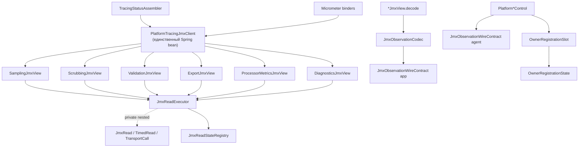

# JMX Client Domain Split — описание реализации

Документ фиксирует **фактическое** состояние после стори
`jmx_client_domain_split` (план Cursor:
`C:\Users\andrew\.cursor\plans\jmx_client_domain_split_3316eb29.plan.md`).
Назначение — опорный материал для дальнейшего рефакторинга: классы, иерархии,
границы модулей, отклонения от плана и точки напряжения.

Статус стори по плану: slices `inventory` … `gates` — **completed**;
`tests-docs-verify` в плане помечен **pending** (часть тестов и ADR уже есть —
см. §14).

Связанные ADR:

- [ADR-jmx-observation-wire-contract](../../decisions/ADR-jmx-observation-wire-contract.md)
- [ADR-jmx-source-identity-model](../../decisions/ADR-jmx-source-identity-model.md)
- [ADR-jmx-absent-owner-encoding](../../decisions/ADR-jmx-absent-owner-encoding.md)
- [ADR-autoconfigure-boundaries-and-jmx-parity](../../decisions/ADR-autoconfigure-boundaries-and-jmx-parity.md)

Type ledger: записи `jmx-domain-split` в
[`platform-tracing-autoconfigure-type-ledger.md`](../../architecture/platform-tracing-autoconfigure-type-ledger.md)
помечены **DONE**.

---

## 1. Цель и принятые решения

### 1.1 Проблема до изменений

`PlatformTracingJmxClient` был монолитным фасадом с silent-failure чтением
(`try/catch → 0.0` / пустые карты). Агентская сторона смешивала:

- **sentinel-значения** (`-1.0`, `-1L`, `"unknown"`) при отсутствии владельца;
- **silent zero** — `(owner == null) ? 0L : …`, неотличимое от «событий не было»;
- скалярные атрибуты без атомарного presence → гонка между presence и value.

### 1.2 Принятые архитектурные решения

| Тема | Решение | Код |
|------|---------|-----|
| Identity | **D**: `agentInstanceId` (process) + per-owner `generation` | `JmxSourceIdentity`, `OwnerRegistrationSlot` |
| Micrometer | **D**: политика по типам meter (gauge NaN / monotonic bridge) | binders + `MonotonicJmxCounterGroupBridge` |
| Export / wire | **A**: breaking смена agent-side wire на observation | `SCHEMA_VERSION = 2` |
| Доменные проекции | `public final *JmxView`, package-private ctor | шесть view |
| Spring surface | один bean — `PlatformTracingJmxClient` | views не beans |

### 1.3 Модульные плоскости

```text
agent classloader                          application classloader
─────────────────                          ───────────────────────
*Control / *ControlMBean                   PlatformTracingJmxClient
OwnerRegistrationSlot                      *JmxView × 6
JmxObservationWireContract (copy A)   ≉    JmxObservationWireContract (copy B)
JmxOpenTypeSupport                         JmxObservationCodec
                                           JmxReadExecutor + registry
                                           Micrometer binders
```

Общий Java-тип wire-контракта **запрещён**. Эквивалентность проверяется
independent-verification тестами и golden-snapshot
`jmx-observation-wire-contract-golden.properties` в обоих модулях.

Wire-порт: `MBeanServerConnection` (не `MBeanServer`), чтобы `IOException`
оставался в таксономии. Remote JMX как продуктовая возможность **не публикуется**.

---

## 2. Карта пакетов

### 2.1 Autoconfigure (consume / decode)

```text
…autoconfigure.diagnostics.jmx/
├── PlatformTracingJmxClient              # единственный Spring bean / фасад
├── PlatformTracingJmxObjectNames         # ObjectName константы
├── JmxMBeanRegistrationSnapshot          # общий агрегат 6 доменов
├── DiagnosticsObservation                # без owner-presence; остаётся в корне
├── *JmxView × 6                          # доменные проекции; ctor package-private
├── sampling/     SamplingObservation
├── scrubbing/    ScrubbingObservation, ScrubbingValues
├── validation/   ValidationObservation, ValidationValues
├── export/       ExportObservation, ExportProcessorValues, SafeExporterValues
├── processor/    ProcessorMetricsObservation + 3 Values
├── wire/                                 # бывший observation/
│   ├── JmxObservationWireContract        # SCHEMA_VERSION=2, имена item'ов
│   └── JmxOwnerState                     # sealed presence decode-side (лист графа пакетов)
└── transport/
    ├── JmxReadExecutor                   # единственный доступ к MBeanServerConnection
    ├── JmxObservationCodec               # decode-примитивы (рядом с CV exception)
    ├── JmxReadStateRegistry              # package-private
    ├── JmxAttribute                      # единственный дескриптор member'а (read-only)
    └── enums + diagnostic DTO
```

> **Package-split (A minus views):** доменные подпакеты содержат только read-model DTO,
> которые реально импортируют metrics/status. Views остаются в корне рядом с фасадом —
> package-private ctor инвариант сохраняется без public constructor + ArchUnit-компенсации.
> Имя `processor/` (не `metrics/`) — чтобы не путать с `…autoconfigure.metrics` (Micrometer).

> **Cleanup-заметка:** `JmxMember`/`JmxOperation`/`JmxParameter`/`JmxArgumentEncoder` и
> `JmxReadExecutor.invoke(...)` удалены — нулевые production call-site, ни один view
> не определял операций (см. §12.5, изначально помечено как "мёртвый вес на hot path API").

### 2.2 Metrics (Micrometer)

```text
…autoconfigure.metrics/
├── MonotonicJmxCounterGroupBridge        # package-private
├── SamplerDecisionKey                    # package-private enum
├── PlatformTracingJmxDomainHealthMetricsBinder
├── PlatformTracingSamplerMetricsBinder   # единственный consumer bridge сегодня
├── PlatformTracingSafeWrapperMetricsBinder
├── PlatformTracingConfigMetricsBinder
└── TracingMetricsAutoConfiguration
```

### 2.3 Agent extension (encode / register)

```text
…otel.javaagent.jmx/
├── PlatformTracingJmxRegistrar
├── PlatformTracingObjectNames
├── observation/
│   ├── JmxObservationWireContract
│   ├── JmxOpenTypeSupport (+ nested CompositeSchema)
│   ├── OwnerRegistrationSlot
│   ├── OwnerRegistrationState            # sealed
│   └── JmxSourceIdentity
├── sampling|scrubbing|validation|export|metrics|diagnostics/
│   ├── Platform*ControlMBean             # ровно один observation-getter
│   └── Platform*Control                  # encode fresh CompositeData
└── readiness/                            # отдельно от шести доменов
```

---

## 3. Высокоуровневая иерархия и поток данных



Публичная проекция отказа: `Optional.empty()` + запись в registry.
Внутренний `JmxRead<T>` **не** покидает `JmxReadExecutor`.

---

## 4. Facade и доменные проекции

### 4.1 `PlatformTracingJmxClient`

| Свойство | Значение |
|----------|----------|
| Видимость | `public final class` |
| Роль | Единственный Spring bean и единственная точка входа |
| Конструкторы | `()`, `(MBeanServer)` |
| Ownership | Создаёт один `JmxReadExecutor` и шесть view |

**Публичный API:**

```text
sampling() / scrubbing() / validation() / export() /
processorMetrics() / diagnostics()
    → *JmxView

registrationSnapshot() → JmxMBeanRegistrationSnapshot
jmxContractDiagnostics() → List<JmxDiagnosticSnapshot>
```

Фасад **не** вызывает `MBeanServerConnection` и **не** decode'ит `CompositeData`.

### 4.2 Общий контракт `*JmxView`

Все шесть view:

- `public final class`
- package-private конструктор `(JmxReadExecutor, ObjectName)`
- **не** Spring beans, **не** SPI, не конструируются потребителем
- держат `static final JmxAttribute<*Observation>` с именем атрибута и `JmxContractPoint`
- публичные методы:

```text
JmxMBeanRegistrationState registration()
Optional<*Observation> observation()
Optional<Duration> lastSuccessAge()
```

| View | Attribute name | Contract point | Observation type |
|------|----------------|----------------|------------------|
| `SamplingJmxView` | `SamplingObservation` | `SAMPLING_OBSERVATION` | `SamplingObservation` |
| `ScrubbingJmxView` | `ScrubbingObservation` | `SCRUBBING_OBSERVATION` | `ScrubbingObservation` |
| `ValidationJmxView` | `ValidationObservation` | `VALIDATION_OBSERVATION` | `ValidationObservation` |
| `ExportJmxView` | `ExportObservation` | `EXPORT_OBSERVATION` | `ExportObservation` |
| `ProcessorMetricsJmxView` | `ProcessorMetricsObservation` | `PROCESSOR_METRICS_OBSERVATION` | `ProcessorMetricsObservation` |
| `DiagnosticsJmxView` | `DiagnosticsObservation` | `DIAGNOSTICS_OBSERVATION` | `DiagnosticsObservation` |

Интерфейс `*JmxView` **намеренно не введён**: `final` закрывает наследование,
package-private ctor — конструирование; публичный интерфейс создал бы случайный SPI.

### 4.3 ObjectName map

| Domain | ObjectName |
|--------|------------|
| Sampling | `space.br1440.platform.tracing:type=Sampling,name=PlatformSamplingControl` |
| Scrubbing | `…:type=Scrubbing,name=PlatformScrubbingControl` |
| Validation | `…:type=Validation,name=PlatformValidationControl` |
| Export | `…:type=Export,name=PlatformExportControl` |
| ProcessorMetrics | `…:type=Metrics,name=PlatformProcessorMetricsControl` |
| Diagnostics | `…:type=Diagnostics,name=PlatformDiagnosticsControl` |

(+ readiness, вне шести доменов: `…:type=Readiness,name=PlatformExtension`)

Константы зеркалятся: app `PlatformTracingJmxObjectNames` ↔ agent `PlatformTracingObjectNames`.

---

## 5. Sealed-иерархии (точное состояние)

### 5.1 Decode-side: `JmxOwnerState<T>`

Пакет: `…diagnostics.jmx`

```text
public sealed interface JmxOwnerState<T>
    permits JmxOwnerState.Present, JmxOwnerState.Absent

    long generation()

    record Present<T>(T values, long generation)   // generation > 0, values != null
    record Absent<T>(long generation)              // generation >= 0
```

Отличия от формулировки плана:

| План | Факт |
|------|------|
| `Present(JmxSourceIdentity identity, T values)` | `Present(T values, long generation)` — identity на decode-side **не** собрана в record |
| `Absent()` без generation | `Absent(long generation)` — generation последнего известного owner сохраняется |

`JmxSourceIdentity` существует **только на agent-side**.

### 5.2 Agent-side: `OwnerRegistrationState<T>`

Пакет: `…otel.javaagent.jmx.observation`

```text
public sealed interface OwnerRegistrationState<T>
    permits OwnerRegistrationState.Present, OwnerRegistrationState.Absent

    long generation()

    record Present<T>(T owner, long generation)   // owner != null, generation > 0
    record Absent<T>(long generation)             // generation >= 0
```

### 5.3 Transport: `JmxAttribute<T>`

```text
public record JmxAttribute<T>(String name, JmxContractPoint point, JmxValueDecoder<T> decoder)
```

`JmxMember<T>` (sealed `permits JmxAttribute, JmxOperation`), `JmxOperation`, `JmxParameter`,
`JmxArgumentEncoder` и `JmxReadExecutor.invoke(...)` **удалены** (cleanup-слайс после
архитектурного ревью): контракт всех шести доменных MBean — read-only observation-only,
ни один view никогда не определял операций, вызывать было нечего. `JmxAttribute` больше
не реализует sealed-интерфейс — он единственный член транспорта, sealed hierarchy на
единственный permit не несёт архитектурной ценности.

### 5.4 Transport: `JmxRead<T>` (private nested)

Внутри `JmxReadExecutor` (не `permits`-clause — все варианты nested в том же CU):

```text
private sealed interface JmxRead<T>
    record Present<T>(T value)
    record Absent<T>()
    record ContractViolation<T>(JmxDiagnosticKind kind)
    record ExecutionFailure<T>(JmxDiagnosticKind kind)

private record TimedRead<T>(long sequence, Instant observedAt, JmxRead<T> read)
private interface TransportCall { Object execute() throws … }
```

План упоминал `JmxTransportReader` как nested reader — **в коде такого типа нет**;
роль выполняет `TransportCall` + `readRaw`.

Публичные DTO-аналоги исходов (для диагностики, не для match в view):

- `JmxContractViolation(point, kind, expectedType, actualType)`
- `JmxExecutionFailure(point, kind, debugMessage)`
- сигнал декодера: `JmxContractViolationException extends RuntimeException`

### 5.5 Registration tri-state

```text
public enum JmxMBeanRegistrationState { REGISTERED, NOT_REGISTERED, UNKNOWN }

public record JmxMBeanRegistrationSnapshot(
    sampling, scrubbing, validation, export, processorMetrics, diagnostics)
    boolean allRegistered()
```

Заменяет `boolean allMBeansAvailable()` / `isAvailable()`.

---

## 6. Transport core: `JmxReadExecutor` и registry

### 6.1 Ответственность executor

| Метод | Семантика |
|-------|-----------|
| `read(ObjectName, JmxAttribute<T>)` | getAttribute + decode → `Optional<T>` |
| `registration(ObjectName, JmxContractPoint)` | `isRegistered` → tri-state |
| `diagnosticSnapshot()` | делегирует в registry |
| `lastSuccessAge(point)` | freshness точки |

### 6.2 Сериализация transport per domain

```text
EnumMap<JmxDomain, ReentrantLock> transportLocks
AtomicLong observationSequence
```

Под локом домена:

1. transport-вызов (`getAttribute` / `invoke` / `isRegistered`);
2. `observationSequence.incrementAndGet()`;
3. фиксация `observedAt`.

**Decode и валидация — вне лока.** Следствия:

- вызовы одного MBean не перекрываются;
- единая шкала `observationSequence` для всех четырёх исходов;
- медленный decode не блокирует другие попытки того же домена после возврата transport;
- чтения разных доменов не блокируют друг друга.

`captureSequence` из payload агента в упорядочении registry **не участвует**.

### 6.3 Классификация исключений (факт)

| Исход | Условия |
|-------|---------|
| `Absent` | `InstanceNotFoundException` |
| `ContractViolation(MISSING_ATTRIBUTE)` | `AttributeNotFoundException` |
| `ContractViolation(OPERATION_SIGNATURE_DRIFT)` | `ReflectionException` + cause `NoSuchMethodException`/`ClassNotFoundException` |
| `ExecutionFailure(REFLECTION_UNCLASSIFIED)` | прочий `ReflectionException` |
| `ExecutionFailure(MBEAN_EXECUTION_FAILURE)` | `MBeanException`, `RuntimeMBeanException` |
| `ExecutionFailure(MBEAN_RUNTIME_ERROR)` | `RuntimeErrorException` |
| rethrow `IllegalArgumentException` | `RuntimeOperationsException` + cause `IllegalArgumentException` (дефект клиента) |
| `ExecutionFailure(OPERATIONS_EXCEPTION_UNCLASSIFIED)` | прочий `RuntimeOperationsException` |
| `ExecutionFailure(SECURITY_FAILURE)` | `SecurityException` |
| `ExecutionFailure(CONNECTOR_FAILURE)` | `IOException` |
| не перехватывается | всё остальное |

Broad catch (`Exception`/`RuntimeException`/`Throwable`/`Error`) в jmx-пакете запрещён
source-scanner'ом.

### 6.4 `JmxReadStateRegistry` (package-private)

```text
final class JmxReadStateRegistry
    nested record DiagnosticEpisode(failureSequence, firstSeenAt, lastSeenAt)
```

Правила:

- **Lifetime-счётчики** — каждый отказ, независимо от порядка доставки;
- **текущее состояние** (`unrecovered`, `lastOutcome`) — только при
  `observationSequence >= lastAppliedSequence`, атомарная замена `JmxPointReadState`;
- success снимает unrecovered только с ключей, у которых `failureSequence < successSequence`;
- WARN — один раз на unrecovered-эпизод diagnostic key; **rate limit важнее эпизода**
  (default 5 минут, injected `Clock`); подавления → `suppressedWarnCount`.

Ключ:

```text
public record JmxDiagnosticKey(
    JmxContractPoint point,
    JmxDiagnosticCategory category,
    JmxDiagnosticKind kind)
```

Категории: `CONTRACT_VIOLATION`, `EXECUTION_FAILURE`.

### 6.5 Закрытые enum-пространства

**`JmxDomain`:**  
`SAMPLING`, `SCRUBBING`, `VALIDATION`, `EXPORT`, `PROCESSOR_METRICS`, `DIAGNOSTICS`

**`JmxContractPoint`:** 12 значений — `*_OBSERVATION` + `*_REGISTRATION` на каждый домен.

**`JmxLastReadOutcome`:**  
`NEVER_READ`, `PRESENT`, `ABSENT`, `CONTRACT_VIOLATION`, `EXECUTION_FAILURE`

**`JmxDiagnosticKind` (contract):**  
`NULL_VALUE_FOR_REQUIRED_MEMBER`, `VALUE_TYPE_MISMATCH`, `MAP_KEY_TYPE_MISMATCH`,
`MAP_VALUE_TYPE_MISMATCH`, `ARRAY_ELEMENT_TYPE_MISMATCH`, `VALUE_SEMANTICS_VIOLATION`,
`MISSING_ATTRIBUTE`, `OPERATION_SIGNATURE_DRIFT`, `SCHEMA_VERSION_MISMATCH`,
`COMPOSITE_TYPE_NAME_MISMATCH`, `MISSING_OBSERVATION_ITEM`, `OWNER_GENERATION_INVALID`

**`JmxDiagnosticKind` (execution):**  
`MBEAN_EXECUTION_FAILURE`, `MBEAN_RUNTIME_ERROR`, `SECURITY_FAILURE`, `CONNECTOR_FAILURE`,
`REFLECTION_UNCLASSIFIED`, `OPERATIONS_EXCEPTION_UNCLASSIFIED`, `REGISTRATION_CHECK_FAILED`

**`JmxWireTypeCode`:** стабильные коды ожидаемого/фактического типа (не Java class names).

### 6.6 Snapshot для Actuator

```text
public record JmxDiagnosticSnapshot(
    point, category, kind,
    lifetimeCount, suppressedWarnCount,
    firstSeenAt, lastSeenAt, lastAttemptAt,
    unrecovered)
```

Собирается через `PlatformTracingJmxClient#jmxContractDiagnostics()` →
`tracingStatus.jmxContractDiagnostics` (секция после остальных JMX-чтений в assembler).

---

## 7. Wire-контракт и codec

### 7.1 `JmxObservationWireContract` (две независимые копии)

`SCHEMA_VERSION = 2`.

Общий frame (все шесть членов):

| Item | OpenType | Семантика |
|------|----------|-----------|
| `schemaVersion` | INTEGER | версия схемы |
| `captureSequence` | LONG | монотонный per-MBean счётчик захвата (diagnostic invariant) |
| `agentInstanceId` | STRING | UUID процесса агента |
| `captureStartedAt` | LONG | epoch millis |
| `captureCompletedAt` | LONG | epoch millis, `>= started` |

Per-owner: `ownerPresent` (BOOLEAN), `ownerGeneration` (LONG),
`ownerCapturedOffsetNanos` (LONG) — в sub-composite или на верхнем уровне
в зависимости от домена.

Nested enums в контракте:

```text
KeyCardinality { FIXED_ENUM, BOUNDED_ALLOWLIST, DYNAMIC_NOT_EXPORTED }
ValueSemantics { CUMULATIVE, POINT_IN_TIME }
record DynamicMapKey(key, cardinality, semantics)
```

### 7.2 `JmxObservationCodec` (только autoconfigure)

Общие decode-примитивы: `asComposite`, `requireSchemaVersion`,
`getBoolean/Long/Int/Double/String/Composite`, `getStringLongMap`, `getTabularSize`,
`ownerState(...)`.

Канал ошибки → executor: только `JmxContractViolationException`.

### 7.3 Типы, запланированные, но отсутствующие как Java-типы

| План | Факт |
|------|------|
| `CaptureInterval` record в observation | **нет** — timing остаётся wire-only; observation records его не surfaced |
| `JmxSourceIdentity` в decode DTO | **нет** на autoconfigure; generation живёт в `JmxOwnerState` |
| Frame `agentInstanceId` в observation records | **кодируется агентом**, **не** декодируется в `*Observation` |

### 7.4 Гарантия observation (honest)

Observation — **не** linearizable cross-owner snapshot. В рамках одного JMX-вызова
захватываются независимые состояния владельцев внутри capture-интервала.
`queueSize` может уменьшаться; `LongAdder` слабо согласован; cross-owner consistency нет.

Агент строит **свежий** `CompositeData` на каждый `getAttribute` (кэш mutable
`TabularData` запрещён).

---

## 8. Доменные observation / values — иерархия данных

```text
SamplingObservation
├── samplerEnabled: boolean                 # всегда из AcceptedPolicyAccess
├── samplingRatio: double
├── liveRouteRatioCount: int                # размер tabular route ratios
├── configLastUpdatedSource: String
└── decisionCounts: JmxOwnerState<Map<String,Long>>   # CompositeSampler slot

ScrubbingObservation
└── owner: JmxOwnerState<ScrubbingValues>
    └── ScrubbingValues(enabled, policyVersion, rulesLoaded,
                        circuitBreakersOpen, metrics)

ValidationObservation
└── owner: JmxOwnerState<ValidationValues>
    └── ValidationValues(enabled, strict, strictRuntimeAllowed,
                         configVersion, configLastUpdatedSource)

ExportObservation
├── processor: JmxOwnerState<ExportProcessorValues>
│   └── ExportProcessorValues(queueCapacity, queueSize,
│         droppedOverflowTotal, droppedAfterShutdownTotal,
│         failuresTotal, timeoutsTotal)
└── exporter: JmxOwnerState<SafeExporterValues>
    └── SafeExporterValues(exportEnabled, lastExportDurationNanos, metrics)

ProcessorMetricsObservation
├── watchdog: JmxOwnerState<ProcessorWatchdogValues>
│   └── (forcedSpanCloses, forcedTraceCloses, activeSpanCount, activeTraceCount)
├── composite: JmxOwnerState<ProcessorCompositeValues>
│   └── (errorsTotal, errorsByName)
└── metrics: JmxOwnerState<ProcessorMetricsValues>
    └── (droppedAttributesTotal, droppedEventsTotal, droppedLinksTotal)

DiagnosticsObservation                    # без JmxOwnerState — static singletons
├── invalidConfigCount
├── configReloadMetrics
├── configAuditTrail
├── safeWrapperMetrics
├── platformLogLevel
└── propagationEnabled
```

### Владельцы (agent inventory)

| Домен | Owner(s) | Slot? |
|-------|----------|-------|
| Sampling | policy access (always) + `CompositeSampler` | slot для sampler |
| Scrubbing | `ScrubbingSpanProcessor` | slot |
| Validation | `ValidatingSpanProcessor` | slot |
| Export | `PlatformDropOldestExportSpanProcessor` + `SafeSpanExporter` | 2 slots |
| ProcessorMetrics | `SpanWatchdogProcessor` + `PlatformCompositeSpanProcessor` + `MetricsSpanProcessor` | 3 slots |
| Diagnostics | `ConfigReloadDiagnostics` / `TracingDiagnostics` / log / propagation | **нет** (static; generation константна по смыслу) |

---

## 9. Agent-side: identity, slots, MBean

### 9.1 `JmxSourceIdentity`

```text
public record JmxSourceIdentity(UUID agentInstanceId, long ownerGeneration)
```

Process UUID создаётся один раз при старте агента и передаётся в каждый control.

### 9.2 `OwnerRegistrationSlot<T>`

```text
public final class OwnerRegistrationSlot<T>
    replace(T) → Present(newOwner, previous.generation + 1)   // updateAndGet
    remove()   → Absent(previous.generation)
    capture()  → current state (ровно одно чтение)
```

Только слот аллоцирует generation. Внешний код готовую generation не передаёт.
Стартовое состояние: `Absent(0)`.

### 9.3 MBean-контракт (breaking)

Каждый из шести `*ControlMBean` содержит **ровно один** член:

```text
CompositeData get*Observation()
```

Удалены без compatibility aliases:

- все прежние скалярные атрибуты (`isExportEnabled`, `getExportQueueSize`,
  `getSamplingRatio`, …);
- мутаторы (если были на этих MBean);
- per-key операции вроде `getSamplerDecisionCount(String, String)`;
- v1 sentinel decode path.

Пример Javadoc-контракта — `PlatformExportControlMBean`.

### 9.4 Encode pattern (`Platform*Control`)

Типичный поток:

1. `captureSequence.incrementAndGet()`;
2. `captureStartedAt` / nano base;
3. `slot.capture()` → pattern-match `Present`/`Absent`;
4. при Absent — placeholder'ы фиксированной схемы (`false`, generation, нули, пустые карты);
5. при Present — реальные значения владельца;
6. свежий `CompositeData` через `JmxOpenTypeSupport`.

`JmxOpenTypeSupport` + nested `CompositeSchema` — builders OpenType / `CompositeDataSupport` /
`TabularDataSupport`.

---

## 10. Micrometer

### 10.1 Политика по типам

| Ситуация | Point-in-time gauge | Boolean gauge | Counter bridge |
|----------|---------------------|---------------|----------------|
| MBean Absent / decode fail / execution fail | `NaN` | `NaN` | накопленное без изменений |
| Observation OK, owner Absent | `NaN` для owner gauges | `owner.present=0` | без изменений |
| Observation OK, owner Present | значение | `1.0`/`0.0` | дельта / reset по identity |

Различение `Absent` / `ContractViolation` / `ExecutionFailure` **не** кодируется в
значении gauge (сознательный компромисс ADR) — смотреть
`domain.registered` / `domain.readable` / diagnostics counters / `jmxContractDiagnostics`.

### 10.2 Domain health binder

`PlatformTracingJmxDomainHealthMetricsBinder` регистрирует:

- `platform.tracing.jmx.domain.registered{domain}`
- `platform.tracing.jmx.domain.readable{domain}` — успех **целого** observation
- `platform.tracing.jmx.domain.last_success_age_seconds{domain}`
- `platform.tracing.jmx.owner.present{domain,owner}`

Owners в тегах: sampling/sampler; scrubbing; validation; export/processor+exporter;
processor_metrics/watchdog+composite+metrics. Diagnostics без owner.present
(всегда-присутствующие синглтоны).

### 10.3 `MonotonicJmxCounterGroupBridge<K extends Enum<K>>`

Package-private. Вложенные типы:

```text
enum ResetCause { OWNER_REPLACED, AGENT_INSTANCE_CHANGED }
interface Ticker { long nanoTime(); }
record BridgeSnapshot<K>(accumulated, lastRaw, lastIdentity, refreshedAtNanos)
```

Concurrency model:

- immutable snapshot в `volatile`;
- `count(key)` → при stale `tryLock`: победитель refresh'ит, проигравшие читают last snapshot;
- coalescing-окно default **150 ms** на injected `Ticker`;
- до первого snapshot FunctionCounter → `0`.

Identity для reset: пара `(agentInstanceIdSupplier, generation из JmxOwnerState)`.

**Текущий компромисс (важно для рефакторинга):**

- на wire `agentInstanceId` **есть** (frame всех observation);
- bridge по умолчанию использует `RuntimeMXBean#getName()`, а **не** wire UUID;
- javadoc bridge местами устарел («на wire не публикуется») — факт wire ≠ факт consumer;
- `AGENT_INSTANCE_CHANGED` — защитная ветка, unit-only.

**Adoption сегодня:** bridge подключен только в
`PlatformTracingSamplerMetricsBinder` (`SamplerDecisionKey`).
Cumulative-карты Scrubbing / Export / ProcessorMetrics **классифицированы в wire-контракте**,
но dedicated bridges ещё не заведены — SafeWrapper/Config binders читают maps напрямую
без monotonic group bridge.

Метрики reset/anomaly:

```text
platform.tracing.jmx.source_resets_total{domain, owner, cause}
platform.tracing.jmx.backward_value_anomalies_total{domain, owner, metric}
```

---

## 11. Presence: семантика состояний

| Состояние | `domain.registered` | `domain.readable` | `owner.present` |
|-----------|---------------------|-------------------|-----------------|
| MBean отсутствует | 0 | 0 | `NaN` |
| observation повреждён | 1 | 0 | `NaN` |
| observation валиден, owner absent | 1 | 1 | 0 |
| observation валиден, owner present | 1 | 1 | 1 |

**Критично:** absent owner ≠ `JmxRead.Absent`.
Валидный payload с `ownerPresent=false` → `Optional` of observation (`Present` на transport),
presence моделируется **внутри** `JmxOwnerState`.

Правило: `ownerGeneration = 0` при `ownerPresent = true` → `OWNER_GENERATION_INVALID`.

---

## 12. Отклонения от плана (для рефакторинга)

Ниже — сознательные или незакрытые расхождения; не «баги по умолчанию», а backlog.

### 12.1 Discriminator-first decode — **не строго**

План: при `ownerPresent=false` не декодировать и не валидировать owner-specific item'ы.

Факт: `*JmxView.decode` сначала читает все item'ы / строит `*Values`, затем вызывает
`JmxObservationCodec.ownerState(...)`. При Absent values **отбрасываются** и наружу
не попадают, но placeholder всё ещё проходит type-проверки. Повреждённый placeholder
при absent owner может дать `ContractViolation`, хотя domain-контракт placeholder'ов
не интерпретирует.

**Кандидат рефакторинга:** `ownerState`/`decodeOwner` с early-return до чтения payload.

### 12.2 Frame-поля не surfaced в observation DTO — **частично закрыто**

`agentInstanceId` теперь surfaced во все шесть `*Observation` records и
потребляется `MonotonicJmxCounterGroupBridge`-based binders (см. §4 cleanup-плана,
ADR-jmx-source-identity-model, раздел «Компромисс закрыт»).

`captureSequence`, `captureStartedAt/CompletedAt`, `ownerCapturedOffsetNanos`
по-прежнему кодируются агентом, но не входят в `*Observation` — типа
`CaptureInterval` нет, это остаётся backlog (см. §15 п.2).

### 12.3 `JmxSourceIdentity` не на decode-side

Decode держит только `generation` в `JmxOwnerState`. Полная пара identity
собирается только косвенно в bridge через отдельный supplier.

### 12.4 Monotonic bridge adoption неполный

Только sampler decisions. Остальные cumulative-владельцы (export metrics,
scrubbing metrics, processor errors, safe-wrapper) — прямое чтение maps /
скаляров без owner-level bridge → риск N captures и некорректных reset-событий
при появлении FunctionCounter на этих доменах.

### 12.5 `JmxOperation` мёртвый вес на hot path API — **закрыто**

Инфраструктура операций была объявлена, но ни один view её не использовал.
Удалено в cleanup-слайсе: `JmxMember`, `JmxOperation`, `JmxParameter`,
`JmxArgumentEncoder`, `JmxReadExecutor.invoke(...)` + локальная валидация
арности/типов аргументов. `JmxAttribute` больше не `implements JmxMember` —
единственный оставшийся член транспорта не нуждается в sealed-обёртке на один permit.
Allowlist ([`platform-tracing-autoconfigure-public-type-allowlist.txt`](../../architecture/platform-tracing-autoconfigure-public-type-allowlist.txt))
обновлён — четыре FQCN убраны.

### 12.6 Именование nested transport

План: `JmxTransportReader`. Факт: `TransportCall`. Документы/диаграммы не должны
ссылаться на несуществующий тип.

### 12.7 Устаревший javadoc bridge про wire `agentInstanceId` — **закрыто**

Javadoc `MonotonicJmxCounterGroupBridge` обновлён: wire публикует UUID, binders
его потребляют, `LOCAL_PROCESS_IDENTITY` — только fallback при недоступном
observation.

---

## 13. Иерархия зависимостей (sibling rules)

```text
PlatformTracingJmxClient
  owns → JmxReadExecutor
           owns → JmxReadStateRegistry
           uses → JmxAttribute / JmxContractPoint / JmxDomain
  owns → *JmxView
           uses → JmxReadExecutor
           uses → JmxObservationCodec → JmxObservationWireContract
           produces → *Observation → JmxOwnerState → *Values

MeterBinder → PlatformTracingJmxClient → *JmxView
  Sampler binder → MonotonicJmxCounterGroupBridge ← JmxOwnerState<Map>

Agent:
PlatformTracingJmxRegistrar
  → Platform*Control(slots, agentInstanceId)
       → OwnerRegistrationSlot → OwnerRegistrationState
       → JmxOpenTypeSupport + JmxObservationWireContract
```

ArchUnit-инварианты (ожидаемые):

- фасад не зависит от `javax.management..` напрямую (кроме ctor `MBeanServer`);
- `getAttribute`/`invoke`/`isRegistered` — только executor;
- `*JmxView` → executor + собственные DTO + codec/contract;
- transport internals недостижимы вне пакета `transport` / jmx;
- views не Spring beans (context-тест).

---

## 14. Тесты, гейты, верификация

### 14.1 Уже присутствуют (неполный перечень)

Autoconfigure:

- `PlatformTracingJmxClientTest`
- `JmxReadExecutorTest`, `JmxReadExecutorConcurrencyLinearizationTest`
- `JmxReadStateRegistryTest`
- `JmxOwnerStateSealedSurfaceTest`
- `DomainAbsentOwnerEncodingRoundTripTest`
- `JmxObservationWireContractIndependentVerifyTest`
- `MonotonicJmxCounterGroupBridgeTest`
- `PlatformTracingJmxDomainHealthMetricsBinderTest`

Agent:

- `OwnerRegistrationSlotTest`
- control unit tests × 6 domains
- `DomainMBeanJmxComplianceTest`, `JmxManagementContractSnapshot`
- agent-side independent wire verify

E2E:

- `platform-tracing-e2e-tests` source set `domainObservationE2e`:
  `DomainObservationCrossClassLoaderE2ETest` (требует `-PrunE2e`)

### 14.2 План verification (из стори)

```powershell
.\gradlew.bat :platform-tracing-otel-javaagent-extension:compileJava --no-daemon
.\gradlew.bat :platform-tracing-otel-javaagent-extension:test --no-daemon
.\gradlew.bat :platform-tracing-spring-boot-autoconfigure:compileJava --no-daemon
.\gradlew.bat :platform-tracing-spring-boot-autoconfigure:compileTestJava --no-daemon
.\gradlew.bat :platform-tracing-spring-boot-autoconfigure:test --no-daemon
.\gradlew.bat :platform-tracing-bench:test --no-daemon
.\gradlew.bat pr1ModuleTaxonomyVerify pr4ArchitectureFitnessVerify --no-daemon
.\gradlew.bat :platform-tracing-e2e-tests:test -PrunE2e --rerun-tasks --no-build-cache --no-daemon
```

Пропущенный E2E = `INSUFFICIENT_EVIDENCE`, не `PASS`.

---

## 15. Рекомендуемые направления следующего рефакторинга

Приоритизация по риску / незакрытым компромиссам (статус — после cleanup-слайса JMX review):

1. **Strict discriminator-first decode** в `JmxObservationCodec` / views — **закрыто**,
   см. §3 cleanup-плана: `ownerState` принимает `Supplier<T>`, payload больше не
   декодируется до проверки presence.
2. **Surfacing frame** (`agentInstanceId`, capture interval) в decode DTO и
   переключение bridge на wire identity — **частично закрыто**: `agentInstanceId`
   surfaced во все шесть `*Observation` и потребляется bridge'ами; полный
   `CaptureInterval` (captureSequence/captureStartedAt/CompletedAt/ownerCapturedOffsetNanos)
   остаётся backlog.
3. **Расширить `MonotonicJmxCounterGroupBridge`** на export/scrubbing/processor
   cumulative maps с closed enum key spaces — **закрыто**, см. §5 cleanup-плана.
4. **Выровнять javadoc/ADR/ledger** с фактом wire `agentInstanceId` — **закрыто**.
5. Решить судьбу неиспользуемого `JmxOperation` API — **закрыто**: API удалён (§12.5).
6. Довести `tests-docs-verify`: полный прогон E2E, sync runbook/PUML,
   проверка ArchUnit allowlist на полный public surface — выполняется в рамках
   verification-гейтов cleanup-слайса (§8 cleanup-плана).
7. При необходимости — единый package-private helper для идентичного каркаса
   шести `*JmxView` **без** введения публичного интерфейса/SPI — остаётся backlog,
   не затронуто этим слайсом.
8. **Diagnostics single-capture** (Config/SafeWrapper/`invalid_config`) — **закрыто**:
   `CoalescingJmxObservationSource` убирает N× `getAttribute(DiagnosticsObservation)`
   на scrape (см. §6 cleanup-плана, находка D7).

---

## 16. Быстрый указатель файлов

### Autoconfigure — facade / views / shared

- `…/diagnostics/jmx/PlatformTracingJmxClient.java`
- `…/diagnostics/jmx/*JmxView.java`
- `…/diagnostics/jmx/DiagnosticsObservation.java`
- `…/diagnostics/jmx/JmxMBeanRegistrationSnapshot.java`
- `…/diagnostics/jmx/PlatformTracingJmxObjectNames.java`

### Autoconfigure — domain read-model DTO

- `…/diagnostics/jmx/sampling/SamplingObservation.java`
- `…/diagnostics/jmx/scrubbing/ScrubbingObservation.java`, `ScrubbingValues.java`
- `…/diagnostics/jmx/validation/ValidationObservation.java`, `ValidationValues.java`
- `…/diagnostics/jmx/export/ExportObservation.java`, `ExportProcessorValues.java`, `SafeExporterValues.java`
- `…/diagnostics/jmx/processor/ProcessorMetricsObservation.java`, `Processor*Values.java`

### Autoconfigure — wire / transport

- `…/diagnostics/jmx/wire/JmxObservationWireContract.java`
- `…/diagnostics/jmx/wire/JmxOwnerState.java`
- `…/diagnostics/jmx/transport/JmxObservationCodec.java`
- `…/diagnostics/jmx/transport/JmxReadExecutor.java`
- `…/diagnostics/jmx/transport/JmxReadStateRegistry.java`
- `…/diagnostics/jmx/transport/JmxAttribute.java`
- `…/diagnostics/jmx/transport/JmxContractPoint.java`, `JmxDomain.java`, `JmxDiagnosticKind.java`, …

### Metrics

- `…/metrics/MonotonicJmxCounterGroupBridge.java`
- `…/metrics/CoalescingJmxObservationSource.java`
- `…/metrics/PlatformTracingJmxDomainHealthMetricsBinder.java`
- `…/metrics/PlatformTracingSamplerMetricsBinder.java`
- `…/metrics/PlatformTracingConfigMetricsBinder.java`, `PlatformTracingSafeWrapperMetricsBinder.java`
- `…/metrics/PlatformTracingExportMetricsBinder.java`, `PlatformTracingScrubbingMetricsBinder.java`,
  `PlatformTracingProcessorMetricsBinder.java`
- `…/metrics/SamplerDecisionKey.java`
- `…/metrics/TracingMetricsAutoConfiguration.java`

### Agent

- `…/jmx/observation/OwnerRegistrationSlot.java`
- `…/jmx/observation/OwnerRegistrationState.java`
- `…/jmx/observation/JmxSourceIdentity.java`
- `…/jmx/observation/JmxObservationWireContract.java`
- `…/jmx/observation/JmxOpenTypeSupport.java`
- `…/jmx/{sampling|scrubbing|validation|export|metrics|diagnostics}/Platform*Control*.java`
- `…/jmx/PlatformTracingJmxRegistrar.java`

### Docs / evidence

- `docs/decisions/ADR-jmx-*.md`
- `docs/architecture/platform-tracing-autoconfigure-type-ledger.md`
- `docs/runbook/tracing-status-diagnostics.md`
- `*/src/test/resources/jmx-observation-wire-contract-golden.properties`
