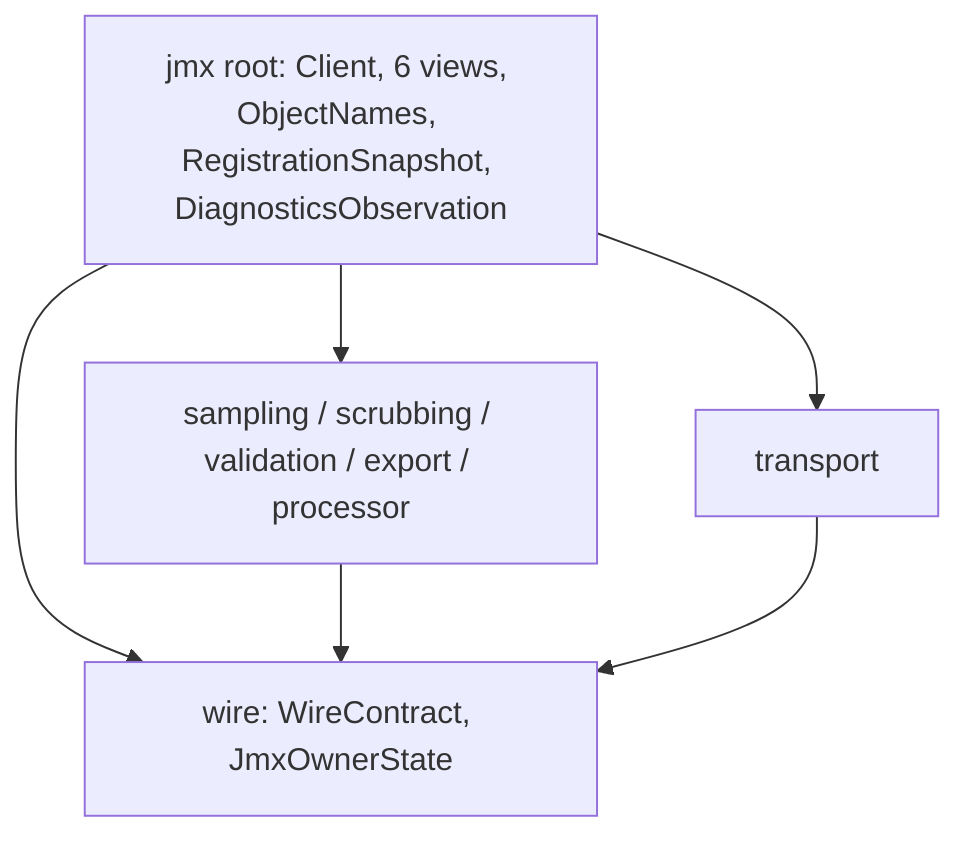
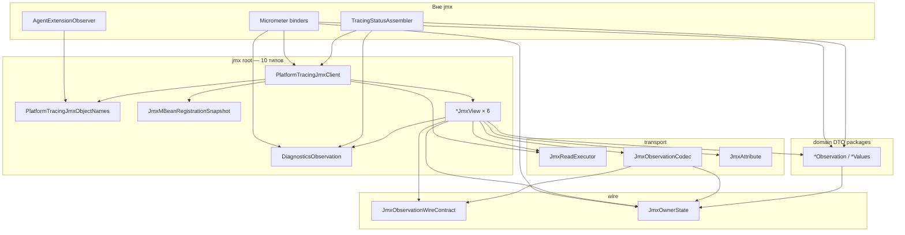

# Обсуждение: корень пакета `…diagnostics.jmx` после package-split

**Статус:** материал для архитектурного обсуждения (не план исполнения).  
**Снимок кода:** 2026-08-03 (после «A minus views» + `wire/` + domain DTO packages).  
**Корень:** `space.br1440.platform.tracing.autoconfigure.diagnostics.jmx`  
**Предыдущий раунд:** [jmx-package-structure-discussion.md](./jmx-package-structure-discussion.md) — закрыт; исполнен гибрид «A minus views».  
**Связанные:** [jmx-client-domain-split-implementation.md](./jmx-client-domain-split-implementation.md), allowlist, `JmxPackageBoundaryArchTest`.

---

## 1. Зачем этот документ

После переноса read-model DTO в доменные подпакеты и `WireContract`/`JmxOwnerState` в `wire/` в корне пакета всё ещё лежит **10 типов**. Архитекторам это кажется «всё ещё кучей».

Цель: зафиксировать **фактическую** роль каждого корневого типа, кто его реально импортирует снаружи, граф зависимостей после split, и варианты дальнейшего прореживания корня — **без** повторения уже отвергнутых решений (public ctor у view, лишний `model/` только ради двух типов).

Пре-production: ломающие package-переезды допустимы при материальном выигрыше границ. Visibility-сокращение — отдельная ось от package-move.

---

## 2. Карта пакетов сейчас (факт)

```text
…diagnostics.jmx/                              ← 10 файлов в КОРНЕ (предмет жалобы)
├── PlatformTracingJmxClient                   # фасад / единственный Spring bean
├── PlatformTracingJmxObjectNames              # ObjectName константы (+ readiness)
├── JmxMBeanRegistrationSnapshot               # агрегат tri-state × 6 доменов
├── DiagnosticsObservation                     # единственный Observation в корне
├── SamplingJmxView
├── ScrubbingJmxView
├── ValidationJmxView
├── ExportJmxView
├── ProcessorMetricsJmxView
├── DiagnosticsJmxView
│
├── sampling/        SamplingObservation                    (1)
├── scrubbing/       ScrubbingObservation, ScrubbingValues  (2)
├── validation/      ValidationObservation, ValidationValues(2)
├── export/          ExportObservation, ExportProcessorValues, SafeExporterValues (3)
├── processor/       ProcessorMetricsObservation + 3 Values (4)
├── wire/            JmxObservationWireContract, JmxOwnerState (2)
└── transport/       JmxReadExecutor, Codec, Attribute, enums… (18; 2 package-private)
```

| Слой | Файлов | Роль |
|------|-------:|------|
| Корень | **10** | Фасад + ObjectNames + RegistrationSnapshot + DiagnosticsObservation + 6 view |
| Domain DTO | 12 | Read-model для внешних consumers (metrics/status) |
| `wire/` | 2 | Нормативные имена item'ов + presence-модель |
| `transport/` | 18 | Единственный порт к MBeanServerConnection + decode/diagnostics |
| **Всего** | **42** | Без изменения числа типов относительно pre-split |

Package-граф после split (ациклический):



---

## 3. Инвентарь корневых типов (детали)

### 3.1 Сводная таблица корня

| # | Тип | Kind | Visibility | Ctor | Роль одной строкой |
|---|-----|------|------------|------|--------------------|
| 1 | `PlatformTracingJmxClient` | class | public final | public | Единственный Spring bean; композиция executor + 6 view |
| 2 | `PlatformTracingJmxObjectNames` | utility class | public final | — | Канонические `ObjectName` (дубль agent-side, другой CL) |
| 3 | `JmxMBeanRegistrationSnapshot` | record | public | public canonical | Агрегат `registration()` шести доменов |
| 4 | `DiagnosticsObservation` | record | public | public canonical | Decode DTO diagnostics (без owner presence) |
| 5 | `SamplingJmxView` | class | public final | **package-private** | Доменная проекция; вход только через Client |
| 6 | `ScrubbingJmxView` | class | public final | **package-private** | то же |
| 7 | `ValidationJmxView` | class | public final | **package-private** | то же |
| 8 | `ExportJmxView` | class | public final | **package-private** | то же |
| 9 | `ProcessorMetricsJmxView` | class | public final | **package-private** | то же |
| 10 | `DiagnosticsJmxView` | class | public final | **package-private** | то же |

Все 10 — в public-type allowlist. Package-private в корне: **0** (только ctor у view).

### 3.2 `PlatformTracingJmxClient`

```text
Владеет:
  JmxReadExecutor (1)
  SamplingJmxView … DiagnosticsJmxView (6)

Публичный API:
  sampling() / scrubbing() / validation() / export() /
  processorMetrics() / diagnostics()  → *JmxView
  registrationSnapshot()              → JmxMBeanRegistrationSnapshot
  jmxContractDiagnostics()            → List<JmxDiagnosticSnapshot>  (из transport)
```

Сам **не** читает `MBeanServerConnection` и **не** decode'ит `CompositeData`.  
Внешние production-потребители (импорт типа): metrics binders, `TracingMetricsAutoConfiguration`, `TracingStatusAssembler` / AutoConfiguration, `TracingRuntimeDiagnosticsAutoConfiguration`.

### 3.3 `PlatformTracingJmxObjectNames`

Константы строк + предсозданные `ObjectName` для шести доменов и `EXTENSION_READINESS`.  
Дублирует agent `PlatformTracingObjectNames` намеренно (разные classloader).  
Внешний consumer: `AgentExtensionObserver` (readiness). Client/views используют те же константы при конструировании.

### 3.4 `JmxMBeanRegistrationSnapshot`

```text
record(
  sampling, scrubbing, validation, export, processorMetrics, diagnostics
  : JmxMBeanRegistrationState   // enum из transport/
)
+ allRegistered(): boolean
```

Собирается только Client'ом. Заменяет прежние `boolean isAvailable()` — tri-state (REGISTERED / NOT_REGISTERED / CHECK_FAILED) не схлопывается.

### 3.5 `DiagnosticsObservation`

Единственный Observation, оставленный в корне (решение прошлого раунда: нет owner-presence, нет `*Values`, подпакет `diagnostics/` дал бы FQCN `…jmx.diagnostics.DiagnosticsObservation`).

```text
record(
  agentInstanceId,
  invalidConfigCount,
  configReloadMetrics,      // Map
  configAuditTrail,         // List
  safeWrapperMetrics,       // Map
  platformLogLevel,
  propagationEnabled
)
```

Внешние импорты типа: `PlatformTracingConfigMetricsBinder`, `PlatformTracingSafeWrapperMetricsBinder`, `PlatformTracingSamplerMetricsBinder` (`invalid_config`), `TracingStatusAssembler`, `TracingMetricsAutoConfiguration` (generic на `CoalescingJmxObservationSource`).

### 3.6 Шесть `*JmxView` (одинаковый каркас)

Каждый view:

```text
public final class *JmxView {
  private static final JmxAttribute<*Observation> OBSERVATION = …;
  private final JmxReadExecutor executor;
  private final ObjectName objectName;

  *JmxView(JmxReadExecutor, ObjectName)   // package-private

  registration()    → JmxMBeanRegistrationState
  observation()     → Optional<*Observation>
  lastSuccessAge()  → Optional<Duration>

  private static *Observation decode(Object raw)  // codec + wire + ownerState
}
```

| View | Observation package | Owners на wire |
|------|---------------------|----------------|
| `SamplingJmxView` | `jmx.sampling` | 1 (`decisionCounts`) + always-present policy scalars |
| `ScrubbingJmxView` | `jmx.scrubbing` | 1 |
| `ValidationJmxView` | `jmx.validation` | 1 |
| `ExportJmxView` | `jmx.export` | 2 (processor, exporter) |
| `ProcessorMetricsJmxView` | `jmx.processor` | 3 (watchdog, composite, metrics) |
| `DiagnosticsJmxView` | root (`DiagnosticsObservation`) | 0 |

**Ключевой факт для следующего решения:** ни один production-класс **вне** `diagnostics.jmx` не объявляет поле/параметр/return type `*JmxView` (защищено ArchUnit). Но цепочки `client.sampling().observation()` создают **bytecode-зависимость** на view через return type accessor'а Client — полный `dependOnClassesThat(*JmxView)` неприменим.

Views **нельзя** перенести в domain-подпакеты, сохранив package-private ctor: Client в корне не сможет их создавать. Предыдущий раунд это отверг (public ctor + ArchUnit-компенсация = fake SPI).

---

## 4. Иерархия владения и поток данных

Это композиция, не наследование.



### 4.1 Жизненный цикл read

```text
PlatformTracingJmxClient.sampling()
  → SamplingJmxView.observation()
    → JmxReadExecutor.read(ObjectName, JmxAttribute)
         transport getAttribute (per-domain lock)
         decode вне lock: View.decode
              → Codec.asComposite / requireSchemaVersion
              → frame (agentInstanceId, …)
              → Codec.ownerState(Supplier)   // discriminator-first
         Present → Optional.of(sampling.SamplingObservation)
         Absent/CV/Failure → Optional.empty() + registry
```

### 4.2 Что реально «торчит» наружу из корня

| Корневой тип | Импортируется снаружи root? | Кем |
|--------------|------------------------------|-----|
| `PlatformTracingJmxClient` | **да** | metrics, status, diagnostics auto-config |
| `PlatformTracingJmxObjectNames` | **да** | `AgentExtensionObserver` |
| `DiagnosticsObservation` | **да** | Config/SafeWrapper/Sampler binders, status, auto-config |
| `JmxMBeanRegistrationSnapshot` | косвенно / редко как тип | через `Client.registrationSnapshot()`; прямых import в metrics мало |
| `*JmxView` × 6 | **нет как тип** | только bytecode через `client.*()` return type |

---

## 5. Почему в корне «ещё много» — разбор жалобы

| Наблюдение | Факт | Комментарий |
|------------|------|-------------|
| 10 файлов в корне | да | Было 23 до package-split |
| 6 из 10 — `*JmxView` | да | Осознанно оставлены для package-private ctor |
| Views «публичные» | class public, ctor package-private | Не Spring beans; не конструируются снаружи модуля-пакета |
| DiagnosticsObservation «особняком» | да | Единственный Observation без domain-подпакета |
| Shared types в корне | Client, ObjectNames, RegistrationSnapshot | Не domain-specific |

**Суть напряжения:** прошлый split оптимизировал **внешний consumer boundary** (DTO → domain packages), а не **визуальную плотность корня**. Корневая «куча» сейчас = 6 view + 4 shared/facade типа. Чтобы убрать 6 view из корня, нужно другое решение по visibility/friend, чем в прошлом раунде.

---

## 6. Варианты дальнейшего прореживания корня

Опции для решения архитекторов. Можно комбинировать.

### Вариант R1 — Status quo (корень = façade + views)

Оставить как есть. Документировать: «корень = единственный package для package-private view construction».

**Плюсы:** нулевой churn; инвариант ctor сохранён; ArchUnit на декларативную поверхность уже есть.  
**Минусы:** 10 файлов в корне остаются; асимметрия с agent (`sampling/…` содержит и Control, и encode).

### Вариант R2 — Domain packages для view + friend-фабрика в корне

```text
jmx/
├── PlatformTracingJmxClient
├── PlatformTracingJmxObjectNames
├── JmxMBeanRegistrationSnapshot
├── view/   или оставить view creation в Client через package-private factory
└── sampling/
    ├── SamplingJmxView          // package-private class?
    └── SamplingObservation
```

Проблема Java: `sampling.SamplingJmxView` с package-private ctor **не** создаётся из `jmx.PlatformTracingJmxClient`.

Обходы:

| Обход | Цена |
|-------|------|
| R2a: public ctor + ArchUnit «только Client конструирует» | Fake-public API; отвергнуто в прошлом раунде |
| R2b: package-private view + `jmx.internal` nest / один пакет на всё | Откат domain-split DTO |
| R2c: `SamplingJmxView` package-private в `sampling/`, Client вызывает `SamplingJmxView.create(executor, name)` **public static factory** внутри sampling | View class может стать package-private; factory — единственная точка; Client зависит от factory |
| R2d: JPMS / module-info `exports … to` | В репозитории нет module-info на autoconfigure; большой toolchain-сдвиг |

**R2c** — единственный Java-честный путь без public ctor: view становится package-private в domain-пакете, публичный только static factory (или package-private factory в том же domain-пакете + Client переезжает… нет, Client должен остаться entry point).

Уточнение R2c:

```text
jmx.sampling/
  public final class SamplingJmxViews {           // или package-private helper
    static SamplingJmxView create(executor, name) // package-private? тогда Client не видит
  }
```

Чтобы Client в `jmx` видел factory в `jmx.sampling`, factory/`create` должен быть **public**. Тогда:

```text
public final class SamplingJmxView {
  private SamplingJmxView(...)  // private ctor
  public static SamplingJmxView create(JmxReadExecutor, ObjectName) { ... }
}
```

`create` public = почти тот же surface, что public ctor, но с именем «не для потребителей». ArchUnit: «только Client вызывает create». Это **мягче** public ctor (нет «new как SPI»), но не строже package-private.

### Вариант R3 — Подпакет `view/` в корневом namespace (layer, не domain)

```text
jmx/
├── PlatformTracingJmxClient
├── PlatformTracingJmxObjectNames
├── JmxMBeanRegistrationSnapshot
├── DiagnosticsObservation          // или diagnostics/
└── view/
    ├── SamplingJmxView
    ├── …
    └── DiagnosticsJmxView
```

**Не компилируется** с package-private ctor: `view` ≠ `jmx`. Та же проблема, что R2. Нужен R2a/R2c.

### Вариант R4 — Только вынести `DiagnosticsObservation` в `diagnostics/`

Корень: 9 файлов (−1). Симметрия «все Observation в domain packages».

**Плюсы:** дешёво; убирает асимметрию прошлого решения.  
**Минусы:** FQCN `…jmx.diagnostics.DiagnosticsObservation`; корень всё ещё = 6 view + 3 shared.

### Вариант R5 — Подпакет `facade/` / оставить в корне только Client

```text
jmx/
└── PlatformTracingJmxClient     # единственный файл в корне
jmx.names/  PlatformTracingJmxObjectNames
jmx.registration/ JmxMBeanRegistrationSnapshot
jmx.diagnostics/ DiagnosticsObservation (+ DiagnosticsJmxView?)
jmx.view/ or domain/ … views
```

Корень визуально пуст. Без решения R2 по view — views всё равно где-то «кучей» (в `view/` или domain). Перекладывание, не уменьшение связности, если не менять visibility.

### Вариант R6 — Visibility-first без переезда view

Оставить views в корне, но:

- сделать `*JmxView` **package-private** (class, не только ctor);
- публичный API фасада меняется: `sampling()` не может возвращать package-private тип наружу модуля… **внутри того же модуля** другие пакеты (`metrics`) **не видят** package-private типы другого пакета.

Следствие: accessors Client должны возвращать что-то public — либо Observation напрямую (`Optional<SamplingObservation> samplingObservation()`), либо public interface.

Это уже **API redesign**, не package move:

```text
// вместо client.sampling().observation()
client.samplingObservation()
client.samplingRegistration()
client.samplingLastSuccessAge()
```

Тогда views могут стать package-private в корне (или исчезнуть как типы, став private nested у Client). Корень визуально: Client + ObjectNames + Snapshot (+ DiagnosticsObservation). **Сильный** выигрыш границ; большой blast radius (все binders/status/health).

---

## 7. Сравнение вариантов по корневой плотности

| Вариант | Файлов в корне (оценка) | Ломает package-private ctor? | Меняет public API Client? | Риск fake SPI |
|---------|------------------------:|------------------------------|---------------------------|---------------|
| R1 status quo | 10 | нет | нет | низкий (как сейчас) |
| R2a view→domain + public ctor | ~4 | да (ослабляет) | FQCN view | **высокий** |
| R2c view→domain + public static create | ~4 | ctor private | FQCN + create | средний |
| R3 view/ | ~4 | да, без R2a/c | FQCN | как R2 |
| R4 DiagnosticsObservation→diagnostics/ | 9 | нет | FQCN одного DTO | низкий |
| R5 пустой корень | 1 | зависит от view-решения | много FQCN | зависит |
| R6 flatten API, views package-private/nested | 2–4 | нет (усиливает) | **да, существенно** | низкий |

---

## 8. Вопросы к архитекторам

1. **Что именно раздражает:** число файлов в IDE, accidental public surface, или асимметрия «DTO в domain / view в корне»?
2. **Допустимо ли менять публичный API Client** (R6: убрать возврат `*JmxView`, отдать Observation/registration/age напрямую)? Это единственный путь сделать view по-настоящему невидимыми снаружи без public ctor.
3. Если API Client трогать нельзя — приемлем ли **R2c** (`public static create` + private ctor + ArchUnit «только Client»)?
4. **`DiagnosticsObservation`:** всё же перенести в `diagnostics/` ради единообразия (R4), несмотря на тройное `diagnostics` в FQCN?
5. **ObjectNames / RegistrationSnapshot:** оставлять рядом с Client (фасадный кластер) или выносить в `names/` / `registration/` ради «корня из одного файла» (R5)?
6. **Связка с backlog visibility:** сокращать ли public allowlist (`*JmxView` убрать из allowlist сделав package-private) в том же PR, что package-move, или строго раздельно?

---

## 9. Ограничения, которые нельзя ломать

- Единственный Spring bean: `PlatformTracingJmxClient`.
- Единственный transport port: `JmxReadExecutor` / `MBeanServerConnection`.
- Discriminator-first decode; CV exception package-private в `transport/`.
- Wire: `SCHEMA_VERSION = 2`, независимые копии WireContract (agent ≠ app).
- Views не Spring beans; потребители не должны получать «конструктор как SPI».
- ArchUnit: декларативная поверхность `*JmxView` (поля/параметры/return type) вне корневого пакета — уже есть; при переезде view правило нужно переписать.
- Metrics single-capture / monotonic bridge остаются в `…autoconfigure.metrics`.

---

## 10. Приложение A — полный список production-файлов `jmx*`

### Корень (10)

```text
…jmx.PlatformTracingJmxClient
…jmx.PlatformTracingJmxObjectNames
…jmx.JmxMBeanRegistrationSnapshot
…jmx.DiagnosticsObservation
…jmx.SamplingJmxView
…jmx.ScrubbingJmxView
…jmx.ValidationJmxView
…jmx.ExportJmxView
…jmx.ProcessorMetricsJmxView
…jmx.DiagnosticsJmxView
```

### Domain DTO (12)

```text
…jmx.sampling.SamplingObservation
…jmx.scrubbing.ScrubbingObservation
…jmx.scrubbing.ScrubbingValues
…jmx.validation.ValidationObservation
…jmx.validation.ValidationValues
…jmx.export.ExportObservation
…jmx.export.ExportProcessorValues
…jmx.export.SafeExporterValues
…jmx.processor.ProcessorMetricsObservation
…jmx.processor.ProcessorWatchdogValues
…jmx.processor.ProcessorCompositeValues
…jmx.processor.ProcessorMetricsValues
```

### wire (2)

```text
…jmx.wire.JmxObservationWireContract
…jmx.wire.JmxOwnerState
```

### transport (18; package-private: ContractViolationException, ReadStateRegistry)

```text
…jmx.transport.JmxReadExecutor
…jmx.transport.JmxObservationCodec
…jmx.transport.JmxAttribute
…jmx.transport.JmxValueDecoder
…jmx.transport.JmxDomain
…jmx.transport.JmxContractPoint
…jmx.transport.JmxDiagnosticCategory
…jmx.transport.JmxDiagnosticKind
…jmx.transport.JmxWireTypeCode
…jmx.transport.JmxLastReadOutcome
…jmx.transport.JmxMBeanRegistrationState
…jmx.transport.JmxDiagnosticKey
…jmx.transport.JmxDiagnosticSnapshot
…jmx.transport.JmxContractViolation
…jmx.transport.JmxExecutionFailure
…jmx.transport.JmxPointReadState
…jmx.transport.JmxContractViolationException   # package-private
…jmx.transport.JmxReadStateRegistry            # package-private
```

---

## 11. Приложение B — внешние consumers по корневым типам

| Consumer | Client | ObjectNames | DiagnosticsObservation | *JmxView as type |
|----------|:------:|:-----------:|:----------------------:|:----------------:|
| `*MetricsBinder` / health / export / scrubbing / processor / sampler | ✓ | — | ✓ (часть) | — (только bytecode chain) |
| `TracingMetricsAutoConfiguration` | ✓ | — | ✓ | — |
| `TracingStatusAssembler` | ✓ | — | ✓ | — |
| `TracingStatusAutoConfiguration` | ✓ | — | — | — |
| `TracingRuntimeDiagnosticsAutoConfiguration` | ✓ | — | — | — |
| `AgentExtensionObserver` | — | ✓ | — | — |

---

## 12. Краткая сводка для встречи

| Факт | Значение |
|------|----------|
| Всего файлов в `jmx*` | 42 |
| В корне сейчас | **10** (было 23 до split) |
| Из них view | 6 |
| Из них «настоящий» внешний API корня | Client, ObjectNames, DiagnosticsObservation (+ Snapshot как return Client) |
| View импортируются снаружи как тип | **нет** |
| View перенос в domain при package-private ctor | **невозможен без R2a/R2c или R6** |
| Уже отвергнуто | public ctor view + ArchUnit как единственная защита |

**Рекомендуемая рамка обсуждения:** сначала ответить на вопрос 1–2 (§8) — «плотность IDE» vs «честная невидимость view». От этого зависит, достаточно ли R4 (+ опционально R5 для ObjectNames/Snapshot), или нужен R6 (API Client).
