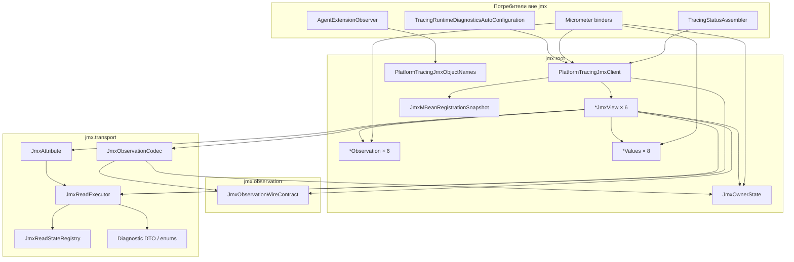

# Обсуждение: структура пакета `…autoconfigure.diagnostics.jmx`

**Статус:** обсуждение закрыто; решение исполнено.  
**Принятый вердикт:** гибрид «A minus views» + `wire/` (с `JmxOwnerState`) + `transport/` без изменений;  
`DiagnosticsObservation` остаётся в корне; `*Values` = **7** (не 8).

**ArchUnit-уточнение при исполнении:** полный `dependOnClassesThat(*JmxView)` неприменим —
цепочки `client.sampling().observation()` создают bytecode-зависимость на view через return type
accessor'а. Защищается декларативная поверхность: поля / параметры / return type `*JmxView`
вне корневого `…diagnostics.jmx` (`JmxPackageBoundaryArchTest`).  
**Снимок кода:** 2026-08-03, модуль `platform-tracing-spring-boot-autoconfigure`.  
**Корень:** `space.br1440.platform.tracing.autoconfigure.diagnostics.jmx`  
**Связанные документы:** [jmx-client-domain-split-implementation.md](./jmx-client-domain-split-implementation.md), allowlist `docs/architecture/platform-tracing-autoconfigure-public-type-allowlist.txt`.

---

## 1. Зачем этот документ

После domain-split в корне пакета `jmx` лежит «куча» публичных типов: фасад, шесть view, шесть observation DTO, owner-values, presence-модель, ObjectName-константы. Подпакеты `observation/` и `transport/` уже выделены, но **доменные decode-DTO и view остались flat в корне**.

Цель обсуждения: договориться, как разложить пакет по ownership / visibility / читаемости **без** изменения wire-контракта и без расширения публичного SPI.

Пре-production: ломающие package-переезды допустимы, если они улучшают границы и снижают accidental public surface. Совместимость с текущими FQCN не является целью по умолчанию.

---

## 2. Текущая карта пакетов (факт)

```text
…diagnostics.jmx/                          ← 23 файла (корень «в куче»)
├── PlatformTracingJmxClient               # фасад / единственный Spring bean
├── PlatformTracingJmxObjectNames          # ObjectName константы
├── JmxOwnerState                          # sealed Present|Absent
├── JmxMBeanRegistrationSnapshot           # tri-state × 6 доменов
├── *JmxView × 6                           # Sampling…Diagnostics
├── *Observation × 6                       # decode frame DTO
├── *Values × 8                            # owner payload DTO
│
├── observation/                           ← 1 файл
│   └── JmxObservationWireContract         # SCHEMA_VERSION=2, item names
│
└── transport/                             ← 18 файлов
    ├── JmxReadExecutor                    # единственный доступ к MBeanServerConnection
    ├── JmxReadStateRegistry               # package-private
    ├── JmxAttribute / JmxValueDecoder
    ├── JmxObservationCodec                # decode-примитивы (+ discriminator-first)
    ├── JmxContractViolationException      # package-private signal
    └── enums + diagnostic DTO             # Domain, Kind, Snapshot, …
```

**Итого production-типов:** 42 файла (`23 + 1 + 18`).

> Заметка: в implementation.md §2.1 `JmxObservationCodec` ещё указан под `observation/` — после cleanup-слайса он живёт в `transport/` (рядом с `JmxContractViolationException`).

---

## 3. Инвентарь классов

### 3.1 Корень `…diagnostics.jmx` (23)

| Тип | Kind | Visibility | Роль |
|-----|------|------------|------|
| `PlatformTracingJmxClient` | class | public final | Единственный Spring bean / фасад; владеет executor + 6 view |
| `PlatformTracingJmxObjectNames` | class | public final | Константы `ObjectName` шести MBean |
| `JmxOwnerState` | sealed interface | public | Decode-side presence: `Present<T>` / `Absent` + generation |
| `JmxMBeanRegistrationSnapshot` | record | public | Tri-state регистрации всех шести доменов |
| `SamplingJmxView` | class | public final | Доменная проекция; ctor package-private |
| `ScrubbingJmxView` | class | public final | то же |
| `ValidationJmxView` | class | public final | то же |
| `ExportJmxView` | class | public final | то же |
| `ProcessorMetricsJmxView` | class | public final | то же |
| `DiagnosticsJmxView` | class | public final | то же |
| `SamplingObservation` | record | public | Frame DTO Sampling |
| `ScrubbingObservation` | record | public | Frame DTO Scrubbing |
| `ValidationObservation` | record | public | Frame DTO Validation |
| `ExportObservation` | record | public | Frame DTO Export (2 owners) |
| `ProcessorMetricsObservation` | record | public | Frame DTO ProcessorMetrics (3 owners) |
| `DiagnosticsObservation` | record | public | Frame DTO Diagnostics (без owner presence) |
| `ScrubbingValues` | record | public | Owner payload Scrubbing |
| `ValidationValues` | record | public | Owner payload Validation |
| `ExportProcessorValues` | record | public | Owner payload Export.processor |
| `SafeExporterValues` | record | public | Owner payload Export.exporter |
| `ProcessorWatchdogValues` | record | public | Owner payload PM.watchdog |
| `ProcessorCompositeValues` | record | public | Owner payload PM.composite |
| `ProcessorMetricsValues` | record | public | Owner payload PM.metrics |

Все 23 FQCN — в public-type allowlist.

### 3.2 `…jmx.observation` (1)

| Тип | Kind | Visibility | Роль |
|-----|------|------------|------|
| `JmxObservationWireContract` | class + nested enums/records | public final | Нормативные имена item'ов / SCHEMA_VERSION; зеркало агентской копии (общий Java-тип запрещён) |

### 3.3 `…jmx.transport` (18)

| Тип | Kind | Visibility | Роль |
|-----|------|------------|------|
| `JmxReadExecutor` | class | public final | Единственный порт к `MBeanServerConnection`; private nested `JmxRead` 4-outcome |
| `JmxReadStateRegistry` | class | **package-private** | Per-point read state / diagnostics aggregation |
| `JmxAttribute` | record | public | Дескриптор атрибута (name + point + decoder) |
| `JmxValueDecoder` | `@FunctionalInterface` | public | `Object → T` decode callback |
| `JmxObservationCodec` | class | public final | Общие decode-примитивы + `ownerState(Supplier)` |
| `JmxContractViolationException` | class | **package-private** | Внутренний CV-сигнал codec → executor |
| `JmxDomain` | enum | public | 6 доменов |
| `JmxContractPoint` | enum | public | Точки контракта (observation / registration) |
| `JmxDiagnosticCategory` | enum | public | Категория диагностики |
| `JmxDiagnosticKind` | enum | public | Вид отказа (type mismatch, schema, …) |
| `JmxWireTypeCode` | enum | public | Ожидаемый/фактический wire-тип |
| `JmxLastReadOutcome` | enum | public | Исход последнего чтения |
| `JmxMBeanRegistrationState` | enum | public | REGISTERED / NOT_REGISTERED / CHECK_FAILED |
| `JmxDiagnosticKey` | record | public | Ключ diagnostics map |
| `JmxDiagnosticSnapshot` | record | public | Публикуемый снимок для `tracingStatus` |
| `JmxContractViolation` | record | public | Структурированное CV (для registry/status) |
| `JmxExecutionFailure` | record | public | Структурированный execution failure |
| `JmxPointReadState` | record | public | Per-point состояние чтения |

Package-private только 2 из 18. Остальные 16 — в allowlist.

### 3.4 Nested / скрытые типы (не отдельные файлы)

```text
JmxOwnerState
├── Present<T>(values, generation)
└── Absent<T>(generation)

JmxReadExecutor (private nested)
├── TransportCall
├── JmxRead<T>  sealed
│   ├── Present
│   ├── Absent
│   ├── ContractViolation
│   └── ExecutionFailure
└── TimedRead

JmxObservationWireContract (nested)
├── KeyCardinality
├── ValueSemantics
└── DynamicMapKey
```

Внутренний `JmxRead` **не** покидает executor — публичная проекция отказа: `Optional.empty()` + запись в registry.

---

## 4. Иерархия владения и поток данных

Это **не** OO-иерархия наследования. Граф — композиция + decode pipeline.



### 4.1 Жизненный цикл одного observation-read

```text
PlatformTracingJmxClient.sampling()
  → SamplingJmxView.observation()
    → JmxReadExecutor.read(ObjectName, JmxAttribute)
         1) transport getAttribute под per-domain lock
         2) decode вне lock: SamplingJmxView.decode
              → JmxObservationCodec.asComposite / requireSchemaVersion
              → frame fields (agentInstanceId, …)
              → JmxObservationCodec.ownerState(Supplier)  // discriminator-first
         3) Present → Optional.of(Observation)
            Absent/CV/Failure → Optional.empty() + registry
```

### 4.2 Модель presence по доменам

| Домен | Owners на wire | Decode DTO shape |
|-------|----------------|------------------|
| Sampling | 1 (`decisionCounts` / CompositeSampler) + always-present policy fields | `SamplingObservation(agentInstanceId, scalars…, JmxOwnerState<Map>)` |
| Scrubbing | 1 | `ScrubbingObservation(agentInstanceId, JmxOwnerState<ScrubbingValues>)` |
| Validation | 1 | `ValidationObservation(agentInstanceId, JmxOwnerState<ValidationValues>)` |
| Export | 2 (processor, exporter) | `ExportObservation(…, processor, exporter)` |
| ProcessorMetrics | 3 (watchdog, composite, metrics) | `ProcessorMetricsObservation(…, watchdog, composite, metrics)` |
| Diagnostics | 0 (static singletons) | `DiagnosticsObservation(agentInstanceId, maps/scalars)` — без `JmxOwnerState` |

---

## 5. Внешние потребители (call-site)

Потребители **вне** `diagnostics.jmx` (production):

| Потребитель | Что импортирует |
|-------------|-----------------|
| `…metrics.*MetricsBinder` / `MonotonicJmxCounterGroupBridge` | `PlatformTracingJmxClient`, `*Observation`, `*Values`, `JmxOwnerState`, иногда `JmxObservationWireContract` |
| `…status.TracingStatusAssembler` | Client + Observation/Values + `JmxDiagnosticSnapshot` |
| `…status.TracingStatusAutoConfiguration` | `PlatformTracingJmxClient` |
| `…diagnostics.TracingRuntimeDiagnosticsAutoConfiguration` | `PlatformTracingJmxClient` |
| `…agent.AgentExtensionObserver` | `PlatformTracingJmxObjectNames` |

Вне модуля autoconfigure production-импортов пакета почти нет; E2E (`DomainObservationCrossClassLoaderE2ETest`) и тесты — отдельные.

**Практический вывод для рефакторинга пакетов:** переезд FQCN затрагивает в основном autoconfigure (metrics/status) + allowlist + тесты. Это не «половина платформы», но и не нулевой blast radius.

---

## 6. Что именно выглядит как «куча»

### 6.1 Уже разделено хорошо

- `transport/` — executor, registry, diagnostic taxonomy, attribute descriptor.
- `observation/` — wire names (тонкий контрактный слой).
- Views не являются Spring beans; ctor package-private; вход только через фасад.
- Внутренний 4-outcome `JmxRead` скрыт внутри executor.

### 6.2 Проблемы корня (предмет обсуждения)

1. **23 публичных типа в одном пакете** — фасад, transport-agnostic DTO, view и ObjectName смешаны в одном namespace.
2. **Accidental public surface:** почти всё в allowlist; package-private только 2 типа во всём дереве `jmx.*`. Views и Values публичны, хотя конструируются только внутри модуля.
3. **Асимметрия domain-split:** на стороне агента уже есть `sampling|scrubbing|validation|export|metrics|diagnostics/` подпакеты; на стороне autoconfigure decode — flat root.
4. **Codec vs Wire:** wire в `observation/`, codec в `transport/` — осознанно (CV exception visibility), но имя `observation` для единственного WireContract может путать («где decode?»).
5. **Cross-package coupling корня к transport:** каждый `*JmxView` импортирует 5–6 типов из `transport` + WireContract. Корень зависит «вниз» — направление ок, но визуально root = kitchen sink.
6. **Нет единого места для «read model»:** Observation/Values/OwnerState — это decode read-model, но лежат рядом с фасадом и ObjectNames.

---

## 7. Варианты раскладки (для решения архитекторов)

Ниже — опции, не рекомендация. Можно комбинировать A+C или B+D.

### Вариант A — Domain subpackages (зеркало агента)

```text
jmx/
├── PlatformTracingJmxClient
├── PlatformTracingJmxObjectNames
├── JmxOwnerState
├── JmxMBeanRegistrationSnapshot
├── sampling/     SamplingJmxView, SamplingObservation
├── scrubbing/    ScrubbingJmxView, ScrubbingObservation, ScrubbingValues
├── validation/   …
├── export/       ExportJmxView, ExportObservation, ExportProcessorValues, SafeExporterValues
├── processor/    ProcessorMetrics* + Watchdog/Composite/Metrics Values
├── diagnostics/  DiagnosticsJmxView, DiagnosticsObservation
├── observation/  JmxObservationWireContract
└── transport/    (как сейчас)
```

**Плюсы:** читаемость «по домену»; симметрия с agent extension.  
**Минусы:** 6 пакетов × (view+DTO); фасад всё равно знает все домены; при package-private view потребуются nested/friend-паттерны или оставление view public.

### Вариант B — Layer subpackages (по роли, не по домену)

```text
jmx/
├── PlatformTracingJmxClient          # или jmx.client
├── facade/   PlatformTracingJmxClient, PlatformTracingJmxObjectNames, JmxMBeanRegistrationSnapshot
├── model/    JmxOwnerState, *Observation, *Values
├── view/     *JmxView × 6
├── wire/     JmxObservationWireContract   # rename observation → wire
└── transport/
```

**Плюсы:** корень пустеет; model отдельно от transport; ясный layering.  
**Минусы:** `view` ↔ `model` ↔ `transport` — три пакета вместо «доменного» локального cohesion; доменные типы снова рядом друг с другом внутри `model/`.

### Вариант C — Visibility-first (минимальный переезд пакетов)

Оставить структуру пакетов близкой к текущей, но:

- сделать `*JmxView`, `*Values`, часть transport enums **package-private** или relocать в package, недоступный снаружи модуля;
- публичными оставить: `PlatformTracingJmxClient`, `*Observation` (если нужны binders), `JmxOwnerState`, diagnostic snapshots, возможно ObjectNames;
- сузить allowlist.

**Плюсы:** максимальный выигрыш по accidental API при минимальном churn FQCN.  
**Минусы:** metrics binders живут в другом пакете (`…metrics`) — package-private view/values из `jmx` им **недоступны**, значит либо binders остаются в том же пакете (плохо), либо Observation/Values остаются public, либо вводится тонкий public read-model API.

> Ключевой архитектурный вопрос C: **какие типы реально должны быть видны за пределами `diagnostics.jmx`?** Сейчас binders читают Observation/Values напрямую — это и есть драйвер публичности DTO.

### Вариант D — Public façade + internal decode

```text
jmx/                          # только intentional public API
├── PlatformTracingJmxClient
├── *Observation / JmxOwnerState / JmxMBeanRegistrationSnapshot  # read-model
└── internal/
    ├── view/ *JmxView
    ├── values/ *Values          # если Values не нужны снаружи
    ├── wire/ JmxObservationWireContract
    └── transport/ …
```

В Java нет module-info «internal» без JPMS; на практике `…jmx.internal.*` + ArchUnit «не импортировать извне autoconfigure-пакетов кроме allowlist» / сужение allowlist.

**Плюсы:** явное «что можно трогать снаружи».  
**Минусы:** Values сейчас нужны binders (`ExportProcessorValues` и т.д.) — либо Values остаются public, либо binders ходят только через Observation accessors / map adapters.

### Вариант E — Не трогать пакеты сейчас

Зафиксировать текущую карту как baseline после cleanup-слайса; следующий рефакторинг — только visibility/allowlist или полный CaptureInterval frame DTO.

**Плюсы:** нулевой churn.  
**Минусы:** корень остаётся «кучей» из 23 типов.

---

## 8. Вопросы к архитекторам (решающие)

1. **Граница публичного API:** достаточно ли снаружи `PlatformTracingJmxClient` + `*Observation` + `JmxOwnerState` + diagnostic snapshots? Или binders/status должны продолжать видеть `*Values` и wire-константы напрямую?
2. **Ось нарезки:** domain (A, как у агента) vs layer (B) vs visibility-first (C/D)?
3. **Имя `observation`:** оставить для WireContract или переименовать в `wire` / `contract`, чтобы decode (`Codec`) не путали с «observation DTO»?
4. **Симметрия с агентом:** обязательна ли одинаковая taxonomy пакетов app↔agent, или достаточно одинаковых имён доменов в коде/доках?
5. **Allowlist policy:** цель — сократить public surface до минимального read-model, или оставить views/codecs public «для тестов/прозрачности»?
6. **Связка с backlog:** полный frame DTO (`CaptureInterval`, offsets) — делать до или после package-split, чтобы не двигать типы дважды?

---

## 9. Ограничения, которые рефакторинг не должен ломать

- Wire: `SCHEMA_VERSION = 2`, presence-дискриминатор, independent wire-contract copies (agent ≠ app Java type).
- Единственный Spring bean: `PlatformTracingJmxClient`.
- Единственный transport port: `JmxReadExecutor` / `MBeanServerConnection`.
- Discriminator-first decode (`ownerState(Supplier)`).
- Публичная проекция отказа: `Optional.empty()`, не leak `JmxRead` / `JmxContractViolationException`.
- Remote JMX не публикуется как продуктовая возможность.
- Metrics single-capture / monotonic bridge остаются в `…autoconfigure.metrics` (не смешивать с decode-пакетами без отдельного решения).

---

## 10. Приложение: полный список FQCN (allowlist-срез `diagnostics.jmx`)

```text
…jmx.DiagnosticsJmxView
…jmx.DiagnosticsObservation
…jmx.ExportJmxView
…jmx.ExportObservation
…jmx.ExportProcessorValues
…jmx.JmxMBeanRegistrationSnapshot
…jmx.JmxOwnerState
…jmx.PlatformTracingJmxClient
…jmx.PlatformTracingJmxObjectNames
…jmx.ProcessorCompositeValues
…jmx.ProcessorMetricsJmxView
…jmx.ProcessorMetricsObservation
…jmx.ProcessorMetricsValues
…jmx.ProcessorWatchdogValues
…jmx.SafeExporterValues
…jmx.SamplingJmxView
…jmx.SamplingObservation
…jmx.ScrubbingJmxView
…jmx.ScrubbingObservation
…jmx.ScrubbingValues
…jmx.ValidationJmxView
…jmx.ValidationObservation
…jmx.ValidationValues
…jmx.observation.JmxObservationWireContract
…jmx.transport.JmxAttribute
…jmx.transport.JmxContractPoint
…jmx.transport.JmxContractViolation
…jmx.transport.JmxDiagnosticCategory
…jmx.transport.JmxDiagnosticKey
…jmx.transport.JmxDiagnosticKind
…jmx.transport.JmxDiagnosticSnapshot
…jmx.transport.JmxDomain
…jmx.transport.JmxExecutionFailure
…jmx.transport.JmxLastReadOutcome
…jmx.transport.JmxMBeanRegistrationState
…jmx.transport.JmxObservationCodec
…jmx.transport.JmxPointReadState
…jmx.transport.JmxReadExecutor
…jmx.transport.JmxValueDecoder
…jmx.transport.JmxWireTypeCode
```

Не в allowlist (package-private): `JmxContractViolationException`, `JmxReadStateRegistry`.

---

## 11. Краткая сводка для встречи

| Факт | Число |
|------|------:|
| Production-файлов в `jmx*` | 42 |
| В корне «кучей» | 23 |
| Уже в `transport/` | 18 |
| Уже в `observation/` | 1 |
| Package-private во всём дереве | 2 |
| Public / allowlisted | 40 |
| Доменных view | 6 |
| Observation DTO | 6 |
| Owner Values DTO | 8 |

**Суть проблемы:** domain-split поведения уже есть; domain-split *пакетов* на стороне autoconfigure — нет. Корень смешивает façade, read-model и view. Transport/wire частично выделены.

**Следующий шаг после обсуждения:** выбрать вариант A/B/C/D/E (или гибрид), зафиксировать целевой public surface и только затем писать execution-plan с миграцией allowlist/тестов.
