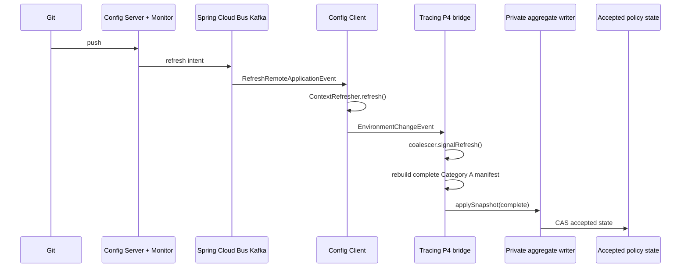

# Корректность Hot Reloading настроек трейсинга относительно платформенного Config Server

| Field | Value |
| --- | --- |
| Дата | 2026-07-28 |
| Репозиторий трейсинга | `E:\Platform_Traces` |
| Источники Config Server | `E:\Platform_Config_Server\Doc\config-server.md`, `example\app-config-server-master`, UML |
| Нормативный план | `C:\Users\andrew\.cursor\plans\immutable_config_namespace_split_ba8da442.plan.md` (§12, P4–P6, E6) |
| E6 evidence | `docs/research/boot-cloud-bom-refresh-s06.md`, `docs/research/evidence/boot-cloud-bom-refresh/refresh-delivery-decision.json` |
| Production Java изменён этим review | **NO** |

---

## 1. Executive verdict

**Вердикт: `HOT_RELOAD_TARGET_CORRECT / LIVE_PATH_NON_COMPLIANT / P4_SKELETON_PARTIAL`**

| Слой | Статус | Кратко |
| --- | --- | --- |
| Целевой дизайн плана (P4 + E6 §12) | **CORREСT** относительно Spring Cloud Config Bus и инвариантов Category A | Полный snapshot, `EnvironmentChangeEvent` как сигнал, coalescing, LKG, private writer |
| Live hot reload в кодовой базе сейчас | **INCORRECT / LEGACY** | Единственный wired path — `TracingRefreshScopeAutoConfiguration` → `RuntimeConfigApplier` (patch по доменам, ungated) |
| P4 building blocks в коде | **PARTIAL** | Provenance / manifest / coalescer / bridge / authority guard есть и покрыты unit-тестами, но **не зарегистрированы** в auto-configuration и не доставляют policy в private writer |
| Платформенный пример Config Server vs план трейсинга | **ALIGNMENT GAP** | Пример публикует custom protobuf `ConfigRefreshEvent` в Kafka; план/E6 требуют Spring Cloud Config Monitor + Spring Cloud Bus |

Итог для внедрения: план hot reload настроек трейсинга **архитектурно корректен** и согласован с UML Bus Refresh и закрытым gate E6. **Текущая production-capable реализация hot reload в трейсинге этому плану не соответствует.** Часть P4 уже написана как package-private skeleton, но end-to-end path ещё не замкнут.

---

## 2. Scope и метод

Проанализированы:

1. Документация платформенного Config Server.
2. Пример `app-config-server-master` (фактически сервер, не клиентский микросервис).
3. UML startup и Bus Refresh.
4. Нормативный план immutable config / Category A.
5. E6 refresh-delivery decision.
6. Фактический код `platform-tracing-spring-boot-autoconfigure` (legacy RefreshScope + новый package `configuration`).

Разделение фактов и интерпретаций помечено явно.

---

## 3. Платформенный Config Server: что есть на самом деле

### 3.1 Документация (`Doc/config-server.md`)

**FACT.** Документ описывает:

- централизованный Git-backed Config Server;
- клиентские зависимости `spring-cloud-starter-config` + `spring-cloud-starter-bootstrap`;
- клиентский `bootstrap.yml` с `spring.cloud.config.*`;
- hot-reload как «второй этап»;
- обновление через `/actuator/refresh`.

**FACT.** Документ **не** описывает:

- Spring Cloud Bus / Kafka binder;
- Config Server `/monitor`;
- custom protobuf hot-reload event;
- `spring.config.import=configserver:` (Config Data API).

### 3.2 Пример `example/app-config-server-master`

**FACT.** Это реализация **Config Server**, а не пример внедрения в бизнес-микросервис.

Состав:

| Компонент | Назначение |
| --- | --- |
| `@EnableConfigServer` | Git-backed serving конфигурации |
| `WebSecurityConfig` | Basic auth; `/actuator/**` и `/webhook/**` permitAll |
| `GitlabWebhookController` `/webhook/gitlab` | Принимает GitLab push, проверяет `X-Gitlab-Token` |
| `GitlabWebhookService` | Парсит `commits[*].modified[*]`, строит protobuf, шлёт в Kafka |
| `config-server-hotreload-event.proto` | `ConfigRefreshEvent{service_name, timestamp, changed_files, event_type}` |
| `KafkaConfig` | Producer `KafkaTemplate<String, byte[]>` с SASL SCRAM |

**FACT.** В `build.gradle` примера **нет**:

- `spring-cloud-bus`
- `spring-cloud-config-monitor`
- `spring-cloud-stream` / Kafka binder Bus

**FACT.** В репозитории `Platform_Config_Server` **нет** клиентского consumer'а `ConfigRefreshEvent` (нет кода микросервиса, который читает топик и вызывает refresh).

**INTERPRETATION.** Hot-reload «второго этапа» в примере — это **кастомный control-plane сигнал** (GitLab webhook → Kafka protobuf), а не стандартный Spring Cloud Bus fan-out.

### 3.3 UML

#### Startup sequence

```text
Pod(Config Client) → Service(config-server) → Config Server Pod → Git
→ Aggregated Config → ApplicationContext init
```

**FACT.** Совпадает с docs и стандартным Spring Cloud Config Client bootstrap/import.

#### Bus Refresh

```text
Dev → Git push
Dev → ConfigServer POST /actuator/refresh | /actuator/busrefresh
ConfigServer → Git check
ConfigServer → Bus: RefreshRemoteApplicationEvent
Bus → Client pods
Clients update @RefreshScope beans
```

**FACT.** UML описывает **классический Spring Cloud Bus**, а не protobuf `ConfigRefreshEvent` из примера.

### 3.4 Три несовместимых модели fan-out

| Модель | Источник | Сигнал | Клиентское действие | Совместимость с планом трейсинга |
| --- | --- | --- | --- | --- |
| A. Docs + `/actuator/refresh` | `config-server.md` | HTTP refresh на инстанс | `@RefreshScope` / ContextRefresher | **REJECTED** E6 (`HTTP_ACTUATOR_REFRESH`) |
| B. UML Spring Cloud Bus | `.puml` Bus Refresh | `RefreshRemoteApplicationEvent` | ContextRefresher → Environment change / `@RefreshScope` | **SELECTED** E6 |
| C. Пример Config Server | `app-config-server-master` | Custom protobuf `ConfigRefreshEvent` в Kafka | **Не определён в репозитории** | **Не эквивалентен** Bus без отдельного клиента |

**BINDING для трейсинга (E6):** выбран механизм B:

```text
Config Server Monitor/webhook
  → Spring Cloud Bus (Kafka binder)
  → Config Client ContextRefresher.refresh()
  → EnvironmentChangeEvent
  → tracing bridge (complete snapshot only)
```

Трассировочный bridge **не** должен вызывать refresh и **не** должен потреблять protobuf Config Server напрямую.

---

## 4. Целевой hot reload трейсинга по плану

### 4.1 Норматив §12 (Config Server lifecycle)

Обязательные свойства:

- `spring.config.import=configserver:` (не legacy bootstrap);
- modern `configClient` marker;
- complete manifest всех **восьми** Category A leaves;
- per-key provenance; fail-closed на local/system/env override `policy.*`;
- `EnvironmentChangeEvent` — только observation trigger (keys ≠ patch);
- generation/dirty coalescer + один worker;
- complete snapshot rebuild, **never** patch apply;
- один bounded rebuild/retry после `STALE`;
- запрет polling и HELM fallback;
- runtime outage → LKG retained; missing Category A key → `REJECTED`.

### 4.2 Целевая последовательность



### 4.3 Оценка корректности целевого дизайна

Относительно платформенного Config Server и UML:

| Критерий | Оценка | Обоснование |
| --- | --- | --- |
| Независимость от payload refresh keys | **CORRECT** | Ключи `EnvironmentChangeEvent` — triggers only |
| Совместимость с Bus fan-out | **CORRECT** | E6 явно выбрал Bus; UML совпадает |
| Изоляция tracing library от Bus ownership | **CORRECT** | Fan-out владеет Config Server + ops; bridge только слушает local event |
| Complete snapshot / no patch | **CORRECT** | Соответствует accepted-state / Category A |
| Coalescing refresh storms | **CORRECT** | Требуется at-least-once Bus |
| Отказ от HTTP mutation на app | **CORRECT** | E6 rejected `/actuator/refresh` |
| Отказ от polling | **CORRECT** | Совпадает с запретом плана |
| Привязка к custom protobuf примера | **NOT REQUIRED / MUST NOT** | Bridge абстрагирован на `EnvironmentChangeEvent`; custom event без ContextRefresher не активирует path |

**Вердикт по плану:** целевая модель hot reload **корректна** для enterprise Config Server + Bus и для safety-инвариантов трейсинга. Она **намеренно строже**, чем наивный `@RefreshScope` из UML note и docs.

---

## 5. Что реализовано в кодовой базе трейсинга сейчас

### 5.1 Live production-capable path (wired)

**FACT.** В `AutoConfiguration.imports` зарегистрирован:

```text
TracingRefreshScopeAutoConfiguration
```

Поведение:

```text
RefreshScopeRefreshedEvent
  → RuntimeConfigApplier.applyAll(TracingProperties)
  → per-domain JMX updates (sampling, scrubbing, validation, export, propagation, log-level)
```

**FACT.** `RuntimeConfigApplier`:

- делает **последовательные** domain writes;
- допускает **PARTIAL** apply;
- включает **scrubbing** (Category B), не только Category A;
- не классифицирует Config Server provenance;
- не строит complete Category A snapshot;
- не имеет STALE/LKG semantics на уровне Spring adapter;
- активируется при наличии `RefreshScope` на classpath без authority posture guard.

Это **единственный** wired hot-reload mutation path сегодня.

### 5.2 P4 skeleton (present, not wired)

**FACT.** В `.../autoconfigure/configuration/` существуют package-private типы:

| Тип | Роль по плану | Статус |
| --- | --- | --- |
| `TracingConfigurationAuthorityGuard` | mode/authority posture | код + unit tests |
| `ConfigServerProvenanceClassifier` | per-key provenance | код + unit tests |
| `CompleteTracingPolicyManifestBuilder` | complete 8-leaf manifest | код + unit tests |
| `ConfigServerPolicyBridge` | initial/refresh deliver + one STALE retry | код + unit tests |
| `RefreshGenerationCoalescer` | generation/dirty single-worker | код + unit tests |
| `ConfigServerRefreshEventBridge` | `EnvironmentChangeEvent` → signal only | код |
| `DesiredTracingPolicy` / delivery outcomes | typed desired policy | код |

**FACT.** Эти типы:

- **отсутствуют** в `AutoConfiguration.imports`;
- **не имеют** production `TracingPolicyDelivery` к private aggregate writer;
- создаются в тестах через `new ...`, не как Spring beans;
- в plan todos P4 всё ещё `pending` (при том что skeleton уже в дереве исходников).

### 5.3 Foundation, уже закрытая планом

**FACT (план + research evidence):**

- P1 accepted-state foundation — complete;
- P2 private control boundary — complete (writer registration spike/test posture);
- P3 readers → accepted policy snapshot — complete;
- E6 refresh delivery contract — closed;
- E9 Config Server provenance characterization — closed.

Supported production writer **ещё не переключён** (P6 cutover).

---

## 6. Матрица корректности: план / код / Config Server

| Инвариант | План | Live RefreshScope path | P4 skeleton | Config Server пример |
| --- | --- | --- | --- | --- |
| Fan-out через Bus / Monitor | Required (E6) | Не владеет (может сработать косвенно, если клиент Bus обновляет Environment) | Ожидает `EnvironmentChangeEvent` | Custom protobuf, **не Bus** |
| Trigger = observation only | Required | Слушает `RefreshScopeRefreshedEvent`, применяет bound POJO | `EnvironmentChangeEvent` → coalescer only | Публикует file/service names как payload |
| Complete Category A snapshot | Required | **No** (domain patch) | **Yes** (builder) | N/A (server-side) |
| Never patch apply | Required | **Violates** | Designed correct | N/A |
| Provenance / no local override | Required | **No** | **Yes** | N/A |
| Reject legacy bootstrap | Required | Soft / RefreshScope era | Fail-fast message | Docs всё ещё учат bootstrap |
| Coalescer | Required | **No** | **Yes** | N/A |
| One STALE retry | Required | **No** | **Yes** (refresh only) | N/A |
| LKG on runtime reject/outage | Required | Partial domain failure possible | Depends on delivery→writer (not wired) | N/A |
| No app HTTP mutation as primary | Required | Docs/пример всё ещё продвигают `/actuator/refresh` | Compliant by design | Webhook на Config Server; `/actuator/**` open |
| Private aggregate writer | Required | Uses legacy domain JMX client | Interface only | N/A |
| Dual writer forbidden in supported posture | Required | Legacy still live | Must stay C-05 unreachable until P6 | N/A |

---

## 7. Критические gaps

### G-01 — Live hot reload не соответствует плану

**Severity: P0 (architecture / safety)**

Текущий wired path нарушает:

- complete-snapshot rule;
- Category A allowlist (тянет scrubbing);
- no-partial-apply;
- provenance authority;
- ungated mutation debt, явно помеченную планом к удалению в P6.

Пока `TracingRefreshScopeAutoConfiguration` активен, **нельзя** утверждать, что hot reload трейсинга реализован корректно.

### G-02 — P4 не замкнут end-to-end

**Severity: P0 (implementation incomplete)**

Даже при корректных unit-тестах bridge/coalescer/provenance отсутствует:

- auto-configuration wiring;
- production `TracingPolicyDelivery` → private writer;
- application configuration readiness gate;
- C-05 unreachable activation до P6;
- удаление одной линии dual-writer риска (legacy остаётся).

### G-03 — Расхождение платформенного примера Config Server и E6/плана

**Severity: P1 (platform control-plane alignment)**

| Вопрос | Пример Config Server | Требование трейсинга (E6) |
| --- | --- | --- |
| Транспорт refresh intent | Custom protobuf topic | Spring Cloud Bus Kafka binder |
| Событие | `ConfigRefreshEvent` | `RefreshRemoteApplicationEvent` / Bus refresh |
| Клиентский эффект | Не показан | `ContextRefresher.refresh()` → `EnvironmentChangeEvent` |
| Зависимости server | webhook + spring-kafka producer | `config-monitor` + bus + stream binder |

Если платформа оставит только custom protobuf без Bus/ContextRefresher, P4 bridge **не активируется** сам по себе.

**Минимальный совместимый контракт для трейсинга:** любой control-plane (включая custom webhook) обязан в итоге вызвать на каждом instance стандартный Config Client refresh, который обновляет Environment и публикует `EnvironmentChangeEvent`. Потребление protobuf внутри tracing library **запрещено** планом/E6.

### G-04 — Docs Config Server устарели относительно целевого клиента

**Severity: P2 (adoption)**

Docs/README примера рекомендуют:

- `spring-cloud-starter-bootstrap`;
- `bootstrap.yml`;
- `/actuator/refresh`.

План трейсинга требует:

- `spring.config.import=configserver:`;
- fail-fast на legacy bootstrap marker;
- Bus fan-out, не app-facing refresh как primary.

### G-05 — Security debt в примере Config Server (вне scope трейсинга, но влияет на trust boundary)

**Severity: P1 для control-plane; наблюдение**

- `/webhook/**` permitAll (защита только header token);
- логирование полного webhook JSON;
- логирование JAAS template с password в `KafkaConfig`.

Это не ломает дизайн tracing bridge, но ослабляет доверие к refresh control-plane.

---

## 8. Ответ на основной вопрос

> Корректна ли реализация Hot reloading настроек трейсинга по плану / в текущей кодовой базе?

### Короткий ответ

1. **План (будущая реализация P4+P6) — корректный** относительно платформенного Config Server *в модели Spring Cloud Bus* (UML + E6), и существенно лучше наивного `@RefreshScope` из docs.
2. **Текущая wired реализация — некорректна** относительно того же плана и относительно safety-модели Category A / accepted-state.
3. **P4 skeleton в дереве исходников — directionally correct, но incomplete**: алгоритмические куски есть, production path не собран.
4. **Платформенный пример `app-config-server-master` нельзя считать эталоном клиентского hot reload для трейсинга**: это server-side custom Kafka event publisher без Bus и без клиентского consumer'а.

### Рекомендуемый критерий «готово»

Hot reload трейсинга можно считать корректным только когда одновременно верно:

1. Live mutation идёт только через complete Category A snapshot → private writer → accepted state.
2. Trigger — `EnvironmentChangeEvent` (после Config Client refresh), keys не используются как patch.
3. Provenance fail-closed; missing key → `REJECTED` + LKG.
4. Coalescer + один STALE retry работают под refresh storm.
5. `TracingRefreshScopeAutoConfiguration` / `RuntimeConfigApplier` удалены из supported posture (P6).
6. Platform Config Server fan-out гарантированно приводит к Config Client refresh на каждом pod (Bus/Monitor или эквивалент с тем же локальным эффектом).

На дату review пункты 1–5 для **supported runtime** не выполнены; пункт 6 на стороне примера Config Server **не доказан** в модели E6.

---

## 9. Evidence index

| Артефакт | Path |
| --- | --- |
| Config Server docs | `E:\Platform_Config_Server\Doc\config-server.md` |
| Config Server example | `E:\Platform_Config_Server\example\app-config-server-master` |
| UML Bus Refresh | `E:\Platform_Config_Server\UML\Spring Cloud Config Bus Refresh.puml` |
| UML startup | `E:\Platform_Config_Server\UML\Spring Cloud Config Server startup sequence.puml` |
| Plan | `C:\Users\andrew\.cursor\plans\immutable_config_namespace_split_ba8da442.plan.md` |
| E6 report | `docs/research/boot-cloud-bom-refresh-s06.md` |
| E6 decision JSON | `docs/research/evidence/boot-cloud-bom-refresh/refresh-delivery-decision.json` |
| Legacy live path | `platform-tracing-spring-boot-autoconfigure/.../TracingRefreshScopeAutoConfiguration.java` |
| Legacy applier | `.../RuntimeConfigApplier.java` |
| P4 skeleton package | `.../autoconfigure/configuration/*.java` |
| Auto-config registry | `.../META-INF/spring/org.springframework.boot.autoconfigure.AutoConfiguration.imports` |

---

## 10. Residual risks / assumptions

| ID | Тип | Текст |
| --- | --- | --- |
| A-01 | Assumption | В корпоративном runtime всё же будет развёрнут Spring Cloud Bus/Monitor, а не только custom protobuf из example |
| A-02 | Assumption | Клиентские микросервисы в CONFIG_SERVER mode получат `spring-cloud-starter-bus-kafka` (E6 ownership) |
| R-01 | Risk | Если platform оставит только custom `ConfigRefreshEvent`, tracing P4 останется inert без отдельного adapter вне tracing library |
| R-02 | Risk | Dual-writer window: появление wired P4 bridge до удаления RefreshScope path нарушит C-05, если оба активны в supported posture |
| R-03 | Risk | Docs Config Server продолжают учить bootstrap + `/actuator/refresh`, что конфликтует с adoption path трейсинга |

Verification status этого review: **PASS** как documentary/architecture analysis; runtime E2E hot-reload path **INSUFFICIENT_EVIDENCE** (не исполнялся в рамках этой работы).
)
