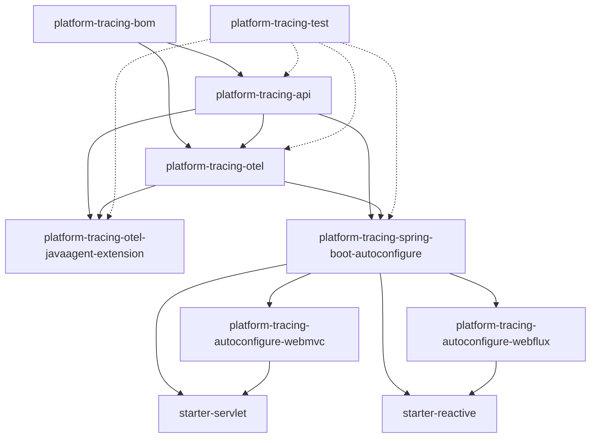
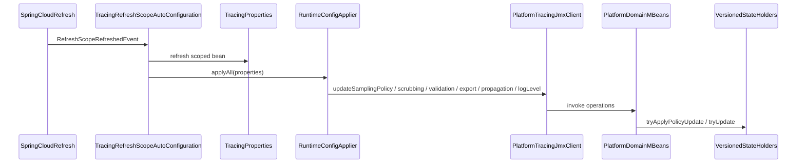
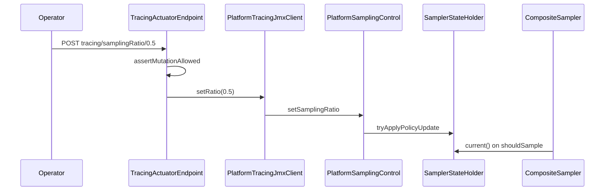
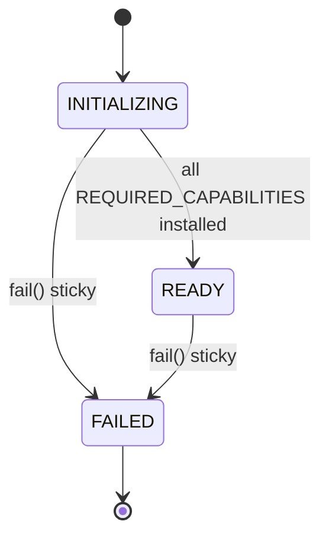

# Hybrid Tracing Configuration — Repository-Grounded Context Dossier

| Field | Value |
|-------|-------|
| Purpose | Evidence-backed context for external LLM review of hybrid tracing configuration plan |
| Date | 2026-07-26 |
| Repository | `E:/Platform_Traces` |
| Production code modified | **No** |
| Authoritative plan | `.cursor/plans/immutable_config_namespace_split_ba8da442.plan.md` |
| Provenance spike | `docs/research/config-server-property-provenance-spike.md` (Step 0B PASS) |
| Prior property inventory | `docs/research/tracing-properties-codebase-investigation.md` (64 keys, 2026-07-24) |

**Legend:** **FACT** = confirmed in source/tests; **INFERRED** = reasonable from call sites; **PLAN** = target design not in code; **UNKNOWN** = not resolved in repo.

---

## Search methodology (representative)

```powershell
# Property prefixes
rg "platform\.tracing\." --glob "*.{java,yml,yaml,md,properties,env}"
rg "@ConfigurationProperties|ExtensionPropertyNames|TracingProperties" -g "*.java"

# Mutation / JMX
rg "@WriteOperation|RuntimeConfigApplier|VersionedStateHolder|PlatformControlProtocol" -g "*.java"
rg "ObjectName|PlatformTracingObjectNames|registerMBean" -g "*.java"

# Spring Cloud / refresh
rg "RefreshScope|EnvironmentChangeEvent|spring-cloud" -g "*.{java,gradle}"

# Architecture fitness
rg "ArchTest|ArchitectureFitness" -g "*.java"
```

---

## 1. Executive repository facts

| Topic | Confirmed repository fact | Evidence | Confidence |
|-------|---------------------------|----------|------------|
| Java version | Toolchain **21** (compile + runtime corporate standard) | `build.gradle` subprojects toolchain; `docs/SUPPORTED.md:40-41` | **FACT** |
| Spring Boot | **3.5.5** in `gradle.properties`; SUPPORTED validates 3.5.5 | `gradle.properties:9`; `docs/SUPPORTED.md:42` | **FACT** |
| Spring Cloud (production) | **`spring-cloud-context:4.1.5`** BOM constraint only; **no Config Client** on production classpath | `gradle.properties:13`; `platform-tracing-bom/build.gradle:29`; `platform-tracing-spring-boot-autoconfigure/build.gradle:50` compileOnly | **FACT** |
| Spring Cloud (Step 0B tests) | Isolated `configProvenance` source set: BOM **2025.0.0**, Boot **3.5.6**, Client/Context **4.3.0** | `config-server-property-provenance-spike.md` §10; `platform-tracing-e2e-tests/build.gradle` | **FACT** |
| OpenTelemetry SDK BOM | **1.62.0** | `gradle.properties:10` | **FACT** |
| OTel Instrumentation / Agent | **2.28.1** agent, **2.28.1-alpha** extension API | `gradle.properties:11-12`; `docs/SUPPORTED.md:45-48` | **FACT** |
| Product version | **0.1.0-SNAPSHOT**, pre-production | `gradle.properties:8`; `docs/SUPPORTED.md:3-4,31-32` | **FACT** |
| Gradle modules | **16** active modules (+ optional composite starters) | `settings.gradle` | **FACT** |
| Production deployment path | **Agent-first** Spring Boot 3.5.x + Controlled Platform Agent 2.28.x + servlet/reactive starter | `docs/SUPPORTED.md:16-26,58-64` | **FACT** |
| SDK-only production | **Not supported** v0.1.0 | `docs/SUPPORTED.md:62-63` | **FACT** |
| Configuration mutation | **Present**: JMX domain setters, RefreshScope applier, gated Actuator POST, unified control protocol (partial applier), perf-only HTTP admin | See §6 | **FACT** |
| Config Server integration (production) | **Absent** — no bridge, guard, or `spring-cloud-starter-config` in production modules | Grep build.gradle; no `TracingConfigServerBridge` class | **FACT** |
| Plan authority modes (`HELM` / `CONFIG_SERVER` / `DEV_ACTUATOR`) | **Not in code** — only `platform.tracing.mode=AGENT\|DISABLED` | `TracingProperties.java:34`; `SdkMode.java` | **FACT** (absence) |
| Plan namespace `platform.tracing.policy.*` | **Test/doc only** except attribute `platform.tracing.policy.version` on resource | E2E `configProvenance` tests; `ExtensionPropertyNames.RESOURCE_POLICY_VERSION_ATTR:43` | **FACT** |
| Step 0 overall | **PASS/COMPLETED** (plan + spike §10); **General implementation NOT GO** | Plan frontmatter; spike §10 | **FACT** (plan status) |

---

## 2. Module and dependency topology

### 2.1 Module list (actual names)

From `settings.gradle`: `platform-tracing-bom`, `platform-tracing-api`, `platform-tracing-otel`, `platform-tracing-spring-boot-autoconfigure`, `platform-tracing-autoconfigure-webmvc`, `platform-tracing-autoconfigure-webflux`, `platform-tracing-spring-boot-starter-servlet`, `platform-tracing-spring-boot-starter-reactive`, `platform-tracing-otel-javaagent-extension`, `platform-tracing-collector-config`, `platform-tracing-test`, `platform-tracing-samples`, `platform-tracing-bench`, `platform-tracing-e2e-tests`, `platform-tracing-perf-tests`, `platform-tracing-perf-harness`.

`platform-tracing-semconv-lint` commented out. No `buildSrc/`.

### 2.2 Responsibility summary

| Module | Main responsibility |
|--------|---------------------|
| `platform-tracing-api` | Public contracts: propagation headers, control protocol wire types, SPI |
| `platform-tracing-otel` | OTel facade/runtime, versioned state primitive, control protocol handler/validator |
| `platform-tracing-otel-javaagent-extension` | Agent extension: sampler, processors, JMX MBeans, readiness, export path |
| `platform-tracing-spring-boot-autoconfigure` | Spring binding, JMX client, Actuator, RefreshScope reconcile, mode detection |
| `platform-tracing-autoconfigure-webmvc/webflux` | Servlet/WebFlux adapters (propagation, suppression, filters) |
| Starters | Thin aggregators (web + platform autoconfigure) |
| `platform-tracing-test` | ArchUnit fitness rules, shared test utilities |
| `platform-tracing-e2e-tests` | Docker/process E2E, config provenance characterization (isolated source set) |
| `platform-tracing-perf-tests/harness` | Macro perf SUT, `PerfAdminController`, k6 scenarios |
| `platform-tracing-bench` | JMH hot-path benchmarks |
| `platform-tracing-bom` | Version alignment BOM |

### 2.3 Dependency graph (Mermaid)



**Starter smoke rule:** starters must **not** transitively depend on `platform-tracing-otel-javaagent-extension` (`build.gradle` `pr0StarterDependencySmoke`).

### 2.4 Module boundary rules (architecture fitness)

| Rule source | Enforces |
|-------------|----------|
| `platform-tracing-test/.../ArchitectureFitnessArchRules.java` | API protocol JDK-only; no OpenMBean in protocol; unified `TracingControlProtocol*` naming |
| `platform-tracing-test/.../ModuleTaxonomyArchRules.java` | API purity, web stack isolation, versioned state placement, propagation ownership |
| `AutoconfigureNoOtelExtensionMainDepArchTest` | Autoconfigure must not **implement** depend on javaagent-extension |
| `CoreRuntimeVersionedArchTest` / `VersionedStateBoundaryArchTest` | Versioned state package boundaries |
| Root `pr1ModuleTaxonomyVerify`, `pr4ArchitectureFitnessVerify` | Aggregated CI gates |

**Ambiguity:** Autoconfigure **test** classpath includes javaagent-extension; production compile does not (`compileOnly` spring-cloud-context only).

---

## 3. Deployment topology matrix

| Topology | Bootstrap owner | SDK owner | Runtime state owner | Config readers | JMX | Actuator | Evidence | Gaps |
|----------|-----------------|-----------|---------------------|----------------|-----|----------|----------|------|
| **Spring + Java Agent** (supported prod) | Agent premain + Spring context | Agent `GlobalOpenTelemetry` | Agent extension holders + gates | Agent `ExtensionConfig` + Spring `TracingProperties` + JMX reconcile | 8 MBeans registered from extension CL | `GET/POST /actuator/tracing` (POST gated) | `TracingCoreAutoConfiguration.java:132-153`; `docs/SUPPORTED.md:16-26` | Dual-channel for export/propagation/log-level until JMX push |
| **Spring without Agent, mode=AGENT** | Spring only | N/A — startup **fails** | N/A | Spring properties only until fail | Unavailable / not READY | Partial | `TracingCoreAutoConfiguration.java:136-139` | Not a supported runtime |
| **Spring mode=DISABLED** | Spring | NoOp facade | No runtime policy | Spring properties | Observer may see no READY agent | Read-only actuator likely | `TracingCoreAutoConfiguration.java:132-134`; `NoopTraceOperations` | Facade disabled; agent may still run if attached externally |
| **Direct SDK / user OTel bean** | — | — | — | — | — | — | **Rejected at startup**: competing `OpenTelemetry` bean | `TracingCoreAutoConfiguration.java:64-76` | By design fail-fast |
| **Agent-only (no Spring)** | Agent extension | Agent SDK | Agent holders | `-D` / env / OTel autoconfigure | All domain MBeans | No Spring Actuator | Agent SPI entry `PlatformAutoConfigurationCustomizer` | No Config Server bridge |
| **Disabled facade + active Agent** | Both | Agent | Agent | Both planes | Yes | Spring tracing POST gated separately | Dual plane independent | Drift possible between planes |
| **Local SDK test fixtures** | Test source sets | Test OTel SDK | Test-only | Test properties | Optional wire fixtures | Test | `platform-tracing-e2e-tests` custom source sets | Not production |

**Feature parity:** **Not assumed.** Spring `TracingProperties` covers 36 leaf fields; agent adds 28+ keys (`tracing-properties-codebase-investigation.md`).

---

## 4. Complete configuration property inventory

**Machine-audited baseline:** 64 keys documented in [`tracing-properties-codebase-investigation.md`](tracing-properties-codebase-investigation.md) (36 `TracingProperties` + 28 agent/control-plane).

**Canonical binder:** `TracingProperties` — `platform-tracing-spring-boot-autoconfigure/.../TracingProperties.java:25-229`.

**Agent constants:** `ExtensionPropertyNames.java:6-67`, `PropagationDefaults.java`, `PlatformResourceProvider` service keys.

**No** committed `META-INF/spring-configuration-metadata.json` (**FACT**, investigation §1 item 8).

### 4.1 Summary by category

| Category | Keys (representative) | Plane | Runtime mutable today? | Notes |
|----------|----------------------|-------|------------------------|-------|
| **Authority / mode** | `platform.tracing.mode` | Spring | No (startup) | **PLAN** keys `configuration.authority`, `dev-control.*` **not bound** |
| **Sampling** | `sampling.enabled/ratio/route-ratios/force-record-header-values/drop-paths` + agent header aliases | Both | Yes (JMX) for Spring-bound subset | Agent reads at bootstrap; Spring reconciles via `RuntimeConfigApplier` |
| **Scrubbing** | `scrubbing.enabled/built-in-rules` (Spring); secrets/rules-config/extensions (agent) | Both | Partial — only enabled + builtInRules via JMX | `rules-config` startup-only (**FACT**, §14) |
| **Validation** | `validation.enabled/strict` (Spring); `validation.mode`, `platform.environment` (agent) | Both | Partial — enabled/strict via JMX | Agent `validation.mode` primary at bootstrap |
| **Exporter** | `exporter.enabled` (Spring); OTel `otel.exporter.*` (read via actuator snapshot) | Both | Yes (`setExportEnabled`) | Spring OTLP group **removed** (`CHANGELOG.md:15-18`) |
| **Propagation** | `propagation.enabled` mutable; headers/outbound/baggage mostly startup | Both | **Only** `propagation.enabled` via JMX | `PlatformHeaders` constants fixed in API |
| **Trace-control headers** | `propagation.platform-headers.*` defaults → `PlatformHeaders.X_*` | Spring bind | No | `PlatformHeaders.java:19-37` |
| **Resource / service identity** | `platform.tracing.service.*` via env bridge; `resource.*` agent keys | Agent | No | `ResourceEffectiveSnapshot.java` |
| **Queue / BSP** | `platform.tracing.queue.overflow-policy`, OTel BSP props in `OtelEffectiveConfigSnapshot` | Agent / OTel | No | Startup agent config |
| **Diagnostics / log level** | `platform.tracing.log-level` (Spring POJO field line 39) | Both | Yes via JMX | Not in `RuntimeConfigApplier` domain batch for all domains — pushed in applier lines 94-98 |
| **Actuator / control gates** | `actuator.mutation-enabled`, `control.runtime-mutation.enabled` | Spring / Agent | No | Defaults **false** |
| **Platform-wide signal** | `platform.environment` | Agent | No | `ExtensionPropertyNames.PLATFORM_ENVIRONMENT:36` |

### 4.2 Duplicate defaults / dual-channel / dead keys

| Finding | Evidence |
|---------|----------|
| Dual-channel gap: export/propagation/log-level agent bootstrap vs Spring | `tracing-properties-codebase-investigation.md:50`; `RuntimeConfigApplier.java:87-98` |
| Same logical keys on both planes (`sampling.ratio`, etc.) | `ExtensionPropertyNames` mirrors `TracingProperties.Sampling` |
| `scrubbing.rules-config` removed from Spring, agent-only | `CHANGELOG.md:18`; `TracingActuatorEndpointTest` asserts no `rulesConfig` in scrubbing read model |
| `platform.tracing.sdk.mode` **dead** — replaced by `mode` | `CHANGELOG.md:11-13`; grep shows only stale consumer test |
| Plan-only: `platform.tracing.policy.*`, `javaagent.*`, `sdk.*`, `configuration.*` namespaces | No `@ConfigurationProperties`; E2E tests use `policy.sampling.ratio` as **test key** only |

Full per-key chains: see investigation doc §3–§4B. **Properties inventoried: 64** (+ plan-only test keys).

---

## 5. Configuration source and precedence map

| Source | Before premain? | Before Spring context? | Visible to Agent? | Visible to Spring? | Mutable at runtime? | Current owner | Evidence |
|--------|-----------------|------------------------|-------------------|--------------------|-----------------------|---------------|----------|
| `-D` / env (`OTEL_*`, `PLATFORM_TRACING_*`, `platform.tracing.*`) | Yes | Yes | Yes (ExtensionConfig SPI) | Yes (Environment) | Agent keys: mostly no; some via JMX | Agent bootstrap + Spring bind | `PlatformTracingDefaultsProvider`; agent `*ExtensionConfig` |
| Helm/K8s env → ConfigMap | Yes (env) | Yes | Yes | Yes | Same as env | Ops / platform | `perf-harness/config/k8s/perf-app-configmap.yaml` |
| `application.yml` / profiles | No | Yes (late) | Only if copied to `-D`/env or refreshed into Spring | Yes | Via RefreshScope + applier for bound fields | Spring | `TracingRefreshScopeAutoConfiguration` |
| OTel Agent autoconfigure | Yes | N/A | Yes | Indirect via GlobalOpenTelemetry | Processor/sampler via JMX | Agent extension | `PlatformAutoConfigurationCustomizer` |
| Spring Cloud Config | No (needs import) | After import | Only if materialized into Environment | Yes | RefreshScope event → applier today | **None in prod** | Spike §10; isolated e2e source set |
| Actuator `POST /actuator/tracing/...` | No | After context | Via JMX | Yes | Yes (5 properties) | Spring endpoint → JMX client | `TracingActuatorEndpoint.java:202-304` |
| JMX domain setters | After agent ready | After agent ready | Yes | Via JMX connector | Yes (ungated at MBean) | Agent MBeans | `PlatformSamplingControl`, etc. |
| Generic control protocol JMX | Same | Same | Yes | Via JMX | Yes (gated) | `PlatformControlProtocolMBean` | `control.runtime-mutation.enabled` |
| Perf `PerfAdminController` | No | After context | Via JMX | HTTP test only | Yes | Perf module | `platform-tracing-perf-tests` |

**Precedence (Spring resolution):** standard Spring `PropertySource` order; spike §10 corrected: `commandLineArgs` > `configserver:*` > local `application.yml` for tested stack.

---

## 6. Current runtime mutation architecture

### 6.1 Path summary

| Path | Classifications | Entry | Gate |
|------|-----------------|-------|------|
| **A** RefreshScope reconcile | PROD | `RefreshScopeRefreshedEvent` | MBeans must exist | `TracingRefreshScopeAutoConfiguration:55-61` |
| **B** Actuator POST | PROD | `/actuator/tracing/{prop}/{val}` | `actuator.mutation-enabled=true` | `TracingActuatorEndpoint:298-304` |
| **C** Unified control protocol | PROD (partial) | `PlatformControlProtocolMBean.applyPolicy` | `control.runtime-mutation.enabled` | Applies sampling+validation only in `JmxRuntimePolicyApplier` |
| **D** Direct domain JMX | PROD | JMX clients / `PlatformTracingJmxClient` | **None** at MBean layer | Primary production path |
| **E** PerfAdminController | PERF-ONLY | `POST /perf/admin/*` | None | `platform-tracing-perf-tests` |
| **F** JMH benchmarks | BENCH | Direct holder mutation | N/A | `platform-tracing-bench` |
| **G** Tests | TEST | Various | N/A | Module tests + E2E |

**Dead:** `SamplingControlClient` removed (`ProductionControlPlaneNotMigratedArchTest`).

### 6.2 Path A — RefreshScope (sequence)



Evidence: `RuntimeConfigApplier.java:68-111`; domain MBeans → holders (§7).

### 6.3 Path B — Actuator sampling ratio



Evidence: `TracingActuatorEndpoint.java:250-288`; `PlatformSamplingControl.java`; `CompositeSampler.java:39-44`.

### 6.4 Path C — Control protocol (sampling + validation only)

`PlatformControlProtocolMBean` → `TracingControlProtocol.decode` (api) → `RuntimePolicyControlHandler` (otel) → `JmxRuntimePolicyApplier` → `PlatformSamplingControl` / `PlatformValidationControl`.

**FACT gap:** Validator keys include scrubbing/export/propagation; applier does **not** apply them (`JmxRuntimePolicyApplier` — subagent trace).

### 6.5 Domain operations inventory (mutation)

| Domain | JMX operations (write) | Versioned holder? |
|--------|------------------------|-------------------|
| Sampling | `setSamplerEnabled`, `setSamplingRatio`, `setRouteRatios`, `setDropPathPrefixes`, `setForceRecordValues`, `updateSamplingPolicy` | Yes — `SamplerStateHolder` |
| Scrubbing | `updateScrubbingPolicy` | Yes — `ScrubbingPolicyHolder` |
| Validation | `updateValidationPolicy` | Yes — `ValidationPolicyHolder` |
| Export | `setExportEnabled` | No — `SafeSpanExporter` |
| Diagnostics | `setPropagationEnabled`, `setPlatformLogLevel` | No — gates/singletons |
| Control protocol | `applyPolicy(CompositeData)` | Partial domains |

**Mutation paths traced: 6** materially distinct (A–G above, excluding test variants).

---

## 7. Versioned state and holder inventory

| State component | Stored state | Version model | Writers | Readers | Atomicity | LKG | Diagnostics | Tests |
|-----------------|-------------|---------------|---------|---------|-----------|-----|-------------|-------|
| `VersionedStateHolder<T>` | Generic immutable snapshot | `VersionedState.version()` | `tryUpdate` CAS | `current()` | `AtomicReference` CAS loop | Failed update keeps previous | N/A (primitive) | `VersionedStateHolderTest` (otel) |
| `SamplerStateHolder` | `SamplerState` policy snapshot | Monotonic version in snapshot | JMX, benchmarks | `CompositeSampler` | Per-holder CAS | Yes — documented in holder Javadoc | `SamplingConfigVersion`, `SamplingConfigLastUpdatedSource` MBean attrs | `SamplerStateHolderTest`, concurrency tests |
| `ScrubbingPolicyHolder` | `ScrubbingSnapshot` | Version in snapshot | JMX scrubbing update | `ScrubbingSpanProcessor` | CAS via holder | Yes | Scrubbing version/source attrs | Scrubbing runtime JMX tests |
| `ValidationPolicyHolder` | `ValidationSnapshot` | Version in snapshot | JMX validation update | `ValidatingSpanProcessor` | CAS via holder | Yes | Validation version/source attrs | Validation JMX tests |

### 7.1 Factual answers (no RETAIN/REFACTOR decision)

| Question | Answer | Evidence |
|----------|--------|----------|
| Generic or tracing-specific? | **Generic primitive** `VersionedStateHolder<T>`; tracing-specific snapshots | `VersionedStateHolder.java:19-19`; ADR `ADR-versioned-state-runtime-package.md` |
| Modules using it? | Defined **otel**; instantiated **javaagent-extension** only (3 holders) | ADR; grep instantiations |
| Depends on control protocol? | **No** direct dependency | Imports in `VersionedStateHolder.java` |
| CAS / compare-and-commit? | **Yes** — `compareAndSet` retry | `VersionedStateHolder.java:46-77` |
| Per-domain mutation? | **Yes** — separate holders per domain | Three holder classes |
| Atomic across domains? | **No** — `RuntimeConfigApplier` sequential best-effort calls | `RuntimeConfigApplier.java:68-99` |
| LKG stored separately? | **No** — same ref holds LKG; failed CAS retains | Javadoc `VersionedStateHolder.java:9-17` |
| Diagnostics from holders? | Version + lastUpdatedSource exposed via domain MBeans | `PlatformSamplingControlMBean` attributes |
| Remove entirely? | Would break runtime sampling/scrubbing/validation mutation + ADR C-5 LKG | Tests M10d, `SamplerStateHolderTest` |
| Retain unchanged? | Plan proposes rename/split to `VersionedPolicyState` — **PLAN**, not code | Plan §Minimal atomic state |

---

## 8. JMX management contract inventory

**Production MBeans: 8.** No `@JmxEndpoint` / `@ManagedResource` in repository (**FACT**, grep 0 matches).

### 8.1 Baseline table (contract-test ready)

| ObjectName | Interface | Impl | Read attrs (count) | Write ops | Registration |
|------------|-----------|------|-------------------|-----------|--------------|
| `space.br1440.platform.tracing:type=Sampling,name=PlatformSamplingControl` | `PlatformSamplingControlMBean` | `PlatformSamplingControl` | 8 | 10 | `PlatformTracingJmxRegistrar.registerAllOrRollback` |
| `…:type=Scrubbing,name=PlatformScrubbingControl` | `PlatformScrubbingControlMBean` | `PlatformScrubbingControl` | 4 | 3 | batch |
| `…:type=Validation,name=PlatformValidationControl` | `PlatformValidationControlMBean` | `PlatformValidationControl` | 5 | 2 | batch |
| `…:type=Export,name=PlatformExportControl` | `PlatformExportControlMBean` | `PlatformExportControl` | 8 | 1 | batch |
| `…:type=Metrics,name=PlatformProcessorMetricsControl` | `PlatformProcessorMetricsControlMBean` | `PlatformProcessorMetricsControl` | 9 | 0 | batch |
| `…:type=Diagnostics,name=PlatformDiagnosticsControl` | `PlatformDiagnosticsControlMBean` | `PlatformDiagnosticsControl` | 6 | 2 | batch |
| `…:type=Control,name=PlatformControlProtocol` | `PlatformControlProtocolMXBean` | `PlatformControlProtocolMBean` | 0 | 2 (`applyPolicy`, `readAppliedState`) | batch + refresh |
| `…:type=Readiness,name=PlatformExtension` | `PlatformExtensionReadinessMBean` | `PlatformExtensionReadinessControl` | 12 | 0 | constructor (separate) |

**ObjectName constants:** Agent `PlatformTracingObjectNames.java:17-41`; Spring duplicate for 6 domain + readiness (`PlatformTracingJmxObjectNames.java`) — **not** control protocol.

**Open Types:** Control protocol uses `CompositeData`/`CompositeType` with string coercion (`PlatformControlProtocolMBean.java:98-144`).

**Notifications:** None found on production MBeans.

**Dependent scripts/runbooks:** `docs/tracing/runtime-sampling-control.md` references MBean names; perf harness JMX bridge for M10.

See **Appendix C** for baseline detail.

---

## 9. Cross-classloader boundaries

| Boundary | Caller plane | Callee plane | Transport | Data types | Tests |
|----------|--------------|--------------|-----------|------------|-------|
| JMX domain control | Spring (app CL) | Agent extension CL | JMX RMI/connectors | OpenTypes, primitives, String[], TabularData maps | `PlatformTracingJmxClientTest`, E2E smoke |
| Control protocol | External JMX client | Agent | `CompositeData` → Map decode | String-keyed maps in otel handler | `PlatformControlProtocolJmxWireE2ETest` |
| Readiness observation | Spring | Agent | JMX read attributes | Strings, String[], booleans | `AgentExtensionAttestationE2ETest` |
| SPI scrubbing rules | Agent CL | Agent CL | `ServiceLoader` | `SpanAttributeScrubbingRule` | `ExtensionRuleLoader` tests |
| GlobalOpenTelemetry | Spring | Agent-registered SDK | Static singleton | OTel API types | `TracingCoreAutoConfiguration` |

**FACT:** Readiness object **never** crosses CL — JMX exposes primitives only (`PlatformExtensionReadiness.java:6-10` Javadoc).

**Risk:** Java DTOs from `platform-tracing-otel` must not be passed across JMX; current code uses OpenTypes/maps at boundary (**FACT** for control protocol).

---

## 10. Agent readiness, attestation and capability model

### 10.1 State machine



Evidence: `PlatformExtensionLifecycle.java:6-9`; `PlatformExtensionReadiness.java:24-52`.

### 10.2 Capabilities (required set = 7)

`CONFIGURATION_LOADED`, `PLATFORM_SAMPLER_INSTALLED`, `REQUIRED_SPAN_PROCESSORS_INSTALLED`, `SANITIZER_INSTALLED`, `PROPAGATION_HOOKS_INSTALLED`, `SAFE_EXPORTER_INSTALLED`, `EXPORT_PATH_PROTECTED` — `PlatformExtensionCapability.java:6-13`.

**Spring integration:** `AgentExtensionObserver.awaitStartupDecision` → `SdkModeDiagnostics` → `TracingHealthIndicator` requires `AGENT_READY` for UP (`TracingHealthIndicator.java:32-42`).

### 10.3 CONFIG_SNAPSHOT_V1 capability

**UNKNOWN / not present.** Current capabilities are fixed enum; adding `CONFIG_SNAPSHOT_V1` would require extending `PlatformExtensionCapability` and readiness install sites — **no code yet**. **INFERRED:** feasible without new Gradle module (same descriptor), but wire contract undefined in repo.

---

## 11. Spring autoconfiguration and Actuator surface

### 11.1 Auto-configuration classes (production)

| Class | Conditions (summary) | Side effects |
|-------|---------------------|--------------|
| `TracingCoreAutoConfiguration` | `@ConditionalOnClass(OpenTelemetry)` | Runtime beans, JMX client, rejects competing OTel beans |
| `TracingRefreshScopeAutoConfiguration` | `@ConditionalOnClass(RefreshScope)` | Scoped properties + refresh listener |
| `TracingActuatorAutoConfiguration` | Actuator on classpath | `TracingActuatorEndpoint` |
| `SemanticLayerAutoConfiguration` | Semantic properties | Span spec / semconv |
| `TracingObservationAutoConfiguration` | Observation / micrometer | Observation predicates |
| `TracingMetricsAutoConfiguration` | Micrometer | Platform metrics |
| `TracingAopAutoConfiguration` | AOP present | Tracing aspects |
| `TracingAsyncContextAutoConfiguration` | `@ConditionalOnProperty` thread-pool executor | BPP for executor propagation |
| `PlatformKafkaAutoConfiguration` / outbound | Kafka classes | Header propagation |
| `PlatformOutboundPropagationAutoConfiguration` | Outbound propagation | Web client hooks |
| `RequestContextSupplierAutoConfiguration` | Always (no gate) | Request context supplier |
| `ServiceNameProviderAutoConfiguration` | — | Service name resolution |

WebMvc/WebFlux modules add stack-specific autoconfig (suppression, filters).

### 11.2 Spring Cloud / Config / Refresh

| Feature | Production support |
|---------|-------------------|
| `spring-cloud-context` / `@RefreshScope` | **Optional** compileOnly; used when on classpath |
| `EnvironmentChangeEvent` listener | **Absent** in production code |
| Config Data `spring.config.import=configserver:` | **Absent** in production |
| `@JmxEndpoint` | **Absent** |
| `spring.jmx.enabled` | Standard Boot; platform does not override |

---

## 12. Config Server readiness (repository facts)

| Item | Status | Evidence |
|------|--------|----------|
| Production Boot version | 3.5.5 | `gradle.properties:9` |
| Production Cloud | context 4.1.5 only | `gradle.properties:13` |
| Config Client in production | **No** | grep build.gradle |
| Step 0B tests | **Yes** — `configProvenance` source set, T1–T10 PASS | `config-server-property-provenance-spike.md` §10 |
| WireMock vs JDK HTTP stub | Layer A uses JDK HTTP stub; Git process test Layer B | Spike §10 methodology |
| Testcontainers for Config Server | Not required for 0B PASS | Spike §10 |
| Blockers to production bridge | No `TracingConfigServerBridge`, classifier, guard; BOM not bumped in production | Code search |

Spike runtime refinements (**FACT**): skip `configurationProperties` as winning source; `OriginLookup` may return null on stub but present on real Git Config Server (spike §10 item 1-2).

---

## 13. Sampling architecture

**Bootstrap:** `SamplingExtensionConfig` reads agent property names → `PlatformSamplerBuilder` → `SamplerStateHolder` initial state.

**Hot path:** `CompositeSampler.shouldSample` reads `SamplerStateHolder.current()` (`CompositeSampler.java:39-44`).

**Composition:** Route ratios, drop paths, force-record/QA headers — `CompositeSampler` + rule chain (see `docs/architecture/platform-tracing-sampling-characterization.md`).

**Runtime mutation:** JMX → `PlatformSamplingControl.updateSamplingPolicy` → `SamplerStateHolder.tryApplyPolicyUpdate` with validation + LKG.

**Runtime-safe today (FACT):** enabled, ratio, routeRatios, dropPaths, forceRecordValues via JMX batch.

**Startup-only:** force-record header **names** (`SamplingRuntimeConfig` Javadoc line 22 area).

**Headers:** QA/trace-control via `PlatformHeaders.X_TRACE_ON`, `X_QA_TRACE` — not runtime-configurable names in JMX domain.

**Perf:** M10/M10c/M10d, JMH `CompositeSamplerConcurrentUpdateBenchmark`.

---

## 14. Scrubbing architecture

**Pipeline:** `ScrubbingSpanProcessor` + `ScrubbingPolicyHolder` + built-in/SPI rules.

**Runtime mutable:** `enabled`, `builtInRules` via JMX (`ScrubbingRuntimeConfig` Javadoc).

### 14.1 What is `scrubbing.rules-config`? (factual classification)

| Aspect | Finding | Evidence |
|--------|---------|----------|
| **Representation** | **File path string** (classpath:, file:, or bare filesystem path) | `ScrubbingRulesLoader.java:24-29,68-70` |
| **Not** | Inline rule data, URI scheme beyond classpath/file, YAML | Loader uses `Properties.load`; YAML explicitly rejected Javadoc 32-36 |
| **Content** | Java Properties file; key `additional-built-in-rules` | `ScrubbingRulesLoader.java:55,100+` |
| **Consumer** | `ScrubbingExtensionConfig.rulesConfig()` → `PlatformSpanProcessorFactory` → `ScrubbingRulesLoader.load(path, CL)` | `ScrubbingExtensionConfig.java:30`; `PlatformSpanProcessorFactory.java:215` |
| **Plane** | Agent-only (removed from Spring POJO) | `CHANGELOG.md:18` |
| **Runtime mutable?** | **No** — startup-only | `ScrubbingRuntimeConfig.java:18` Javadoc |
| **Category A/B decision** | **UNRESOLVED** — secrets (`hmac-key`) agent-only; rules-config is path reference, not secret inline | Investigation + plan pending classification |

**Mixed/ambiguous:** Path can point to classpath **resource** or **file** — loader distinguishes by prefix, not by key semantics.

---

## 15. Validation architecture

**Agent primary mode:** `platform.tracing.validation.mode` (LENIENT|STRICT|DISABLED) — `ExtensionPropertyNames.VALIDATION_MODE`.

**Spring mirror:** `validation.enabled`, `validation.strict` — JMX mutable.

**Platform environment:** `platform.environment` — agent control-plane signal (`ExtensionPropertyNames.PLATFORM_ENVIRONMENT`).

**Atomic cross-domain updates:** **No** — separate holders/applier calls (`RuntimeConfigApplier` sequential).

**Production gates:** secure agent profile rejects `scrubbing.enabled=false` at startup (`PlatformAutoConfigurationCustomizer.java:70-74` per investigation).

---

## 16. Export, propagation and diagnostics gates

| Setting | Current name | Semantically precise? | Runtime mutable | Evidence |
|---------|--------------|----------------------|-------------------|----------|
| Export kill switch | `platform.tracing.exporter.enabled` | **Yes** for platform-managed gate | Yes | `PlatformExportControl.setExportEnabled` |
| OTel exporter topology | `otel.exporter.otlp.*` | OTel standard | No (read via actuator) | `OtelEffectiveConfigSnapshot` |
| Propagation gate | `platform.tracing.propagation.enabled` | **Partial** — gates platform propagation hooks, not all W3C | Yes | `PlatformDiagnosticsControl.setPropagationEnabled` |
| Trace-control headers | `propagation.platform-headers.*` | Maps to `PlatformHeaders` | No | `TracingProperties.Propagation.PlatformHeadersConfig` |
| Log level | `platform.tracing.log-level` | Agent extension diagnostics | Yes | `setPlatformLogLevel` |

**W3C tracecontext:** Delegated to OTel propagators — not separately gated by platform property (**FACT**, `PlatformHeaders` Javadoc).

---

## 17. Perf and E2E evidence

| Scenario | Subject | Mutation path | Gating? | Prod relevance | Planned fate (plan) | Evidence |
|----------|---------|---------------|---------|----------------|---------------------|----------|
| **M8a-c** | Collector degradation | None (config at startup) | Hard budgets | Resilience | Keep | `performance-test-matrix.md:17-19` |
| **M9** | Soak/leak | None | Hard | Stability | Keep | matrix:20 |
| **M10** | Reload under load | **PerfAdminController → JMX** | Hard (P5) | Runtime policy | Plan: migrate to Config Server flow | matrix:21; `RuntimeSamplingControlSmokeTest` comment |
| **M10c** | Valid config storm | PerfAdmin → JMX | Evidence | Runtime | Plan: Config Server | matrix:22 |
| **M10d** | Invalid config storm | PerfAdmin → JMX | Evidence | LKG | Plan: Config Server | matrix:23 |
| **P5** | Hot-path stall budget | Linked to M10 | Hard | Performance | Keep invariant | `ADR-runtime-sampling-policy.md` C-7 |
| E2E smoke sampling | JMX via test client | JMX direct | Test | Characterizes prod path | Keep | `RuntimeSamplingControlSmokeTest` |
| Control protocol wire E2E | CompositeData round-trip | Protocol MBean | Test | Partial prod path | Plan: replace with snapshot writer | `RuntimeControlMutationWireRoundTripE2ETest` |
| Config provenance T1–T10 | Spring Cloud Config | Refresh / env | Test | **Future** CONFIG_SERVER | Step 0B PASS | `ConfigServerProvenanceCharacterizationTest` |
| Agent attestation E2E | Readiness MBean | Read-only | Test | Prod observer | Keep | `AgentExtensionAttestationE2ETest` |

**Legacy-coupled tests:** Actuator mutation tests, control protocol E2E, PerfAdminController scenarios — encode **current** mutation design.

---

## 18. Diagnostics and audit inventory (retention matrix)

| Existing diagnostic | Producer | Consumer | Semantic source after target design | Disposition | Replacement | Evidence |
|--------------------|----------|----------|-------------------------------------|-------------|-------------|----------|
| `ConfigReloadMetrics` | `PlatformDiagnosticsControl` | Actuator `GET tracing`, JMX | **PLAN:** `TracingPolicyApplyDiagnostics` | **MERGE/REWRITE** | Unified apply diagnostics | `TracingActuatorEndpoint.java:188-193` |
| `ConfigAuditTrail` | Diagnostics MBean | Actuator | **PLAN:** `TracingPolicyAuditBuffer` | **MERGE/REWRITE** | Bounded audit buffer | same |
| `InvalidConfigCount` | Shared `LongAdder` in registrar | Diagnostics MBean, Actuator | Rejected apply attempts | **KEEP** (likely) | Same counter semantics | `PlatformTracingJmxRegistrar.java:65` |
| Per-domain `*ConfigVersion` | Domain MBeans | JMX reads, Actuator | **PLAN:** `acceptedSequence` global | **MERGE** | Single sequence + digest | Sampling MBean attrs |
| `*ConfigLastUpdatedSource` | Domain MBeans | JMX reads | **PLAN:** authority + attemptId | **REWRITE** | attemptId + source channel | Sampling MBean |
| LKG (implicit) | Versioned holders | Hot path | Current accepted policy | **KEEP** concept | Document as logical LKG | `VersionedStateHolder` Javadoc |
| `SamplerDecisionCounts` | Sampling MBean | Ops/debug | Sampling domain | **KEEP** | — | `PlatformSamplingControlMBean` |
| Processor/export metrics | Export/Metrics MBeans | Actuator | Infrastructure | **KEEP** | — | Export/Metrics controls |
| Readiness attrs | Readiness MBean | Spring health, observer | Startup attestation | **KEEP** | Add capability for snapshot? | `AgentExtensionObserver` |
| Actuator effective config maps | `TracingActuatorEndpoint` | Operators | Read-only projection | **REWRITE** | Post-bridge snapshot read model | endpoint read ops |

**Note:** Disposition is **evidence for review**, not an implementation decision.

---

## 19. Public and accidental API inventory

| Contract | Classification | Evidence |
|----------|----------------|----------|
| `platform-tracing-api` propagation types, `PlatformHeaders` | **Intentional public API** | Published module |
| `TracingControlProtocol*` wire types | **Intentional but plan marks deletion** | Plan: remove generic protocol |
| `TracingProperties` keys | **Supported configuration surface** | Spring Boot binding |
| JMX ObjectNames (8) | **Operational accidental API** — plan preserves names | Duplicate constants agent/Spring |
| `POST /actuator/tracing/{property}/{value}` | **Internal ops API** (gated, default off) | Actuator endpoint |
| `PerfAdminController` paths | **Accidental if exposed** — perf module only | Not in starter |
| Domain JMX setter operation names | **Accidental ops API** | MBean interfaces |
| Control protocol CompositeData string map | **Wire accidental API** | MXBean |
| Gradle coordinates `space.br1440.platform:platform-tracing-*` | **Published BOM** | `platform-tracing-bom` |

---

## 20. Dead code and cleanup candidates

| Candidate | Evidence | Purpose today | Safe delete now? | After cutover? |
|-----------|----------|---------------|------------------|----------------|
| `TracingControlProtocol` + handler/applier partial path | Still registered; applier incomplete | Unified mutation | **No** | Plan: delete with bridge |
| `TracingRefreshScopeAutoConfiguration` | Active when Cloud present | Config Server precursor | **No** | Plan: replace with bridge |
| `RuntimeConfigApplier` | Active | Refresh reconcile | **No** | Plan: replace with applier port |
| Domain JMX setters (many) | Active primary path | Runtime control | **No** | Plan: aggregate snapshot writer |
| `PerfAdminController` | Perf tests only | M10 load driver | **No** | Rewire to Config Server or JMX test hook |
| `SamplingControlClient` | **Already deleted** | — | — | — |
| `OtelEnvHintsBuilder` | **Deleted** | — | — | Docs still mention in places |
| Stale `platform.tracing.sdk.mode` in consumer fixture | `gradle/c3-published-consumer` | Test consumer | Maybe | Update fixture |

---

## 21. Plan-to-code traceability matrix

| Plan proposal | Existing code affected | Evidence complete? | Missing facts | Improvisation risk |
|---------------|------------------------|-------------------|---------------|-------------------|
| Topology-neutral `platform.tracing.policy.*` | **None bound**; E2E uses test keys | Partial | Namespace migration map | **High** |
| Three authority modes | Only `mode=AGENT\|DISABLED` | Partial | Guard/autority enum | **High** |
| Config Server bridge | No bridge; RefreshScope applier exists | Partial (0B spike) | Production BOM bump | Medium |
| DEV_ACTUATOR JMX endpoint | No `@JmxEndpoint`; domain JMX exists | Partial | New endpoint design | Medium |
| One snapshot writer | Many domain setters + protocol | **Yes** | Baseline capture | Low |
| Versioned state owner in otel | Already in otel | **Yes** | RETAIN vs REFACTOR | Low |
| Category A/B split | Partially implied by RuntimeConfig vs ExtensionConfig | Partial | Full key classification | Medium |
| Structural drift / restartRequired | Not implemented | **No** | T4/T5 spike only in tests | **High** |
| Capability `CONFIG_SNAPSHOT_V1` | Readiness enum extensible | Partial | Descriptor versioning | Medium |
| Diagnostics consolidation | Split across MBeans + Actuator | **Yes** | Field-level matrix | Low |
| Legacy mutation deletion | All paths §6 active | **Yes** | JMX baseline | Low |
| Fixed `PlatformHeaders` | **Already fixed** in API | **Yes** | Remove YAML header overrides? | Low |
| ObjectName preservation | Constants duplicated | **Yes** | — | Low |

---

## 22. Evidence gaps and implications

### Blockers (implementation GO)

| Gap | Why it matters | Investigation needed | Blocks GO? |
|-----|----------------|---------------------|------------|
| JMX baseline artifact not captured | Plan requires baseline before setter removal | Run introspection test → JSON fixture | **Yes** (plan todo) |
| `scrubbing.rules-config` category A/B | Snapshot codec design | Classify secrets vs path; ADR | **Yes** (plan checklist) |
| `VersionedStateHolder` RETAIN vs REFACTOR | State owner design | This dossier §7 + dedicated review | **Yes** |
| Authority modes not in code | Guard/bridge binding | Design + property migration | **Yes** |
| Production Config Client dependency gap | Bridge runtime | BOM bump scope decision | **Yes** |

### High priority (non-blocking for spike, blocking for cutover)

| Gap | Action |
|-----|--------|
| Dual-channel export/propagation/log-level bootstrap | Trace first-request behavior without RefreshScope |
| Control protocol applier incomplete vs validator keys | Document or close scrubbing/export/propagation in protocol |
| Diagnostics retention final matrix | Sign-off per field |
| Perf M10 path still PerfAdminController | Rewire plan execution |

### Useful, non-blocking

| Gap | Action |
|-----|--------|
| Spring configuration metadata JSON absent | Generate/commit or document IDE workaround |
| Stale doc refs to `OtelEnvHintsBuilder` | Doc cleanup |
| M10c/M10d perf artifacts incomplete | Run or waive per baseline docs |

**Recommendations appear only in this section** (per task instructions).

---

## 23. External LLM context capsule

### Repository topology

Platform Tracing is a **16-module Gradle** Java 21 / Spring Boot **3.5.5** / OTel **1.62.0** / Agent **2.28.1** monorepo (`0.1.0-SNAPSHOT`, **pre-production**, production rollout forbidden per `SUPPORTED.md`). Production path is **Spring Boot + Controlled Platform Agent + servlet or reactive starter**. Starters must not pull the javaagent-extension module onto the app classpath; the agent loads the extension via `otel.javaagent.extensions`.

Layers: **`platform-tracing-api`** (public contracts), **`platform-tracing-otel`** (runtime facade, generic `VersionedStateHolder`, control protocol handler), **`platform-tracing-otel-javaagent-extension`** (sampler, scrubbing, validation processors, JMX, readiness), **`platform-tracing-spring-boot-autoconfigure`** (TracingProperties, JMX client, Actuator, optional RefreshScope reconcile).

### Confirmed deployment modes

- **`platform.tracing.mode=AGENT`** (default): requires agent readiness `AGENT_READY` or Spring context fails (`TracingCoreAutoConfiguration`).
- **`platform.tracing.mode=DISABLED`**: NoOp tracing runtime; intentional local disable.
- **SDK-only production**: explicitly **not supported** v0.1.0.
- Competing application `OpenTelemetry` beans: **rejected** at startup.

Plan-proposed modes **`HELM` / `CONFIG_SERVER` / `DEV_ACTUATOR`** are **not implemented**; do not invent bindings for `platform.tracing.configuration.authority`.

### Current configuration channels

1. **Agent bootstrap** — `-D`/env/`ConfigProperties` via `*ExtensionConfig` (28+ keys beyond Spring POJO).
2. **Spring `TracingProperties`** — 36 leaf fields under `platform.tracing.*`.
3. **JMX domain MBeans** (ungated writes) — primary runtime mutation for sampling/scrubbing/validation/export/propagation/log-level.
4. **Actuator POST** — gated by `platform.tracing.actuator.mutation-enabled=false` default; 5 properties.
5. **RefreshScope** — when Spring Cloud on classpath, reapplies `TracingProperties` to JMX on refresh event.
6. **Unified control protocol MBean** — gated by `platform.tracing.control.runtime-mutation.enabled`; applies **sampling+validation only** in current applier.
7. **Config Server** — **not in production**; Step **0B** provenance tests pass in isolated `platform-tracing-e2e-tests/configProvenance` on Boot 3.5.6 + Cloud 2025.0.0.

Dual-channel gap: **`exporter.enabled`, `propagation.enabled`, log-level** are not agent-bootstrap fields; agent defaults apply until first JMX push (often RefreshScope or manual JMX).

### Current mutation paths

RefreshScope → `RuntimeConfigApplier` → `PlatformTracingJmxClient` → six domain MBeans → three `VersionedStateHolder` wrappers + export/propagation/log singletons. Direct JMX and perf HTTP admin bypass Actuator gate. Versioned domains use CAS with **LKG on failed update** (`VersionedStateHolder`). Cross-domain updates are **not atomic**.

### Current state/version/LKG design

Generic `VersionedStateHolder<T extends VersionedState>` in **otel** module; instances in **SamplerStateHolder**, **ScrubbingPolicyHolder**, **ValidationPolicyHolder**. Per-domain MBean attributes expose config version and last-updated source string. Plan proposes **`acceptedSequence`**, **`attemptId`**, split diagnostics — **not in code**.

### Current JMX contracts

Eight ObjectNames under domain `space.br1440.platform.tracing` — six domain controls, one control protocol MXBean (`CompositeData`), one readiness MBean (read-only). Spring duplicates six domain + readiness ObjectName strings for client lookups. **No `@JmxEndpoint`.** Plan: preserve ObjectNames; remove domain setters after baseline; add single aggregate snapshot writer — **not implemented**.

### Current Config Server readiness

Production: **no** `spring-cloud-starter-config`. BOM: **spring-cloud-context 4.1.5** only. Step 0B: T1–T10 **PASS** with pinned test stack; key findings include direct `configClient` marker read for revision, per-key effective vs remote desired, legacy bootstrap **unsupported**, deleted keys appear in `EnvironmentChangeEvent.getKeys()`.

### Exact unresolved decisions

- RETAIN_GENERIC vs REFACTOR_DOMAIN_SPECIFIC for versioned state
- `scrubbing.rules-config` category A/B (currently: **file path**, startup-only, agent-only)
- Full namespace migration to `policy.*` / `javaagent.*` / `sdk.*`
- JMX baseline capture artifact
- Explicit **implementation GO** (plan: NOT GO; legacy deletion BLOCKED)
- Whether to extend readiness capabilities with `CONFIG_SNAPSHOT_V1`

### Hard constraints external models must not invent

- Do **not** claim `platform.tracing.configuration.authority` exists in Java binding.
- Do **not** claim Config Server bridge/guard/applier classes exist in production modules.
- Do **not** claim domain JMX setters are already removed.
- Do **not** import or rely on `ConfigServiceOrigin` as public API (package-private).
- Do **not** assume SDK-only is supported production topology.
- Do **not** assume unified control protocol already applies scrubbing/export/propagation.
- Do **not** conflate `platform.tracing.policy.version` **resource attribute** with plan's `platform.tracing.policy.*` config namespace.
- Fixed header constants live in **`PlatformHeaders`** (`X_TRACE_ON`, `X_QA_TRACE`, `X_REQUEST_ID`, etc.) — not driven by mutable `platform-headers.*` in runtime plan sense today (YAML overrides exist for header **names** at startup).

---

## Appendix A — Symbol index (abbreviated)

| Symbol | Module | Path | Role |
|--------|--------|------|------|
| `TracingProperties` | autoconfigure | `.../TracingProperties.java` | Spring config binding |
| `RuntimeConfigApplier` | autoconfigure | `.../RuntimeConfigApplier.java` | RefreshScope → JMX reconcile |
| `PlatformTracingJmxClient` | autoconfigure | `.../jmx/PlatformTracingJmxClient.java` | Spring-side JMX bridge |
| `TracingActuatorEndpoint` | autoconfigure | `.../actuator/TracingActuatorEndpoint.java` | Actuator read/write |
| `VersionedStateHolder` | otel | `.../runtime/versioned/VersionedStateHolder.java` | Generic CAS holder |
| `RuntimePolicyControlHandler` | otel | `.../control/protocol/RuntimePolicyControlHandler.java` | Protocol handler |
| `PlatformSamplingControl` | javaagent-extension | `.../jmx/sampling/PlatformSamplingControl.java` | Sampling MBean |
| `PlatformControlProtocolMBean` | javaagent-extension | `.../jmx/control/PlatformControlProtocolMBean.java` | Unified JMX control |
| `PlatformExtensionReadiness` | javaagent-extension | `.../readiness/PlatformExtensionReadiness.java` | Readiness state machine |
| `PlatformTracingJmxRegistrar` | javaagent-extension | `.../jmx/PlatformTracingJmxRegistrar.java` | MBean batch registration |
| `ExtensionPropertyNames` | javaagent-extension | `.../configuration/ExtensionPropertyNames.java` | Agent property constants |
| `ScrubbingRulesLoader` | javaagent-extension | `.../scrubbing/ScrubbingRulesLoader.java` | rules-config loader |
| `PlatformHeaders` | api | `.../propagation/PlatformHeaders.java` | Fixed header constants |
| `TracingControlProtocol` | api | `.../control/protocol/TracingControlProtocol.java` | Wire decode/encode |

Full index: grep `class Platform` / `Tracing` in modules above.

---

## Appendix B — Property index (alphabetical)

Includes 64 keys from [`tracing-properties-codebase-investigation.md`](tracing-properties-codebase-investigation.md) §4B + `TracingProperties` nested paths. Additional env/OTel:

- `OTEL_*` / `otel.*` — see `OtelEffectiveConfigSnapshot.EXPOSED_PROPERTIES`
- `PLATFORM_TRACING_*` — `ExtensionEnvironmentVariables.java`
- `otel.javaagent.extensions`
- Plan-only (tests/docs): `platform.tracing.policy.sampling.ratio`, `platform.tracing.configuration.authority`

Representative full keys: `platform.tracing.actuator.mutation-enabled`, `platform.tracing.baggage.allowlist-keys`, `platform.tracing.baggage.deny-patterns`, `platform.tracing.baggage.enabled`, `platform.tracing.classification.enabled`, `platform.tracing.classification.normal-threshold`, `platform.tracing.classification.slow-threshold`, `platform.tracing.control.runtime-mutation.enabled`, `platform.tracing.enriching.enabled`, `platform.tracing.enriching.remote-service-priority`, `platform.tracing.exporter.enabled`, `platform.tracing.kafka.batch-links-enabled`, `platform.tracing.kafka.mode`, `platform.tracing.kafka.propagate-platform-headers`, `platform.tracing.kafka.trusted-topic-patterns`, `platform.tracing.log-level`, `platform.tracing.metrics.enabled`, `platform.tracing.mode`, `platform.tracing.propagation.enabled`, `platform.tracing.propagation.outbound.*`, `platform.tracing.propagation.platform-headers.*`, `platform.tracing.propagation.w3c.diagnostics-only`, `platform.tracing.queue.overflow-policy`, `platform.tracing.resource.*`, `platform.tracing.response.*`, `platform.tracing.sampling.*`, `platform.tracing.scrubbing.*`, `platform.tracing.semantic.*`, `platform.tracing.suppression.suppress-micrometer-tracing`, `platform.tracing.thread-pool-task-executor.enabled`, `platform.tracing.validation.*`, `platform.environment`.

**Total inventoried: 64 platform keys + OTel bridge keys.**

---

## Appendix C — JMX/Open-Type baseline

See §8.1. Control protocol CompositeData: all values coerced to strings at MXBean boundary (`PlatformControlProtocolMBean`). Domain MBeans use Standard MBean conventions (JavaBean attrs/ops).

Readiness MBean ObjectName: `space.br1440.platform.tracing:type=Readiness,name=PlatformExtension`.

---

## Appendix D — Test index (selected)

| Test | Module | Behavior proven | Legacy-coupled? |
|------|--------|-----------------|-----------------|
| `ConfigServerProvenanceCharacterizationTest` | e2e (configProvenance) | T1–T10 provenance | No (future architecture) |
| `RuntimeSamplingControlSmokeTest` | e2e | JMX sampling mutation | Yes |
| `RuntimeControlMutationWireRoundTripE2ETest` | e2e | Control protocol wire | Yes |
| `PlatformControlProtocolJmxWireE2ETest` | javaagent-extension | CompositeData JMX | Yes |
| `RuntimeConfigApplierTest` | autoconfigure | Refresh reconcile | Yes |
| `TracingActuatorEndpointTest` | autoconfigure | Actuator gate + read model | Yes |
| `SamplerStateHolderTest` | javaagent-extension | LKG CAS | Characterizes design |
| `AgentExtensionAttestationE2ETest` | e2e | Readiness attestation | No |
| `VersionedStateHolderTest` | otel | CAS primitive | No |
| Perf M10 scripts | perf-tests | Load + reload | Yes (PerfAdminController) |

---

## Appendix E — Unknowns

1. Exact production timeline for Spring Boot **3.5.6** + Cloud **2025.0.x** BOM bump.
2. Final disposition of `propagation.platform-headers.*` YAML overrides vs fixed `PlatformHeaders` plan.
3. Whether readiness `PlatformExtensionCapability` will gain `CONFIG_SNAPSHOT_V1` and required semantics.
4. Complete category A/B key list for namespace migration.
5. Atomic multi-domain apply semantics under plan (single applier vs current sequential JMX).
6. Production Config Server topology (Git backend label, fail-fast policy) beyond spike tests.
7. `OriginLookup` null on stub vs real server — corroborating signal weight in classifier.
8. Operator dashboards depending on per-domain `*ConfigVersion` vs future `acceptedSequence`.
9. Fate of unified control protocol before bridge lands (keep partial vs delete early).
10. Explicit implementation GO date and JMX baseline artifact location.

---

*End of dossier. Generated by repository investigation; no production code changes.*
